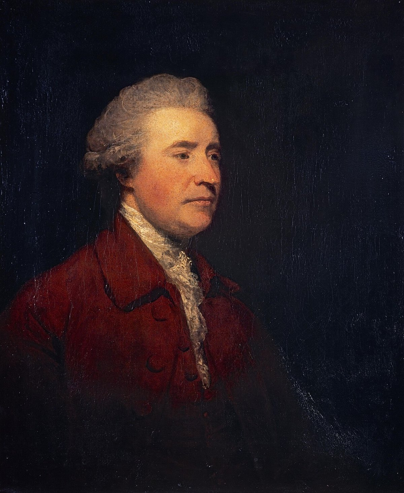
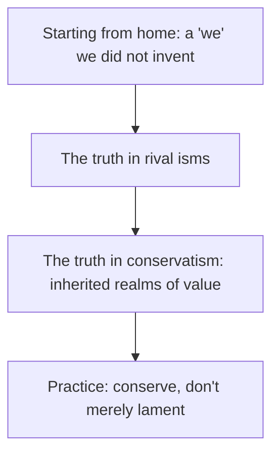

# Scruton, *How to Be a Conservative*

**Prerequisites:** [Roger Scruton](../thinkers/roger-scruton.md); [Conservatism, tradition and beauty](../11-conservatism-and-beauty.md)

*Joshua Reynolds, portrait of Edmund Burke (1729–1797). Scruton's conservatism takes its bearings from Burke's idea of society as a partnership between the living, the dead and the yet unborn. Credit: Joshua Reynolds. License: Public domain. Source: [File:Sir Joshua Reynolds - Edmund Burke, 1729 - 1797. Statesman, orator and author - PG 2362 - National Galleries of Scotland.jpg](https://commons.wikimedia.org/wiki/File:Sir_Joshua_Reynolds_-_Edmund_Burke,_1729_-_1797._Statesman,_orator_and_author_-_PG_2362_-_National_Galleries_of_Scotland.jpg).*

## Dating and form

*How to Be a Conservative* was published by Bloomsbury in 2014, with later paperback and slightly updated editions. It is a book of public philosophy, written in the first person, more accessible than *The Meaning of Conservatism* (1980). Scruton presents conservatism as a temperament and a practice of settlement, not as a party programme, and he organises the middle of the book as a search for what is *true* in the rival "isms" of modern politics.

## Outline

- **Preface; 1. My Journey; 2. Starting from Home.** A short intellectual autobiography (including Paris 1968) and the central claim: political life starts from a home, a first-person plural, and from obligations we did not contract for. Burke's complaint against revolution — that it spends the capital of the dead and so disenfranchises the unborn — is restated here.
- **3–9. The truth in…** Chapters on nationalism, socialism, capitalism, liberalism, multiculturalism, environmentalism and internationalism. In each case Scruton tries to isolate a genuine good (belonging, social justice, economic coordination, individual rights, openness to others, care for the earth, peace among nations) and then to show how that good is damaged when it is detached from settlement, accountability and civil association.
- **10. The Truth in Conservatism; 11. Realms of Value; 12. Practical Matters; 13. A Valediction Forbidding Mourning but Admitting Loss.** The constructive core: conservatism as the defence of inherited realms of value (home, culture, religion, education, the countryside). A closing note, borrowing a title from Donne, admits loss without giving up the work of conservation.

## Key ideas

- Conservatism begins from home and from debts to the dead and the unborn, not from a blank contract among individuals.
- Rival modern ideologies contain truths that a conservative can acknowledge without surrendering the priority of settlement.
- [Oikophilia](../../../../glossary/modern/oikophilia.md), love of home, is the typical motive; [oikophobia](../../../../glossary/modern/oikophobia.md) is its educated negation.

## Reception

The book is the usual entry point to Scruton's political thought. Admirers praise its tone — more irenic than his earlier polemics — and its attempt to learn from opponents. Critics find the "truth in" chapters selective (especially on multiculturalism and the European Union), and argue that "home" can mask exclusions of class, race and citizenship. It should be read with his earlier, more systematic *The Meaning of Conservatism* and with [Rawls](../thinkers/john-rawls.md) as a contrasting picture of political justification. For a first book, it is the right one.

## Where this leads

- Next: [*Beauty*](beauty.md)
- Lesson: [Conservatism, tradition and beauty](../11-conservatism-and-beauty.md)
- Contrast: [Rawls, *A Theory of Justice*](a-theory-of-justice.md)
- Glossary: [conservatism](../../../../glossary/modern/conservatism.md), [oikophilia](../../../../glossary/modern/oikophilia.md), [oikophobia](../../../../glossary/modern/oikophobia.md)
