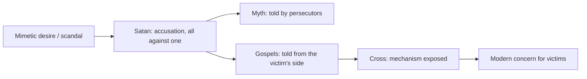

# Girard, *I See Satan Fall Like Lightning*

**Prerequisites:** [[violence-and-the-sacred|*Violence and the Sacred*]]

@@IMG@@

## Dating and form

*Je vois Satan tomber comme l'éclair* was published by Grasset in 1999; James G. Williams's English translation appeared in 2001 (Orbis Books). Its title comes from [[bib:new-testament/books/gospels/luke.md|Luke]] 10:18, where Jesus says, "I saw Satan fall like lightning from heaven." It is a short, accessible summary of [[rene-girard|Girard's]] mimetic theory, focused on the Bible, and he presented it as a defence of Christianity's uniqueness.

## Outline (three parts)

- **Part One: The mimetic cycle.** The Ten Commandments end with a prohibition of coveting the neighbour's goods, which Girard reads as a prohibition of [[g:mimetic-desire|mimetic desire]]. Jesus asks to be imitated, offering a model who does not become a rival. The Gospels' word *skandalon*, a stumbling-block, names the obstacle-model of mimetic rivalry. Satan is the mimetic process itself: the accuser who sows rivalry and then "casts out Satan" by uniting all against a victim, a disorder that restores order.
- **Part Two: The enigma of myth.** A miracle attributed to Apollonius of Tyana by his biographer Philostratus: to end a plague in Ephesus, Apollonius incites the crowd to stone a beggar, who is then revealed as a demon. Girard compares this with the Gospel story of the woman taken in adultery (John 8), where Jesus prevents a stoning ("Let him who is without sin cast the first stone"). Myths like Oedipus tell the story from the persecutors' side; the Joseph story in Genesis and the Passion tell it from the victim's side. The Gospels reveal the mechanism, in the phrase Girard borrows from Matthew 13:35 for an earlier title, "hidden since the foundation of the world".
- **Part Three: The triumph of the cross.** By exposing the victim's innocence, the cross disarms the "principalities and powers" (Colossians 2:15). Modern Western "concern for victims", Girard argues, is a fruit of this revelation, even when turned against Christianity. [[friedrich-nietzsche|Nietzsche]], who opposed "Dionysus versus the Crucified", saw this difference more clearly than most, though he took the side of Dionysus.

## Key ideas

- The prohibition of coveting targets mimetic desire.
- "Satan" names the mimetic cycle of rivalry and scapegoating.
- The Bible, culminating in the Passion, reveals the innocence of victims that myth hides.

## Reception

The book became the most widely read introduction to Girard's theology and influenced Christian thinkers on atonement and nonviolence. Critics in religious studies argue that it caricatures myth and non-Christian religions, while some theologians question his early rejection (later softened) of the language of sacrifice for Christ's death.

## Where this leads

- Back: [[the-brothers-karamazov|*The Brothers Karamazov*]], [[on-the-genealogy-of-morality|*On the Genealogy of Morality*]]
- Bible: [[bib:glossary/people/satan.md|Satan]], [[bib:old-testament/04-joseph.md|Joseph]], [[bib:new-testament/books/gospels/john.md|John]]
- Glossary: [[g:scapegoat-mechanism|scapegoat mechanism]]
