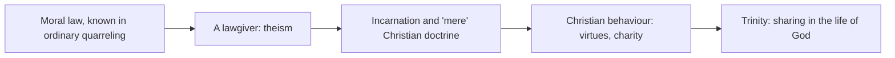

# Lewis, *Mere Christianity*

**Prerequisites:** [C. S. Lewis](../thinkers/c-s-lewis.md)

*Addison's Walk, Magdalen College, Oxford, looking back towards the college. On the night of 19 September 1931 Lewis walked here with J. R. R. Tolkien and Hugo Dyson; the conversation about myth and Christianity was a turning point on the way to the faith this book tries to state. Credit: Gagravarr. License: [CC BY-SA 2.5](https://creativecommons.org/licenses/by-sa/2.5). Source: [File:Magdalen Addison's Walk.jpg](https://commons.wikimedia.org/wiki/File:Magdalen_Addison's_Walk.jpg).*

## Dating and form

*Mere Christianity* was published in 1952, but its origin is earlier. During the Second World War Lewis gave a series of talks on the BBC, later issued as three short books: *Broadcast Talks* (1942), *Christian Behaviour* (1943) and *Beyond Personality* (1944). The 1952 volume revises and gathers them. The adjective "mere" does not mean "thin". Lewis borrows a older use (as in "the mere faith") for what is common to most of the Christian tradition, as distinct from the doctrines that divide churches. He likens that common faith to a hall from which one enters a particular room.

## Outline

- **Book I. Right and Wrong as a Clue to the Meaning of the Universe.** People quarrel, and in quarrelling they appeal to a standard they expect the other person to know. That standard, Lewis argues, is not a social convention or an instinct, but a moral law. The best explanation, he thinks, is a mind behind the moral law.
- **Book II. What Christians Believe.** From theism he moves to the Christian account of a world gone wrong, and to the [Incarnation](../../../../../religion/abrahamic/christianity/bible/glossary/terms/incarnation.md): [Jesus](../../../../../religion/abrahamic/christianity/bible/glossary/people/jesus.md) as more than a moral teacher. The famous "trilemma" (liar, lunatic or Lord) belongs here. He sketches the atonement without tying the reader to one theory of how it works.
- **Book III. Christian Behaviour.** Cardinal and theological virtues, social morality, sexual morality, marriage, forgiveness, charity and hope. The chapter on pride as the great sin is among the best known.
- **Book IV. Beyond Personality: or First Steps in the Doctrine of the Trinity.** God as more than a person; the sonship of Christ; and "good infection" — the idea that Christian life is participation in the life of God, not mere moral effort.

## Key ideas

- There is a moral law we already appeal to; Lewis reads it as a clue to God, in the neighbourhood of [natural law](../../../../glossary/modern/natural-law.md) and of the [Tao](../../../../glossary/modern/the-tao.md) in *The Abolition of Man*.
- "Mere" Christianity is the shared core, not a substitute for belonging to a particular church.
- The talks aim at a general audience: short arguments, analogies, and an invitation rather than a full philosophical system.

## Reception

The book has never gone out of print and is often the first Christian apologetic people read in English. Philosophers have criticised the jump from a moral consensus (which is in any case incomplete) to a lawgiver, and the trilemma for oversimplifying how historians think about Jesus. The social and sexual chapters date in places. As a statement of mid-twentieth-century Anglican "mere Christianity", and as a companion to [the Gospels](../../../../../religion/abrahamic/christianity/bible/new-testament/README.md), it remains a clear, serious popular work. Standard editions are the 1952 text issued by Geoffrey Bles and, in America, by Macmillan, widely reprinted by HarperCollins.

## Where this leads

- Next: [*The Abolition of Man*](the-abolition-of-man.md), [*The Screwtape Letters*](the-screwtape-letters.md)
- Thinker: [C. S. Lewis](../thinkers/c-s-lewis.md)
- Bible: [Jesus](../../../../../religion/abrahamic/christianity/bible/glossary/people/jesus.md), [Incarnation](../../../../../religion/abrahamic/christianity/bible/glossary/terms/incarnation.md), [the Gospels](../../../../../religion/abrahamic/christianity/bible/new-testament/README.md)
- Related: [Tolstoy, *The Kingdom of God Is Within You*](../../nineteenth-century/texts/the-kingdom-of-god-is-within-you.md), a very different Christian moralism
