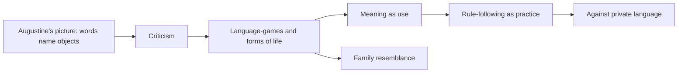

# Wittgenstein, *Philosophical Investigations*

**Prerequisites:** [*Tractatus Logico-Philosophicus*](tractatus-logico-philosophicus.md)

@@IMG@@

## Dating and form

[Wittgenstein](../thinkers/ludwig-wittgenstein.md) worked on the *Investigations* from the mid-1930s until his death in 1951 but never published it. It appeared in 1953, edited by G. E. M. Anscombe and Rush Rhees, in a German–English edition translated by Anscombe. It consists of numbered remarks (693 in Part I) of varying length, often in dialogue with an imagined interlocutor, raising questions it does not always answer. In the preface he called it "an album" of sketches of landscapes made in the course of long and involved journeyings. The "Part II" of earlier editions is presented in the fourth edition (2009, revised by P. M. S. Hacker and Joachim Schulte) as "Philosophy of Psychology – A Fragment".

## Main themes

- **The Augustinian picture.** It opens with a quotation from [Augustine's *Confessions*](../../../medieval/texts/augustine-confessions.md) describing how he learned words by watching adults point at objects. Wittgenstein argues that this picture (words name objects; sentences combine names) fits only a small part of language, and he includes his own earlier view under criticism.
- **Language-games.** Speaking is part of an activity, a "form of life": giving orders, describing, reporting, making jokes, praying. The builders' game (§2) is the first example. See [language-game](../../../../glossary/modern/language-game.md).
- **Meaning as use.** "For a large class of cases—though not for all—in which we employ the word 'meaning' it can be defined thus: the meaning of a word is its use in the language" (§43).
- **Family resemblance.** There is nothing common to all "games", only "a complicated network of similarities overlapping and criss-crossing" (§66–67). See [family resemblance](../../../../glossary/modern/family-resemblance.md).
- **Rule-following.** No interpretation of a rule fixes its application, since any interpretation could itself be interpreted; following a rule is a practice (§185–242). Saul Kripke's *Wittgenstein on Rules and Private Language* (1982) made this a famous sceptical puzzle.
- **Private language.** A language whose words refer to what only the speaker can know (one's private sensations) is incoherent (§243 onward); the "beetle in a box" (§293) suggests that the private object drops out as irrelevant to meaning.
- **Philosophy as therapy.** "Philosophy is a battle against the bewitchment of our intelligence by means of language" (§109). The aim is "to shew the fly the way out of the fly-bottle" (§309).
- **Seeing-as.** In "Part II", the duck-rabbit figure prompts reflections on aspect perception.

## Key ideas

- Meaning is (often) use in a language-game embedded in a form of life.
- Concepts may be unified by family resemblances rather than essences.
- Philosophical problems arise when language "goes on holiday"; philosophy dissolves them.

## Reception

The *Investigations* shaped ordinary-language philosophy, philosophy of mind and social science (Peter Winch). It remains a contested text: some read it as a therapeutic dissolution of philosophy, others as offering theses about meaning and mind. Commentaries: Marie McGinn, *Wittgenstein and the Philosophical Investigations*; Baker and Hacker's multi-volume analytical commentary.

## Where this leads

- Next text: [*The Problems of Philosophy*](the-problems-of-philosophy.md)
- Back: [Augustine](../../../medieval/thinkers/augustine.md)
