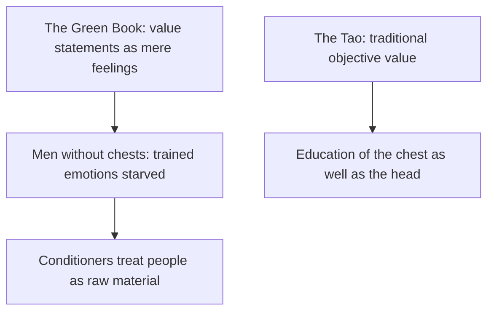

# Lewis, *The Abolition of Man*

**Prerequisites:** [C. S. Lewis](../thinkers/c-s-lewis.md); helpful: [natural law](../../../../glossary/modern/natural-law.md)

*The nave of Durham Cathedral. Lewis delivered the Riddell Memorial Lectures, published as *The Abolition of Man*, at the University of Durham in February 1943. Credit: Michael D Beckwith. License: [CC0](https://creativecommons.org/publicdomain/zero/1.0/). Source: [File:Durham Cathedral Nave.jpg](https://commons.wikimedia.org/wiki/File:Durham_Cathedral_Nave.jpg).*

## Dating and form

The book began as three Riddell Memorial Lectures, given at the University of Durham on 24–26 February 1943 and published the same year by Oxford University Press. It is short, tightly argued, and the most deliberately philosophical of Lewis's non-fiction books — closer to a tract in moral education than to the wartime apologetic of [*Mere Christianity*](mere-christianity.md). An appendix, "Illustrations of the Tao", collects brief moral maxims from Greek, Roman, Jewish, Christian, Norse, Egyptian, Indian and Chinese sources.

## Outline

- **1. Men Without Chests.** Lewis examines a then-current English composition textbook, which he calls *The Green Book* (in fact *The Control of Language* by Alex King and Martin Ketley). A passage about a waterfall, he argues, teaches children that to call a thing "sublime" is only to report one's own feelings. If that lesson is generalised, all value judgments become subjective. But a human being, in a psychology Lewis takes from Plato and the medievals, is not only head (reason) and belly (appetite). The **chest** is the seat of trained emotions, of magnanimity, without which reason cannot govern appetite. An education that debunks sentiment produces "[men without chests](../../../../glossary/modern/men-without-chests.md)" — and then, inconsistently, still demands virtues such as courage and honour that depend on those very sentiments.

- **2. The Way.** The alternative is what Lewis calls the **[Tao](../../../../glossary/modern/the-tao.md)**, using the Chinese word for a traditional, objective moral order known across cultures: the path of right feeling and right action. He treats it as the same territory as [natural law](../../../../glossary/modern/natural-law.md). Attempts to build a new morality "outside" the Tao, he argues, always smuggle Taoist values back in (the innovator still appeals to "progress", "kindness", or "loyalty").

- **3. The Abolition of Man.** If the Tao is rejected, what remains is not freedom but technique: a class of "conditioners" who, with applied science, shape the motives of everyone else. In conquering nature, humanity — except for the conditioners — is itself reduced to nature, to raw material. That is the "abolition" of the title.

## Key ideas

- Value judgments are not merely private feelings; there is a transcultural moral order Lewis names the Tao.
- Moral education has to train the emotions, not only inform the intellect; otherwise one gets men without chests.
- If objective value is abandoned, scientific power over nature becomes power over human nature, in the hands of a few.

## Reception

The lectures have had a life far beyond their occasion. They are widely used in ethics and philosophy-of-education courses, and they stand behind later critiques of emotivism and of a purely technocratic view of humanity. Critics argue that Lewis underestimates genuine moral disagreement, that the appendix cherry-picks agreements among traditions, and that "the Tao" is less unified than he suggests. The book is nonetheless one of the clearest short defences of objective value in twentieth-century English prose, and a natural companion to [Scruton](../thinkers/roger-scruton.md) on beauty and to Aquinas on [natural law](../../../medieval/texts/summa-theologiae.md).

## Where this leads

- Lesson: [Conservatism, tradition and beauty](../11-conservatism-and-beauty.md)
- Other Lewis: [*Mere Christianity*](mere-christianity.md), [*The Four Loves*](the-four-loves.md)
- Back: [Aquinas, *Summa Theologiae*](../../../medieval/texts/summa-theologiae.md); Chinese [*dao*](../../../../glossary/chinese/dao.md)
- Glossary: [the Tao (Lewis)](../../../../glossary/modern/the-tao.md), [men without chests](../../../../glossary/modern/men-without-chests.md), [natural law](../../../../glossary/modern/natural-law.md)
