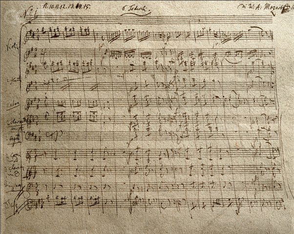

# Scruton, *The Aesthetics of Music*

**Prerequisites:** [Roger Scruton](../thinkers/roger-scruton.md); [*Beauty*](beauty.md)

*A page of the autograph score of Mozart's Symphony No. 38 in D major, the "Prague". Scruton's book argues that we hear such writing as tone — movement, tension and closure in a tonal space — and not as a mere sequence of sounds. Credit: Wolfgang Amadeus Mozart. License: Public domain. Source: [File:Autograph score of the Prague Symphony by Mozart.jpg](https://commons.wikimedia.org/wiki/File:Autograph_score_of_the_Prague_Symphony_by_Mozart.jpg).*

## Dating and form

*The Aesthetics of Music* was published by Oxford University Press (Clarendon Press) in 1997; a paperback followed in 1999. At some five hundred pages, with many printed examples, it is Scruton's most substantial technical work and one of the most ambitious late-twentieth-century books in the philosophy of music. It is harder than [*Beauty*](beauty.md) and assumes some comfort with classical repertoire, though the argument is meant to be philosophical rather than musicological.

## Outline

The book has fifteen chapters:

- **1–3. Sound; Tone; Imagination and Metaphor.** A sound is an acoustic event. A *tone* is a sound heard as music: as moving, gravitating, standing in a space that is not physical space. That hearing, Scruton argues, is imaginative and metaphorical, but not arbitrary; it can be right or wrong, and it can be trained.
- **4–8. Ontology; Representation; Expression; Language; Understanding.** What kind of thing a musical work is; whether music represents; how it expresses emotion without being a language in the ordinary sense; and what it is to understand a piece (to hear its movement and meaning, not merely to explain it from outside).
- **9–11. Tonality; Form; Content.** A defence of tonal organisation — keys, tension and resolution — as the setting in which this kind of hearing most fully works, followed by accounts of musical form and of what, if anything, music is "about."
- **12–15. Value; Analysis; Performance; Culture.** Why some music is better than other music; what analysis is for; what a performance is; and a closing argument about musical culture, including a severe critique of some modernist techniques (notably serialism) and of much popular music.

## Key ideas

- Music is an intentional object: to hear it is to hear tone, not only sound.
- That hearing is metaphorical (space, movement, gravity) and rationally constrained; it is the core of musical understanding.
- Scruton defends the tonal tradition as uniquely well fitted to this understanding, and judges some modern and popular music accordingly — the most contested part of the book.

## Reception

Even critics of the cultural chapters tend to treat the early analysis of sound, tone and metaphor as a major contribution to the philosophy of music. Musicologists and theorists have challenged the elevation of common-practice tonality and the accompanying judgments of serialism and popular styles; some find the metaphysics of "tonal space" over-extended. The book should be read as a systematic aesthetics first and a set of cultural verdicts second. It is the advanced companion to *Beauty*, and the place where Scruton's claim that aesthetic value is real is tested in the greatest detail.

## Where this leads

- Back: [*Beauty*](beauty.md), [Roger Scruton](../thinkers/roger-scruton.md)
- Lesson: [Conservatism, tradition and beauty](../11-conservatism-and-beauty.md)
- Related: [Kant](../../early-modern/thinkers/immanuel-kant.md)
- Glossary: [aesthetics](../../../../glossary/general/aesthetics.md)
