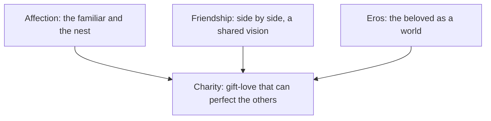

# Lewis, *The Four Loves*

**Prerequisites:** [C. S. Lewis](../thinkers/c-s-lewis.md)

*Eugène Delacroix, *The Good Samaritan* (1849). Lewis's highest love, charity (*agape*), is the will for another's good, the kind of love the parable commends. Credit: Eugène Delacroix. License: Public domain. Source: [File:The Good Samaritan (Delacroix 1849).jpg](https://commons.wikimedia.org/wiki/File:The_Good_Samaritan_(Delacroix_1849).jpg).*

## Dating and form

*The Four Loves* was published in 1960 (Geoffrey Bles in Britain, Harcourt, Brace in the United States). It grew out of radio talks recorded for the Episcopal Radio-TV Foundation in the United States; some of the material on *eros* was thought too candid for broadcast, and the book is the fuller statement. Lewis writes as a lay Christian moralist, not as a psychologist, and he is careful with Greek names without pretending that ordinary English has no words of its own.

## Outline

After an introduction that distinguishes "need-love" from "gift-love", and likes from loves, the book has four chapters:

- **Affection (*storge*).** The humble, often wordless love of the familiar: parents and children, old friends, the comfort of the well-known person or place. It is the most biologically rooted of the loves, and the one most easily taken for granted. Its shadows include possessiveness and a hatred of anything that disturbs the nest.
- **Friendship (*philia*).** For Lewis, the least "natural" of the loves and the one modern life most neglects. Friendship is born when two or more people share an interest or a vision — side by side, not face to face. He defends it against the suspicion that it is always disguised erotic love, and against the claim that it is a luxury.
- **Eros.** Romantic and sexual love, not merely the sexual appetite he calls Venus. *Eros* makes a beloved the centre of a world; it can be a genuine vocation of the imagination, and it can also become a god, justifying cruelty or self-destruction in the beloved's name.
- **Charity (*agape*).** The love that comes from God, which loves the unlovable and can descend into the other three to perfect them. Without charity, affection, friendship and *eros* all go wrong in characteristic ways; with it, they become themselves. Lewis is here close to the New Testament use of *agape* and to the older English word "charity."

## Key ideas

- Human loves are genuinely good, and genuinely distinct; they should not all be reduced to sex or to instinct.
- Each love has a proper excellence and a characteristic corruption.
- Charity, as gift-love, is what keeps the other loves from becoming idols — a Christian claim, but argued through ordinary examples.

## Reception

The book is among Lewis's most used works in pastoral and ethical discussion of love, friendship and marriage. Critics have challenged his sharp separation of friendship from *eros*, his mid-century picture of gender, and the neatness of the fourfold scheme (the Greek field is richer than four words). Read beside [the Gospels](../../../../../religion/abrahamic/christianity/bible/new-testament/README.md) and, in this encyclopedia, beside [Tolstoy](../../nineteenth-century/thinkers/leo-tolstoy.md) on love of neighbour, it is a map, not a last word. It also pairs naturally with [Scruton](../thinkers/roger-scruton.md)'s *Sexual Desire*, a more systematic philosophy of *eros*.

## Where this leads

- Thinker: [C. S. Lewis](../thinkers/c-s-lewis.md)
- Bible: [the Gospels](../../../../../religion/abrahamic/christianity/bible/new-testament/README.md), [Jesus](../../../../../religion/abrahamic/christianity/bible/glossary/people/jesus.md)
- Related: [Tolstoy](../../nineteenth-century/thinkers/leo-tolstoy.md), [Weil on attention](../thinkers/simone-weil.md)
- Back: [*Mere Christianity*](mere-christianity.md), [*The Abolition of Man*](the-abolition-of-man.md)
