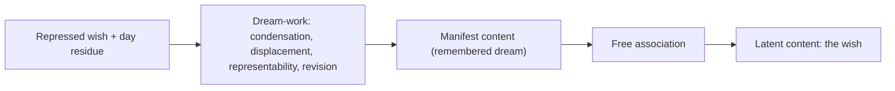

# Freud, *The Interpretation of Dreams*

**Prerequisites:** [[sigmund-freud|Sigmund Freud]]; [[psychoanalysis-and-depth-psychology|Psychoanalysis and depth psychology]]

@@IMG@@

*Freud was a physician and the founder of psychoanalysis, not a philosopher; this book belongs here because it changed how philosophers think about the mind.*

## Dating and form

*Die Traumdeutung* was published in Vienna in November 1899, with the date 1900 on its title page, as if to mark a new century. [[sigmund-freud|Freud]] considered it his most important work. It sold slowly at first but went through eight editions in his lifetime, each revised and expanded. Its epigraph is from Virgil's *Aeneid*: *Flectere si nequeo superos, Acheronta movebo* ("If I cannot bend the higher powers, I will move the infernal regions"). The book draws heavily on Freud's own dreams, analysed as part of his self-analysis after his father's death in 1896. English translations: A. A. Brill (1913), James Strachey (Standard Edition, 1953), Joyce Crick (Oxford, translating the first edition, 1999).

## Outline (seven chapters)

- **Chapter 1.** A review of earlier scientific literature on dreams.
- **Chapter 2.** The method of interpretation: free association to each element of a dream. The specimen dream of "Irma's injection" (July 1895) shows a dream fulfilling Freud's wish to be absolved of responsibility for a patient's illness.
- **Chapter 3.** "A dream is the fulfilment of a wish."
- **Chapter 4.** Distortion in dreams: unpleasant dreams are disguised fulfilments of repressed wishes; the censorship between the systems of the mind distorts them.
- **Chapter 5.** Material and sources: recent impressions ("day residues"), childhood memories, somatic stimuli, typical dreams. Here Freud first published his reading of *Oedipus Rex* and *Hamlet*: the wish to possess one parent and remove the other.
- **Chapter 6.** The dream-work transforms the hidden "latent content" into the remembered "manifest content", through condensation, displacement, considerations of representability (turning thoughts into images) and secondary revision.
- **Chapter 7.** A general psychology of mental processes: the primary process of the [[g:unconscious|unconscious]] (seeking immediate discharge) versus the secondary process of conscious thought; the "topographical" model of unconscious, preconscious and conscious. Here occurs the sentence calling dream interpretation "the royal road to a knowledge of the unconscious activities of the mind".

## Key ideas

- Dreams have meaning and can be interpreted.
- Dreams are disguised fulfilments of (often repressed) wishes.
- The dream-work converts latent thoughts into manifest images.
- The book offers a general model of the unconscious mind.

## Reception

The book founded psychoanalysis as a method and influenced literature, surrealism and philosophy (Ricoeur's *Freud and Philosophy*). [[carl-jung|Jung]] rejected the wish-fulfilment theory, reading dreams as compensatory messages from the psyche. Modern sleep research (e.g., Hobson and McCarley's activation-synthesis hypothesis) challenged Freud's theory, though some neuroscientists (Mark Solms) have defended aspects of it. Critics like Adolf Grünbaum argued that free association cannot test its own conclusions.

## Where this leads

- Next text: [[civilization-and-its-discontents|*Civilization and Its Discontents*]]
- Glossary: [[g:repression|repression]], [[g:psychoanalysis|psychoanalysis]]
