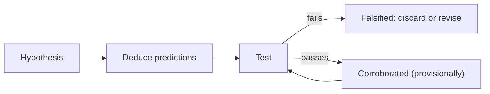

# Popper, *The Logic of Scientific Discovery*

**Prerequisites:** [Karl Popper](../thinkers/karl-popper.md); [Philosophy of science](../06-philosophy-of-science.md)

@@IMG@@

## Dating and form

[Popper](../thinkers/karl-popper.md) published *Logik der Forschung* in Vienna in 1934 (dated 1935), in a series edited by Moritz Schlick and Philipp Frank of the Vienna Circle; the publisher demanded heavy cuts from a longer manuscript. The English version, *The Logic of Scientific Discovery* (1959), was translated by Popper with Julius Freed and Lan Freed and added many new appendices. It is a technical book, with chapters on probability and quantum mechanics as well as the famous early chapters on method.

## Main arguments

- **Two problems.** The problem of induction (can general laws be justified from particular observations?) and the problem of demarcation (what distinguishes empirical science from metaphysics and pseudo-science?). Popper thinks they are connected, and that Hume was right: induction cannot be justified.
- **Deductive testing.** Science does not proceed inductively. Scientists propose hypotheses and deduce consequences that can be tested; failed predictions refute theories by simple deductive logic (*modus tollens*), while successes never prove them.
- **Falsifiability as criterion of demarcation.** A theory is empirical if it can clash with experience: if some possible "basic statements" (reports of observable events) would contradict it. Unlike the Vienna Circle's verifiability principle, this is a criterion for science, not for meaning. See [falsifiability](../../../../glossary/modern/falsifiability.md).
- **Basic statements.** Even observation statements are not certain; scientists accept them by decision, though they can always be tested further. Science "does not rest upon solid bedrock"; Popper compares it to a building on piles driven into a swamp.
- **Content and testability.** The more a theory forbids, the more it says and the more falsifiable it is; bold, improbable theories are preferable. Simplicity is explained as degree of falsifiability.
- **Against conventionalist stratagems.** One can always save a theory by ad hoc adjustments; methodological rules forbid this.
- **Corroboration.** Theories that survive severe tests are corroborated, not made probable. Science is not a system of certain statements but of conjectures.

## Key ideas

- Induction is not the method of science; testing deductions is.
- Falsifiability marks the boundary between science and non-science.
- All scientific knowledge is provisional.

## Reception

The book became a landmark in philosophy of science and a favourite of working scientists, among them Peter Medawar and John Eccles. Critics argued that real theories are rarely abandoned after a single refutation ([Kuhn](../thinkers/thomas-kuhn.md), Lakatos), that the Duhem–Quine thesis makes isolated falsification impossible, and that "corroboration" quietly reintroduces induction.

## Where this leads

- Next text: [*The Structure of Scientific Revolutions*](the-structure-of-scientific-revolutions.md)
- Back: [Hume on induction](../../early-modern/texts/treatise-of-human-nature.md), [Bacon's *Novum Organum*](../../early-modern/texts/novum-organum.md)
- Glossary: [falsifiability](../../../../glossary/modern/falsifiability.md), [problem of induction](../../../../glossary/modern/problem-of-induction.md)
