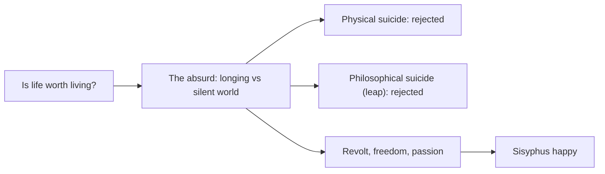

# Camus, *The Myth of Sisyphus*

**Prerequisites:** [[albert-camus|Albert Camus]]; [[the-absurd|The absurd]]

@@IMG@@

## Dating and form

*Le Mythe de Sisyphe* was published by Gallimard in 1942, a few months after the novel *The Stranger*; together with the play *Caligula* they form what [[albert-camus|Camus]] called his "cycle of the absurd". It is a philosophical essay of about 150 pages. Under German censorship, a chapter on Franz Kafka (who was Jewish) was removed from the first edition and published separately; it was restored as an appendix in later editions. English translation: Justin O'Brien (1955).

## Outline

- **An Absurd Reasoning.** It opens: "There is but one truly serious philosophical problem, and that is suicide." Judging whether life is worth living answers the fundamental question of philosophy. The absurd arises in everyday experience: the weariness of routine ("Rising, streetcar, four hours in the office…") when the "why" arises; the strangeness of the world; the awareness of death. The absurd is neither in us nor in the world but in their confrontation. Existentialist thinkers like Kierkegaard, Jaspers and Chestov, and Husserl's phenomenology, commit "philosophical suicide" by leaping to a transcendent meaning. Camus instead keeps the absurd alive through revolt, freedom and passion.
- **The Absurd Man.** Three figures who live without appeal: Don Juan, who loves many women without seeking a single ultimate love; the actor, who lives many lives; and the conqueror, who acts in history knowing it is not eternal.
- **Absurd Creation.** Art can describe without explaining; the absurd novel. Camus examines Dostoevsky's Kirilov from *Demons*, who kills himself to prove his freedom, and asks whether a work can remain faithful to the absurd.
- **The Myth of Sisyphus.** Condemned by the gods to roll a rock up a mountain only to watch it roll down forever, Sisyphus becomes the absurd hero. Camus fixes on him as he walks back down: his lucidity, which should torment him, crowns his victory. "There is no fate that cannot be surmounted by scorn." "The struggle itself toward the heights is enough to fill a man's heart. One must imagine Sisyphus happy."

## Key ideas

- The absurd is born from the clash between human longing for meaning and an unresponsive world.
- Neither suicide nor religious or philosophical hope answers it.
- Lucid revolt, freedom and passion make life worth living without ultimate meaning.

## Reception

The essay became a touchstone of postwar thought and popular culture; its opening sentence is among the most quoted in modern philosophy. Philosophers have questioned whether its arguments are rigorous, and whether Camus fairly read Kierkegaard and Husserl. Camus himself developed its implications in *The Rebel*, arguing that revolt leads to solidarity rather than mere individual defiance.

## Where this leads

- Next text: [[the-second-sex|*The Second Sex*]]
- Back: [[pensees|Pascal's *Pensées*]], [[fear-and-trembling|*Fear and Trembling*]] (the leap Camus rejects)
- Glossary: [[g:the-absurd|the absurd]]
