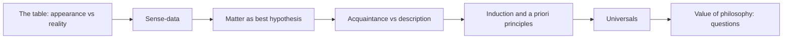

# Russell, *The Problems of Philosophy*

**Prerequisites:** [[bertrand-russell|Bertrand Russell]]

@@IMG@@

## Dating and form

[[bertrand-russell|Russell]] wrote this short book in 1911, and it was published in 1912 in the Home University Library, a series of cheap introductory volumes; Russell called it his "shilling shocker". In fifteen brief chapters it surveys the problems of knowledge, from the existence of a table to the value of philosophy itself. It remains one of the best-known introductions to philosophy and is freely available because it is in the public domain.

## Outline

- **Appearance and reality (ch. 1–4).** Russell starts with a table: its colour, shape and texture vary with light and viewpoint. What we know directly are "sense-data". Is there a real table behind them? Russell argues that belief in physical objects is the simplest hypothesis, an "instinctive belief" we have no good reason to reject. He criticizes [[george-berkeley|Berkeley's]] idealism.
- **Knowledge by acquaintance and by description (ch. 5).** We are acquainted with sense-data, memories, perhaps ourselves, and universals; we know most things (Bismarck, the table) only by description.
- **Induction (ch. 6).** The chicken that has been fed every day expects to be fed again, but "the man who has fed the chicken every day throughout its life at last wrings its neck instead". The principle of induction cannot be proved by experience. See [[david-hume|Hume]].
- **A priori knowledge and universals (ch. 7–10).** Logic and arithmetic are known a priori; Russell rejects [[immanuel-kant|Kant's]] explanation and defends a Platonic realm of universals (relations like "north of") that exist independently of minds.
- **Truth and error (ch. 11–14).** Intuitive knowledge; truth as correspondence between belief and fact; probable opinion; the limits of philosophical knowledge, criticizing Hegel's claim to deduce the nature of the universe.
- **The value of philosophy (ch. 15).** Philosophy's value lies largely in its uncertainty: it frees us from "the tyranny of custom", enlarges our conception of what is possible, and enlarges the self through contemplation of the universe. Philosophy is to be studied "not for the sake of any definite answers to its questions … but rather for the sake of the questions themselves".

## Key ideas

- We know sense-data directly; physical objects are known by inference.
- Induction cannot be justified by experience.
- Universals are real and known a priori.
- Philosophy's value lies in its questions and the freedom they give.

## Reception

The book is still widely assigned as a first text, admired for its clarity. Russell himself soon changed many of its views (on sense-data and universals), and philosophers no longer accept its framework without criticism, but its chapters on induction and on the value of philosophy remain classics.

## Where this leads

- Next text: [[the-interpretation-of-dreams|*The Interpretation of Dreams*]]
- Back: [[treatise-of-human-nature|Hume's *Treatise*]], [[gk:plato.md|Plato]] on Forms
- Glossary: [[g:problem-of-induction|problem of induction]]
