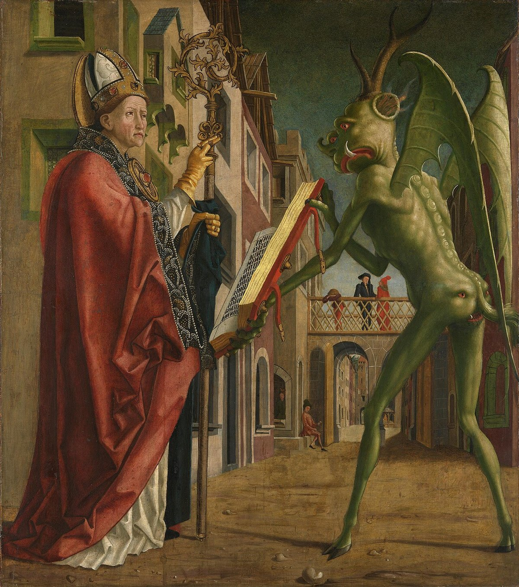
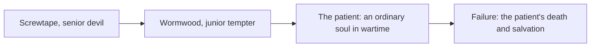

# Lewis, *The Screwtape Letters*

**Prerequisites:** [C. S. Lewis](../thinkers/c-s-lewis.md)

*Michael Pacher, *Saint Augustine and the Devil*, from the Church Fathers Altarpiece (c. 1471–79): Augustine compels the devil to take part in the liturgy. A late-medieval image of the intelligence and banality of temptation, the subject of Lewis's book. Credit: Michael Pacher. License: Public domain. Source: [File:Michael Pacher 004.jpg](https://commons.wikimedia.org/wiki/File:Michael_Pacher_004.jpg).*

## Dating and form

The letters were first published as a serial in *The Guardian*, a Church of England weekly (not the Manchester newspaper of the same name), between May and November 1941, and as a book by Geoffrey Bles in 1942. Lewis dedicated the volume to J. R. R. Tolkien. A later piece, "Screwtape Proposes a Toast" (1959), is often printed with it. The form is an inversion of the spiritual letter: a senior devil in the "Lowerarchy", Screwtape, writes to his nephew Wormwood, a junior tempter assigned to an ordinary young Englishman during the Second World War.

## Outline

There are thirty-one letters and no formal parts, but a clear movement.

- **Early letters.** Screwtape advises on small corruptions: distracting the "patient" in prayer, jamming his relations with his mother, encouraging vague spirituality rather than obedience, and using the familiar irritations of churchgoing. The advice is worldly and precise. Hell's strategy is not always spectacular vice; it is often inattention, vanity and habit.
- **Middle letters.** The war, love, the Church as a body of inconvenient neighbours, and the danger (from Screwtape's point of view) of real humility and real pleasure. Screwtape is interested in twisting good things rather than simply forbidding them.
- **The end.** Wormwood fails. The patient is killed in an air raid and is saved. Screwtape's last letter is a furious lament, in which the "Enemy" (God) is seen, from below, as still more generous than Hell can understand.

## Key ideas

- Temptation, in Lewis's picture, works mainly through attention, habit and the distortion of ordinary goods, not only through dramatic crimes.
- The letters are a work of moral psychology, closer to pastoral satire than to a treatise on [Satan](../../../../../religion/abrahamic/christianity/bible/glossary/people/satan.md), though they belong in that tradition.
- Irony is the method: the reader must invert Screwtape's counsel to recover the Christian advice underneath.

## Reception

The book was an immediate success and remains Lewis's most popular adult work after the Narnia stories. Some readers, including Tolkien, were uneasy with the prolonged imaginative occupation of a devil's point of view. Others find the social comedy dated or the theology too tidy. As a study of self-deception it sits beside [Weil](../thinkers/simone-weil.md) on attention and, in a different key, [Girard](../thinkers/rene-girard.md) on the way ordinary desire goes wrong. It is not a Bible commentary, but it presupposes the moral world of the [Gospels](../../../../../religion/abrahamic/christianity/bible/new-testament/README.md).

## Where this leads

- Next: [*The Four Loves*](the-four-loves.md)
- Thinker: [C. S. Lewis](../thinkers/c-s-lewis.md)
- Bible: [Satan](../../../../../religion/abrahamic/christianity/bible/glossary/people/satan.md), [the Gospels](../../../../../religion/abrahamic/christianity/bible/new-testament/README.md)
- Related: [Weil on attention](../thinkers/simone-weil.md), [Girard, *I See Satan Fall Like Lightning*](i-see-satan-fall-like-lightning.md)
