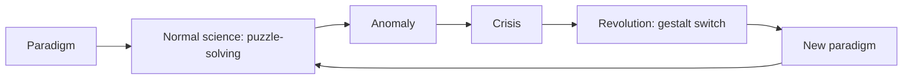

# Kuhn, *The Structure of Scientific Revolutions*

**Prerequisites:** [Thomas Kuhn](../thinkers/thomas-kuhn.md); [*The Logic of Scientific Discovery*](the-logic-of-scientific-discovery.md)

@@IMG@@

## Dating and form

The book was published in 1962 by the University of Chicago Press as a monograph in the *International Encyclopedia of Unified Science*, a series launched by the logical positivists (Otto Neurath, Rudolf Carnap, Charles Morris). The second edition (1970) added a "Postscript—1969" answering critics and clarifying "paradigm"; a fiftieth-anniversary edition (2012) has an introduction by Ian Hacking. It is short, about 200 pages in thirteen sections, and written for a broad audience, with examples from the history of physics and chemistry.

## Outline

- **A role for history (I).** History, read on its own terms rather than as a record of progress toward today's textbooks, could transform our image of science.
- **Normal science (II–V).** A science matures when a paradigm, a shared achievement like Newton's *Principia* or Lavoisier's chemistry, unites a community. Normal science is "mopping-up work" and puzzle-solving: problems whose solution the paradigm guarantees exists. Paradigms are prior to explicit rules; scientists learn them through exemplars.
- **Anomaly and crisis (VI–VIII).** Discoveries like oxygen or X-rays begin with anomalies, violations of paradigm expectations. When anomalies accumulate and resist solution (as in Ptolemaic astronomy before Copernicus, or the ether before Einstein), a crisis loosens the rules and alternatives proliferate.
- **Revolutions (IX–X).** A scientific revolution is a non-cumulative episode in which an older paradigm is replaced by an incompatible new one. It is like a gestalt switch (Kuhn mentions the duck-rabbit figure): "after a revolution scientists are responding to a different world."
- **Invisibility (XI).** Textbooks rewrite history so that revolutions look like additions to knowledge.
- **Resolution (XII).** Choice between paradigms cannot be settled by logic and experiment alone, because the paradigms differ about which problems matter and what counts as a solution. Persuasion, conversion, and generational change play roles; Kuhn quotes Max Planck's remark that a new truth triumphs largely because its opponents eventually die.
- **Progress (XIII).** Science progresses in its puzzle-solving ability, but perhaps not toward a fixed truth; like Darwinian evolution, it is a process "from" rather than "toward".

## Key ideas

- Science alternates between stable normal science and revolutionary change.
- Paradigms shape what scientists see, ask and accept.
- Rival paradigms can be incommensurable; theory choice involves judgment, not algorithm.

## Reception

The book became one of the most cited works in the humanities and social sciences; "paradigm shift" entered everyday language. At the 1965 London colloquium published as *Criticism and the Growth of Knowledge* (1970), [Popper](../thinkers/karl-popper.md), Lakatos and others debated it with Kuhn. Critics charged it with relativism and irrationalism; Kuhn insisted he had been misread. It inspired the sociology of scientific knowledge and science studies.

## Where this leads

- Next text: [*A Theory of Justice*](a-theory-of-justice.md)
- Back: [The scientific revolution](../../early-modern/02-scientific-revolution-and-method.md)
- Glossary: [paradigm](../../../../glossary/modern/paradigm.md)
