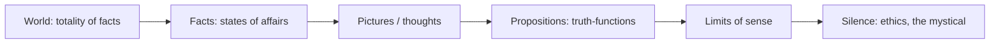

# Wittgenstein, *Tractatus Logico-Philosophicus*

**Prerequisites:** [[ludwig-wittgenstein|Ludwig Wittgenstein]]; [[analytic-turn|The analytic turn]]

@@IMG@@

## Dating and form

[[ludwig-wittgenstein|Wittgenstein]] wrote the book from notebooks he kept while serving in the Austro-Hungarian army in the First World War, completing it in 1918; he was taken prisoner in Italy in November 1918 with the manuscript in his rucksack. After difficulties finding a publisher it appeared in German in 1921 in Wilhelm Ostwald's journal *Annalen der Naturphilosophie*, and in 1922 in a bilingual edition in London, translated by C. K. Ogden with much help from Frank Ramsey, with an introduction by [[bertrand-russell|Russell]] that Wittgenstein disliked. The Latin title was suggested by G. E. Moore. A second translation by David Pears and Brian McGuinness appeared in 1961. The book is under 80 pages, organized as numbered remarks: seven main propositions, with decimals marking comments (2.1 comments on 2; 2.11 on 2.1). In the preface Wittgenstein said that the truth of its thoughts seemed to him "unassailable and definitive", and that he had solved the problems in essentials, while also showing "how little has been achieved" when they are solved.

## The seven main propositions

1. "The world is everything that is the case."
2. What is the case, a fact, is the existence of states of affairs.
3. A logical picture of facts is a thought.
4. A thought is a proposition with a sense.
5. A proposition is a truth-function of elementary propositions.
6. The general form of a truth-function (Wittgenstein gives a formula).
7. "Whereof one cannot speak, thereof one must be silent" (Ogden's translation; Pears and McGuinness: "What we cannot speak about we must pass over in silence").

## Main themes

- **Picture theory.** Propositions picture possible states of affairs by sharing their logical form; see [[g:picture-theory-of-meaning|picture theory of meaning]].
- **Logic.** Logical truths are tautologies; they say nothing about the world.
- **Saying and showing.** Logical form cannot be said, only shown. Ethics, aesthetics, the meaning of life and "the mystical" lie outside what can be said.
- **Philosophy as activity.** Philosophy is not a body of doctrine but the clarification of thoughts. The book's own propositions are ultimately nonsensical: the reader must use them as a ladder and throw it away after climbing up (6.54).

## Key ideas

- Language can picture facts because propositions share logical form with them.
- What can be said can be said clearly; the rest must be passed over in silence.
- Logic and ethics are shown, not said.

## Reception

The Vienna Circle read the *Tractatus* line by line and drew logical positivism from it, though Wittgenstein felt they missed its point about the unsayable. Its interpretation remains contested: "resolute" readers (Cora Diamond, James Conant) argue that the book's nonsense is plain nonsense, with no ineffable truths behind it. Wittgenstein himself later criticized it in [[philosophical-investigations|*Philosophical Investigations*]]. Commentaries: G. E. M. Anscombe, *An Introduction to Wittgenstein's Tractatus*; H. O. Mounce, *Wittgenstein's Tractatus: An Introduction*.

## Where this leads

- Next text: [[philosophical-investigations|*Philosophical Investigations*]]
- Glossary: [[g:logical-atomism|logical atomism]], [[g:logical-positivism|logical positivism]]
