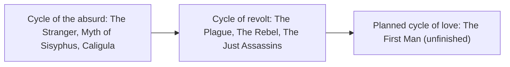

# Albert Camus

**Prerequisites:** [[the-absurd|The absurd]]

@@IMG@@

## Life and context

Albert Camus (1913–1960) was born in Mondovi (now Dréan), in French Algeria, into a poor *pied-noir* family. His father was killed in the Battle of the Marne in 1914; he grew up in a working-class district of Algiers with his nearly deaf, illiterate mother. A schoolteacher, Louis Germain, secured him a scholarship to the lycée; Camus dedicated his Nobel lecture to him. He studied philosophy at the University of Algiers (his thesis was on Plotinus and Augustine), played goalkeeper until tuberculosis struck at seventeen, worked as a journalist exposing the misery of the Berber population of Kabylie, and founded a theatre troupe. In 1942 he published the novel *The Stranger* and the essay [[the-myth-of-sisyphus|*The Myth of Sisyphus*]]. During the occupation he joined the Resistance and edited its clandestine newspaper *Combat*. *The Plague* (1947) and *The Rebel* (1951) followed; the latter caused his public break with [[jean-paul-sartre|Sartre]]. During the Algerian War he condemned both French torture and FLN terrorism and called for a civilian truce, a position that satisfied neither side. He received the Nobel Prize in Literature in 1957, aged 44. He died in a car crash near Villeblevin in January 1960; an unfinished autobiographical novel, *The First Man*, was found in the wreck.

## Core ideas

**The absurd.** The confrontation between the human longing for meaning and the silence of the world. Neither suicide nor the "leap" of faith answers it; lucid revolt does.

**Revolt.** In *The Rebel*, the slave who says "no" to his master also says "yes" to a limit, a value shared by all: "I rebel, therefore we exist." Revolt implies solidarity and dignity.

**Limits and moderation.** Metaphysical rebellion (from Sade and Ivan Karamazov to Nietzsche) and historical revolution (from 1789 to 1917) turned revolt into murder by claiming absolute ends. Camus defended "Mediterranean thought" (*la pensée de midi*), a sense of measure and limit, against totalizing ideologies.

**Against the death penalty.** "Reflections on the Guillotine" (1957) argued for abolition.

**Happiness and the sun.** The lyrical essays *Nuptials* and *Summer* celebrate the Algerian sea and sunlight, a pagan joy in the body and the present. "In the depth of winter, I finally learned that within me there lay an invincible summer" ("Return to Tipasa").

## Camus and his contemporaries

Camus rejected the label "existentialist" and did not consider himself a philosopher. He drew on [[blaise-pascal|Pascal]], [[fyodor-dostoevsky|Dostoevsky]], [[friedrich-nietzsche|Nietzsche]] and the Greeks. He admired [[simone-weil|Simone Weil]], whose *The Need for Roots* he published in Gallimard's "Espoir" series. The break with Sartre turned on whether revolutionary violence could be justified by history.

## Influence and criticism

Camus remains one of the most widely read French writers. Critics such as Sartre and Francis Jeanson charged him with abstract moralism; philosophers have called his arguments more lyrical than rigorous; postcolonial critics, notably Edward Said and Conor Cruise O'Brien, faulted his fiction for erasing Arab Algerians and his politics for failing to support Algerian independence. Admirers see his refusal of murder, his moderation and his insistence on both justice and his mother ("I believe in justice, but I will defend my mother before justice", a remark reported from 1957, whose exact wording is disputed) as a moral clarity rare in his century.

## Key ideas

- The absurd arises from the clash between our demand for meaning and the world's silence.
- Lucid revolt, not suicide or hope, is the answer; one must imagine Sisyphus happy.
- Genuine revolt implies solidarity and limits; revolutions that justify murder betray it.
- He sought measure against ideological absolutism.

## Where this leads

- Text: [[the-myth-of-sisyphus|*The Myth of Sisyphus*]]
- Next thinker: [[simone-de-beauvoir|Simone de Beauvoir]]
- Back: [[augustine|Augustine]] and [[gk:plotinus.md|Plotinus]], the subjects of his thesis; [[the-brothers-karamazov|*The Brothers Karamazov*]]
- Glossary: [[g:the-absurd|the absurd]]
