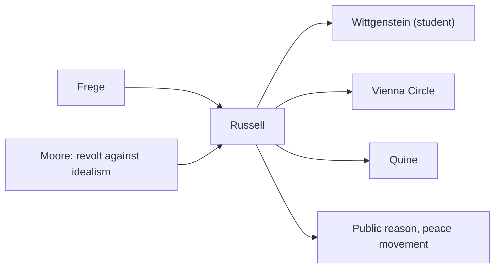

# Bertrand Russell

**Prerequisites:** [[analytic-turn|The analytic turn]]

@@IMG@@

## Life and context

Bertrand Arthur William Russell (1872–1970) was born in Wales into a leading aristocratic Whig family; his grandfather Lord John Russell had twice been prime minister, and the philosopher John Stuart Mill was his secular godfather. Orphaned young, he was raised by his strict grandmother. At Cambridge he studied mathematics and philosophy and, with G. E. Moore, rebelled against British idealism. With Alfred North Whitehead he wrote *Principia Mathematica* (1910–13). He taught Wittgenstein. A pacifist in the First World War, he lost his Trinity College lectureship in 1916 and was imprisoned for six months in 1918 for a pamphlet, during which he wrote *Introduction to Mathematical Philosophy*. He visited Soviet Russia in 1920 and was repelled by Bolshevism; he lectured in China in 1920–21. He married four times and wrote frankly on sex and marriage, which in 1940 led a New York court to annul his appointment at the City College of New York. He received the Nobel Prize in Literature in 1950. In old age he campaigned against nuclear weapons, with Einstein issued the Russell–Einstein Manifesto (1955), helped found the Campaign for Nuclear Disarmament, and at 89 was jailed for a week after an anti-nuclear sit-in. He died in Wales aged 97.

## Core ideas

**Logicism.** Mathematics can be derived from logic. His discovery in 1901 of "Russell's paradox" (the set of all sets that do not contain themselves contains itself if and only if it does not) showed a contradiction in naive set theory and in Frege's system; his theory of types was one response.

**Theory of descriptions.** In "On Denoting" (1905) he analysed definite descriptions ("the present King of France") as disguised quantified statements, removing the need for non-existent objects. Frank Ramsey called it a "paradigm of philosophy".

**Logical atomism.** The world consists of atomic facts; a logically perfect language would mirror their structure. Complex propositions are truth-functions of atomic ones.

**Knowledge by acquaintance and description.** We know some things directly (sense-data, ourselves, universals) and others only through descriptions built from them. See [[the-problems-of-philosophy|*The Problems of Philosophy*]] (1912).

**Neutral monism.** Later he held that mind and matter are both constructed from a neutral stuff, neither mental nor physical.

**Public philosophy.** In books like *Why I Am Not a Christian* (1927), *Marriage and Morals* (1929), *In Praise of Idleness* (1935) and *A History of Western Philosophy* (1945), he wrote for a broad public with clarity and wit.

## Influence and criticism

Russell is one of the founders of analytic philosophy and modern logic. *A History of Western Philosophy*, though criticized by specialists for unfairness to some thinkers (notably the idealists and Nietzsche), introduced millions to philosophy. Critics argued that his sense-data epistemology was untenable, and Wittgenstein's criticisms of his theory of judgment reportedly left him feeling he could no longer do fundamental work in philosophy.

## Key ideas

- Mathematics may be grounded in logic; Russell's paradox exposed problems in set theory.
- The theory of descriptions shows how logical analysis can dissolve philosophical puzzles.
- Logical atomism, acquaintance and description shaped early analytic philosophy.
- He was a major public intellectual for peace and reason.

## Where this leads

- Text: [[the-problems-of-philosophy|*The Problems of Philosophy*]]
- Next thinker: [[ludwig-wittgenstein|Ludwig Wittgenstein]]
- Back: [[john-stuart-mill|Mill]], his godfather; [[gottfried-wilhelm-leibniz|Leibniz]], on whom he wrote a book
- Glossary: [[g:analytic-philosophy|analytic philosophy]], [[g:logical-atomism|logical atomism]]
