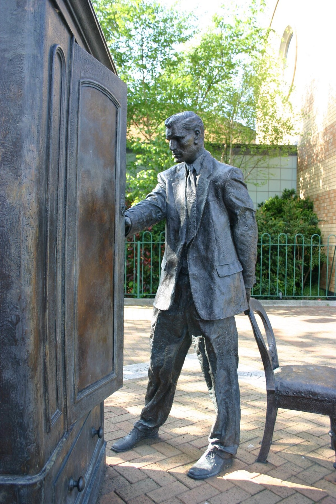
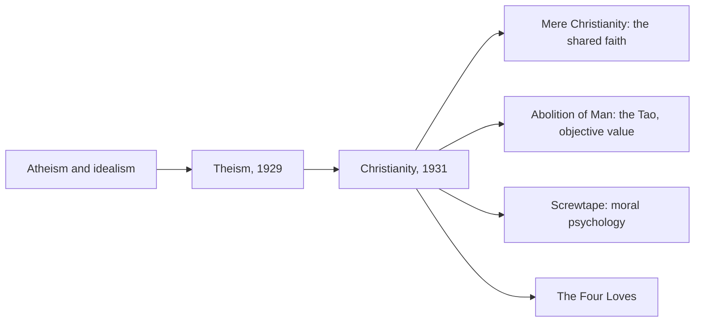

# C. S. Lewis

**Prerequisites:** [Conservatism, tradition and beauty](../11-conservatism-and-beauty.md); helpful: [Simone Weil](simone-weil.md)

*Statue of C. S. Lewis looking into a wardrobe: *The Searcher* by Ross Wilson, in Belfast, his native city. Credit: Genvessel (photograph); Ross Wilson (sculpture). License: [CC BY 2.0](https://creativecommons.org/licenses/by/2.0). Source: [File:Statue of C.S. Lewis, Belfast.jpg](https://commons.wikimedia.org/wiki/File:Statue_of_C.S._Lewis,_Belfast.jpg).*

*Lewis was a literary scholar, novelist and Christian apologist rather than a professional philosopher; he is included here because *The Abolition of Man* and his popular apologetic books have become lasting reference points in moral philosophy, natural-law thinking and the philosophy of religion.*

## Life and context

Clive Staples Lewis (1898–1963), known as Jack, was born in Belfast on 29 November 1898, the younger son of a solicitor, Albert, and Florence ("Flora") Hamilton Lewis. His mother died of cancer when he was nine. He was sent to schools in England, read omnivorously, and lost the Christian faith of his childhood. In 1917 he went up to University College, Oxford, then served in the Somerset Light Infantry and was wounded at the Battle of Arras in April 1918. Returning to Oxford, he took firsts in Honour Moderations, Greats (classics and philosophy) and English. In 1925 he became Fellow and Tutor in English Language and Literature at Magdalen College, Oxford, a post he held until 1954, when he was elected Professor of Medieval and Renaissance English at Cambridge and a fellow of Magdalene College there. He kept his home at The Kilns, on the edge of Oxford.

His scholarly reputation was made by *The Allegory of Love* (1936) and later by *English Literature in the Sixteenth Century, Excluding Drama* (1954). Around him gathered the informal Inklings, including J. R. R. Tolkien and Charles Williams, who met in Lewis's Magdalen rooms and at the Eagle and Child pub.

Lewis's return to religion was gradual. In 1929, after a period of philosophical idealism, he accepted theism; in *Surprised by Joy* (1955) he called himself a reluctant convert. On the night of 19 September 1931 he walked [Addison's Walk](../texts/mere-christianity.md) at Magdalen with Tolkien and Hugo Dyson, talking of myth, truth and Christianity. He later wrote that a motorcycle journey to Whipsnade Zoo with his brother Warren completed his belief that Jesus is the Son of God — traditionally dated 28 September 1931, though Alister McGrath has argued the zoo journey may belong to 1932. He took communion at Holy Trinity, Headington Quarry, that Christmas, and is buried in its churchyard.

In 1956 he entered a civil marriage with the American writer Joy Davidman, partly to secure her right to stay in Britain; a Christian ceremony followed in 1957, when she was already ill with cancer. She died in 1960. *A Grief Observed* (1961), first published under the name N. W. Clerk, records that loss. Lewis died at The Kilns on 22 November 1963.

## Core ideas

**"Mere" Christianity.** In wartime BBC talks, later [*Mere Christianity*](../texts/mere-christianity.md) (1952), Lewis tried to state the beliefs common to most of the Christian tradition — a hallway from which particular churches are rooms — rather than to advertise one denomination. He argued from the experience of a moral law to a lawgiver, then toward the [Incarnation](../../../../../religion/abrahamic/christianity/bible/glossary/terms/incarnation.md) and the Trinity.

**Objective value and the Tao.** [*The Abolition of Man*](../texts/the-abolition-of-man.md) (1943) is his most compact philosophical book. Against an educational fashion for treating value judgments as mere expressions of feeling, he defended a traditional, transcultural moral order he called the [Tao](../../../../glossary/modern/the-tao.md), close to [natural law](../../../../glossary/modern/natural-law.md). Without trained emotions — the "chest" that joins intellect to appetite — one gets "[men without chests](../../../../glossary/modern/men-without-chests.md)", then a class of "conditioners" who treat the rest of humanity as raw material.

**Temptation and moral psychology.** [*The Screwtape Letters*](../texts/the-screwtape-letters.md) (1942) inverts spiritual advice: a senior devil coaches a junior in the everyday corruption of a soul. The book is witty, but its subject is attention, habit and self-deception, closer to pastoral psychology than to systematic theology.

**The four loves.** In [*The Four Loves*](../texts/the-four-loves.md) (1960) he distinguished affection (*storge*), friendship (*philia*), erotic love (*eros*) and charity (*agape*), and asked how the first three are fulfilled, and sometimes distorted, by the fourth.

**Myth, reason and imagination.** Lewis held that pagan myths could be "good dreams" fulfilled in the Christian story, a view shaped by the 1931 conversation with Tolkien. He also wrote a space trilogy, the Narnia books, and *Till We Have Faces*. *Miracles* (1947; revised 1960) argues that naturalism undercuts itself because reasoning, if it is only a natural event, loses its claim to truth — an argument still discussed by philosophers of mind and religion.

## Influence and criticism

Lewis became one of the most widely read Christian writers in English. *The Abolition of Man* is still assigned in ethics courses; the Narnia books carry his moral vision into childhood reading. Admirers include many theologians and some natural-law philosophers. Critics find the apologetic arguments too quick (the moral-law argument, the "trilemma" about [Jesus](../../../../../religion/abrahamic/christianity/bible/glossary/people/jesus.md) as liar, lunatic or Lord), the tone at times breezy or dated, and the treatment of gender and some religions narrow. Compared with [Tolstoy](../../nineteenth-century/thinkers/leo-tolstoy.md), he is far more committed to orthodox doctrine and to the miraculous; compared with [Girard](rene-girard.md), he treats myth as a preparation for the Gospel rather than as a concealment of scapegoat violence. Both contrasts are useful.

## Key ideas

- Lewis was a scholar of medieval and Renaissance literature who became a leading Christian apologist and a novelist.
- *Mere Christianity* tries to state the shared core of the faith; *The Abolition of Man* defends objective value, the Tao, against educational subjectivism.
- *The Screwtape Letters* and *The Four Loves* are studies of temptation, habit and the varieties of love.
- His arguments remain popular and disputed; he sits in this path as a moral and religious thinker, not as a university philosopher.

## Where this leads

- Texts: [*Mere Christianity*](../texts/mere-christianity.md), [*The Abolition of Man*](../texts/the-abolition-of-man.md), [*The Screwtape Letters*](../texts/the-screwtape-letters.md), [*The Four Loves*](../texts/the-four-loves.md)
- Related thinkers: [Simone Weil](simone-weil.md), [René Girard](rene-girard.md), [Leo Tolstoy](../../nineteenth-century/thinkers/leo-tolstoy.md), [Thomas Aquinas](../../../medieval/thinkers/thomas-aquinas.md)
- Bible: [the Bible overview](../../../../../religion/abrahamic/christianity/bible/README.md), [Jesus](../../../../../religion/abrahamic/christianity/bible/glossary/people/jesus.md), [the Incarnation](../../../../../religion/abrahamic/christianity/bible/glossary/terms/incarnation.md)
- Glossary: [the Tao (Lewis)](../../../../glossary/modern/the-tao.md), [men without chests](../../../../glossary/modern/men-without-chests.md), [natural law](../../../../glossary/modern/natural-law.md), [Bulverism](../../../../glossary/modern/bulverism.md)
