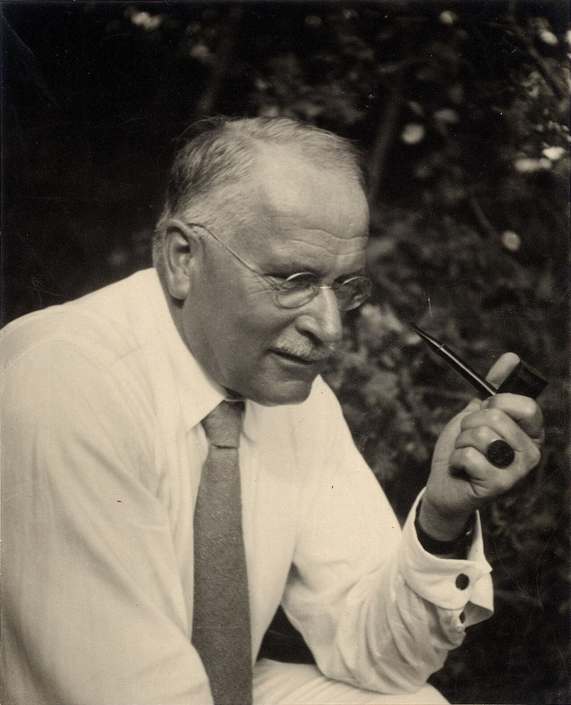
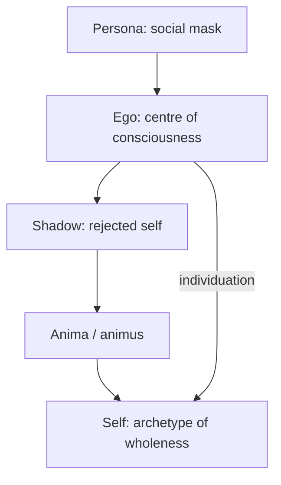

# Carl Gustav Jung

**Prerequisites:** [Psychoanalysis and depth psychology](../05-psychoanalysis-and-depth-psychology.md), [Sigmund Freud](sigmund-freud.md)

*Jung was a psychiatrist and the founder of analytical psychology, not a philosopher. He is included because his theories of archetypes and individuation have shaped religious studies, the study of myth and philosophical ideas of the self.*

*Carl Gustav Jung, portrait from the ETH Library, Zurich. Credit: Unbekannt. License: PDM-owner. Source: [File:ETH-BIB-Jung, Carl Gustav (1875-1961)-Portrait-Portr 14163 (cropped).tif](https://commons.wikimedia.org/wiki/File:ETH-BIB-Jung,_Carl_Gustav_(1875-1961)-Portrait-Portr_14163_(cropped).tif).*

## Life and context

Carl Gustav Jung (1875–1961) was born in Kesswil, Switzerland, son of a Swiss Reformed pastor; many relatives were clergy, and his mother's family had an interest in spiritualism. He studied medicine at Basel, wrote his dissertation on the psychology of so-called occult phenomena, and worked from 1900 at the Burghölzli psychiatric hospital in Zurich under Eugen Bleuler, where he developed the word-association test. After meeting Freud in 1907 (they reportedly talked for thirteen hours) he became his foremost ally and first president of the International Psychoanalytical Association. They broke in 1912–13 after Jung's *Transformations and Symbols of the Libido* (later *Symbols of Transformation*) reinterpreted libido as general psychic energy. A period of inner turmoil followed, which Jung explored through "active imagination" and recorded in the *Red Book* (published 2009). He built a stone tower at Bollingen on Lake Zurich, travelled to North Africa, New Mexico (Pueblo peoples), Kenya and India, and studied alchemy, Gnosticism and Eastern texts. He held professorships at the ETH Zurich and Basel. He died at Küsnacht in 1961; his memoir *Memories, Dreams, Reflections*, compiled with Aniela Jaffé, appeared in 1962.

## Core ideas

- **Personal and collective unconscious.** Beneath repressed personal material lies the collective unconscious, shared by humanity.
- **[Archetypes](../../../../glossary/modern/archetype.md).** Inherited forms that organize experience and appear in myths, religions and dreams: the mother, the child, the hero, the trickster, the wise old man, the shadow, the anima/animus, the Self. See [*The Archetypes and the Collective Unconscious*](../texts/archetypes-and-the-collective-unconscious.md).
- **Persona and shadow.** The persona is the social mask; the [shadow](../../../../glossary/modern/shadow.md) is what the conscious ego rejects in itself, often projected onto others.
- **Anima and animus.** The contrasexual image within a man or woman, mediating the unconscious.
- **The Self and [individuation](../../../../glossary/modern/individuation.md).** The Self is the archetype of wholeness; individuation is the process of becoming an integrated person, especially in life's second half, through confronting the shadow and integrating unconscious contents. Symbols of wholeness include mandalas.
- **Psychological types** (1921): introversion and extraversion; thinking, feeling, sensation, intuition.
- **Synchronicity.** Meaningful coincidences not connected causally (an idea developed with the physicist Wolfgang Pauli).
- **Religion.** Religion expresses archetypal realities and is psychologically necessary; *Answer to Job* (1952) reads the book of Job as a drama in the development of the God-image.

## Influence and criticism

Jung influenced religious studies (Mircea Eliade), comparative mythology (Joseph Campbell's *The Hero with a Thousand Faces*), literary criticism, art therapy, and popular psychology; the Myers–Briggs Type Indicator is loosely based on his typology. Critics argue that archetypes and the collective unconscious are unfalsifiable, that his inheritance claims lack biological support, and that his work blurs science and mysticism. His conduct in the 1930s, when he presided over the International General Medical Society for Psychotherapy (whose German section was Nazified) and wrote about differences between "Jewish" and "Aryan" psychology, has been sharply criticized; defenders point to his later statements and to Jewish colleagues and patients he helped. Scholars continue to disagree about how to weigh this record.

## Key ideas

- Beneath the personal unconscious lies a collective unconscious structured by archetypes.
- The shadow, persona, anima/animus and Self are key figures of the psyche.
- Individuation is the lifelong process of integrating conscious and unconscious into wholeness.
- His influence on myth, religion and popular psychology is vast; his scientific and political record is debated.

## Where this leads

- Text: [*The Archetypes and the Collective Unconscious*](../texts/archetypes-and-the-collective-unconscious.md)
- Next thinker: [Jean-Paul Sartre](jean-paul-sartre.md)
- Related: [Job](../../../../../religion/abrahamic/christianity/bible/old-testament/books/wisdom-poetry/job.md) (Jung's *Answer to Job*)
- Back: [Plato's Forms](../../../../concepts/metaphysics/the-forms.md), which Jung cited as an ancestor of archetypes
- Glossary: [collective unconscious](../../../../glossary/modern/collective-unconscious.md), [archetype](../../../../glossary/modern/archetype.md)
