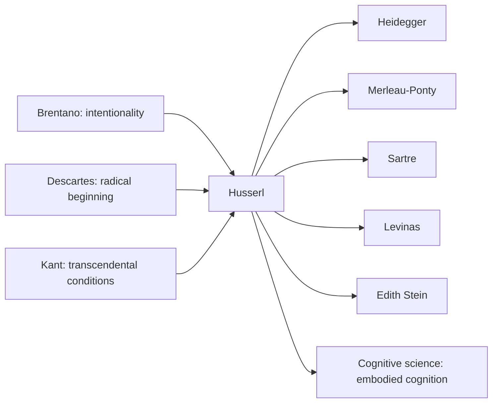

# Edmund Husserl

**Prerequisites:** [[phenomenology|Phenomenology]]

@@IMG@@

## Life and context

Edmund Husserl (1859–1938) was born in Prossnitz, Moravia (now Prostějov, Czech Republic), into a Jewish family. He studied mathematics in Leipzig, Berlin (under Weierstrass) and Vienna, where he took his doctorate in 1883. Attending Franz Brentano's lectures in Vienna convinced him to devote himself to philosophy. In 1886 he converted to Lutheran Christianity. He taught at Halle, Göttingen (1901–1916), where a circle of students gathered around his "phenomenological movement", and Freiburg (1916–1928), where [[martin-heidegger|Heidegger]] was his assistant and successor. His younger son died in the First World War. After 1933, as a person of Jewish descent under the Nazi racial laws, he was suspended, later lost his teaching licence, and was increasingly isolated; Heidegger, by then rector, did not stand by him, and the dedication of *Being and Time* to Husserl was dropped from its 1941 edition at the publisher's request. Husserl died in Freiburg in 1938. A young Franciscan, Herman Leo Van Breda, smuggled his roughly 40,000 pages of shorthand manuscripts to Louvain, Belgium, where the Husserl Archives were founded.

## Development

- **Philosophy of arithmetic** (1891): an early, partly psychological account of number, criticized by Frege.
- **Logical Investigations** (1900–01): a decisive attack on psychologism; logic's laws are ideal, not psychological. The second volume develops descriptive analyses of meaning, intentionality and perception, launching phenomenology.
- **Ideas I** (1913): the "transcendental" turn: the phenomenological reduction (epoché) and the description of pure consciousness and its correlates.
- **Cartesian Meditations** (lectures in Paris, 1929; French 1931): phenomenology as a radicalized Cartesianism, including the problem of how other minds are given (intersubjectivity).
- **The Crisis of European Sciences and Transcendental Phenomenology** (1936, partly published): the lifeworld and the crisis of meaning in modern science.

## Core ideas

- **Intentionality:** every conscious act is directed at an object; act and object correlate.
- **Epoché and reduction:** bracketing the natural attitude to study how the world is constituted in experience.
- **Eidetic intuition:** grasping essences through imaginative variation.
- **Internal time-consciousness:** each present moment includes "retention" of the just-past and "protention" of the about-to-come, which makes perceiving a melody possible.
- **Intersubjectivity and empathy:** others are given as other centres of experience; the objective world is constituted intersubjectively.
- **Lifeworld:** the pre-scientific world of experience from which science abstracts.

## Influence and criticism

Husserl founded the phenomenological movement, which shaped existentialism, hermeneutics, and parts of psychiatry, sociology (Alfred Schutz) and cognitive science. Critics, starting with his own students, rejected his turn to transcendental idealism; Heidegger argued that he started from consciousness rather than from being-in-the-world. Analytic philosophers questioned the reliability of introspective essence-intuition, though Husserl's analyses of meaning and intentionality are increasingly studied alongside Frege's.

## Key ideas

- Logic is not psychology; phenomenology describes the essential structures of experience.
- Consciousness is intentional; the epoché reveals how meaning is constituted.
- Time-consciousness, empathy and the lifeworld were major themes of his later work.
- He founded a movement that shaped much of twentieth-century European thought.

## Where this leads

- Next thinker: [[martin-heidegger|Martin Heidegger]]
- Back: [[rene-descartes|Descartes]], [[immanuel-kant|Kant]]
- Glossary: [[g:intentionality|intentionality]], [[g:lifeworld|lifeworld]], [[g:phenomenology|phenomenology]]
