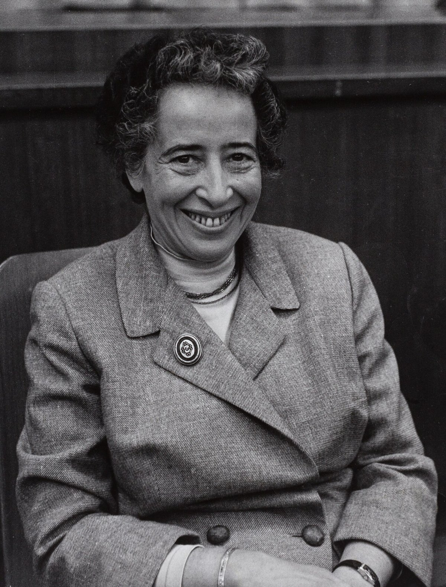

# Hannah Arendt

**Prerequisites:** [Political philosophy after catastrophe](../07-political-philosophy-after-catastrophe.md)

*Hannah Arendt at the first Kulturkritikerkongress, Munich (1958), photographed by Barbara Niggl Radloff. Credit: Barbara Niggl Radloff. License: [CC BY-SA 4.0](https://creativecommons.org/licenses/by-sa/4.0). Source: [File:Hannah Arendt auf dem 1. Kulturkritikerkongress, Barbara Niggl Radloff, FM-2019-1-5-9-16 (cropped).jpg](https://commons.wikimedia.org/wiki/File:Hannah_Arendt_auf_dem_1._Kulturkritikerkongress,_Barbara_Niggl_Radloff,_FM-2019-1-5-9-16_(cropped).jpg).*

## Life and context

Hannah Arendt (1906–1975) was born near Hanover and grew up in Königsberg, Kant's city, in a secular Jewish family. At Marburg in 1924 she studied with [Heidegger](martin-heidegger.md), with whom she had a secret love affair, then with Husserl in Freiburg and Karl Jaspers in Heidelberg, where she wrote her dissertation on love in [Augustine](../../../medieval/thinkers/augustine.md) (1929). In 1933 she was arrested by the Gestapo for researching antisemitic propaganda for a Zionist organization, was released after eight days, and fled to Paris, where she worked helping Jewish refugee children emigrate to Palestine. In 1940 she was interned in the Gurs camp in southern France, escaped in the confusion of the French collapse, and reached New York in 1941 with her husband Heinrich Blücher. Stateless until she became an American citizen in 1951, she worked as a journalist and editor and for Jewish Cultural Reconstruction. [*The Origins of Totalitarianism*](../texts/the-origins-of-totalitarianism.md) (1951) established her reputation. She taught at Chicago, the New School and elsewhere. Her reports on the Eichmann trial for *The New Yorker*, published as [*Eichmann in Jerusalem*](../texts/eichmann-in-jerusalem.md) (1963), caused a storm. She died in New York in 1975, while writing *The Life of the Mind*.

## Core ideas

**Totalitarianism.** A new form of government that uses ideology and terror to achieve total domination, making human beings superfluous; the camps were its laboratories.

**The right to have rights.** Stateless people showed that human rights proved unenforceable once one lost membership in a political community.

**The vita activa.** In *The Human Condition* (1958): labour (cyclical biological necessity), work (making a durable world of objects) and action (speech and deeds among plural equals, revealing who one is and beginning something new). Modernity has elevated labour and lost the public realm where action appears.

**Natality.** The fact that each human being is born as a new beginning grounds the capacity to act and to start something unpredictable; Arendt contrasted this with philosophy's traditional focus on mortality.

**Plurality.** Politics exists because "men, not Man, live on the earth and inhabit the world".

**The banality of evil.** Eichmann's evil came not from monstrous motives but from thoughtlessness, an inability to think from the standpoint of others.

**Thinking and judging.** Her late work asked whether the activity of thinking, the silent dialogue with oneself that Socrates practised, might condition people against evil, and turned to Kant's aesthetics for a theory of political judgment.

**Revolution and authority.** *On Revolution* (1963) contrasted the American Revolution's founding of freedom with the French Revolution's capture by the "social question" of poverty.

## Influence and criticism

Arendt is among the most read political thinkers of the twentieth century, cited in debates on totalitarianism, refugees, civil disobedience, lying in politics and the meaning of citizenship. *Eichmann in Jerusalem* was attacked for her portrayal of Eichmann as banal and for her criticism of the role of some Jewish councils; Gershom Scholem accused her of lacking love for the Jewish people. Historians later found evidence (notably Bettina Stangneth's *Eichmann Before Jerusalem*) that Eichmann was a more committed ideologue than the trial persona suggested. Critics also question her sharp separation of the political from the social, and her 1959 essay on school desegregation in Little Rock, about which she later wrote to Ralph Ellison that he was right and she had missed an essential element of the situation.

## Key ideas

- Totalitarianism is a new form of domination through ideology and terror.
- Political life is action among plural equals; natality is the root of freedom.
- The banality of evil names wrongdoing that comes from failure to think.
- Thinking and judging are political capacities.

## Where this leads

- Texts: [*The Origins of Totalitarianism*](../texts/the-origins-of-totalitarianism.md), [*Eichmann in Jerusalem*](../texts/eichmann-in-jerusalem.md)
- Next thinker: [Simone Weil](simone-weil.md)
- Back: [Augustine](../../../medieval/thinkers/augustine.md), [Kant](../../early-modern/thinkers/immanuel-kant.md), [Socrates](../../../ancient/greek/thinkers/socrates.md)
- Glossary: [banality of evil](../../../../glossary/modern/banality-of-evil.md), [totalitarianism](../../../../glossary/modern/totalitarianism.md), [natality](../../../../glossary/modern/natality.md)
