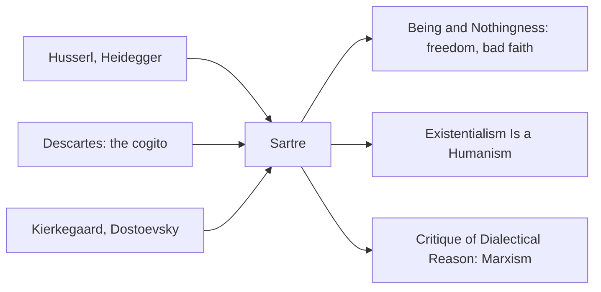

# Jean-Paul Sartre

**Prerequisites:** [Existentialism](../03-existentialism.md), [Phenomenology](../01-phenomenology.md)

@@IMG@@

## Life and context

Jean-Paul Sartre (1905–1980) was born in Paris; his father died when he was a baby, and he grew up in the household of his grandfather Charles Schweitzer (a relative of Albert Schweitzer), surrounded by books, as recounted in his memoir *Words* (1964). At the École Normale Supérieure he met [Simone de Beauvoir](simone-de-beauvoir.md) in 1929; they became lifelong partners in an open relationship, never marrying. In 1933–34 he studied Husserl in Berlin. His novel *Nausea* (1938) described the contingency of existence through a character overwhelmed by the sheer thereness of a chestnut tree root. Drafted in 1939, he was captured in 1940 and spent nine months in a German prisoner-of-war camp. Back in Paris, he wrote [*Being and Nothingness*](../texts/being-and-nothingness.md) (1943) and plays including *The Flies* (1943) and *No Exit* (1944). After liberation, his lecture ["Existentialism Is a Humanism"](../texts/existentialism-is-a-humanism.md) (1945) made him a celebrity; he co-founded the journal *Les Temps modernes*. He moved toward Marxism, defended the French Communist Party for a time, broke with [Camus](albert-camus.md) in 1952, opposed the Algerian War (his apartment was bombed by right-wing militants), and later supported Maoist groups and the students of May 1968. He refused the Nobel Prize in Literature in 1964, saying a writer should not allow himself to be turned into an institution. Some 50,000 people followed his funeral procession in 1980.

## Core ideas

**Being-in-itself and being-for-itself.** Things simply are what they are (in-itself). Consciousness (for-itself) is not a thing; it is a "nothingness", a power of negation and questioning that always exceeds what it is.

**Freedom.** Because consciousness is not a thing, it is radically free: "condemned to be free". We are responsible for our choices, our projects and even our emotions, which Sartre treated as strategies.

**Bad faith.** Self-deception in which we pretend to be determined (I am just a waiter; I had no choice) or pretend to be pure transcendence free of our facts.

**The look.** Being seen by another reveals me as an object; relations with others swing between trying to possess their freedom and being possessed.

**Existential psychoanalysis.** Instead of Freudian drives, understand a life through its "original project", the fundamental choice of being that unifies it; he applied this in biographies of Baudelaire, Genet and Flaubert.

**Marxism and history.** In *Critique of Dialectical Reason* (1960) he tried to combine existentialism with Marxism, examining how individual praxis becomes trapped in material structures ("the practico-inert") and how groups form.

## Influence and criticism

Sartre was the most famous intellectual of postwar France. Critics charged that his early idea of absolute freedom ignored the body, society and the unconscious (Merleau-Ponty, the structuralists); that his ethics was never completed; and that his political judgments, especially his long defence of the Soviet Union and later of Maoism, were seriously wrong. Heidegger repudiated Sartre's humanist reading of him. Yet his analyses of bad faith and the look remain classics, and his insistence on the writer's responsibility shaped a generation.

## Key ideas

- Consciousness is a nothingness that makes us radically free and responsible.
- Bad faith is the self-deceptive flight from freedom.
- The look of the other makes me an object; human relations are marked by conflict.
- Late Sartre sought to unite existential freedom with Marxist history.

## Where this leads

- Texts: [*Being and Nothingness*](../texts/being-and-nothingness.md), [*Existentialism Is a Humanism*](../texts/existentialism-is-a-humanism.md)
- Next thinker: [Albert Camus](albert-camus.md)
- Glossary: [bad faith](../../../../glossary/modern/bad-faith.md), [existence precedes essence](../../../../glossary/modern/existence-precedes-essence.md)
