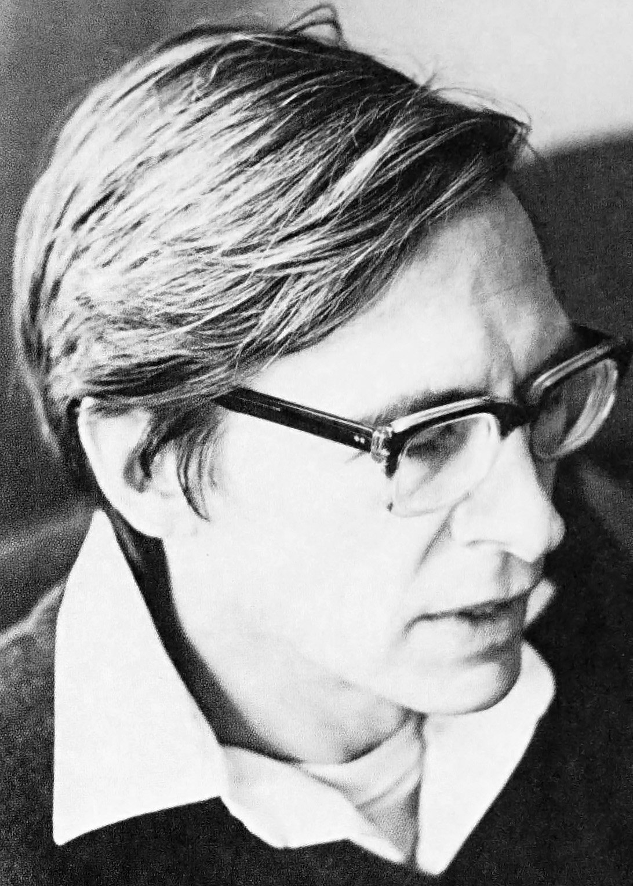
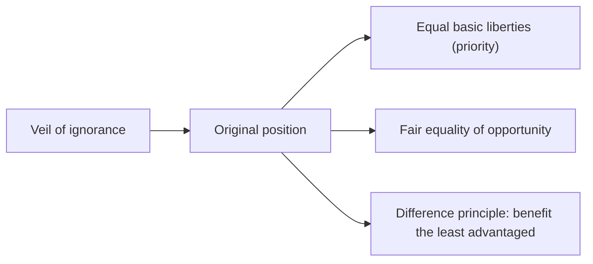

# John Rawls

**Prerequisites:** [The social contract and the state](../../early-modern/05-social-contract-and-the-state.md); [Utilitarianism and liberalism](../../nineteenth-century/03-utilitarianism-and-liberalism.md)

*John Rawls in 1971, the year *A Theory of Justice* appeared. Credit: Published by the Belknap Press of Harvard University Press. Photograph taken by Alec Rawls, John's son. The portrait was uncredited on the o. License: Public domain. Source: [File:John Rawls (1971 photo portrait).jpg](https://commons.wikimedia.org/wiki/File:John_Rawls_(1971_photo_portrait).jpg).*

## Life and context

John Bordley Rawls (1921–2002) was born in Baltimore, Maryland, the son of a lawyer and a mother active in the League of Women Voters. Two of his younger brothers died in childhood of diseases (diphtheria and pneumonia) they caught from him, an experience biographers connect to his lifelong stammer. At Princeton he was a serious Episcopalian and considered the priesthood; his undergraduate thesis (1942) was on sin and faith. He served as an infantryman in the Pacific in the Second World War, and the war, including seeing the aftermath of Hiroshima, ended his orthodox faith. He took his PhD at Princeton (1950), spent a year at Oxford, and taught at Cornell and MIT before joining Harvard in 1962, where he remained. Over two decades of articles he developed "justice as fairness", culminating in [*A Theory of Justice*](../texts/a-theory-of-justice.md) (1971). Later books, *Political Liberalism* (1993) and *The Law of Peoples* (1999), addressed pluralism and international justice. Shy and modest, he rarely gave interviews. He died in Lexington, Massachusetts, in 2002.

## Core ideas

**Justice as the first virtue of institutions.** "Justice is the first virtue of social institutions, as truth is of systems of thought." The subject of justice is the "basic structure" of society: its major institutions distributing rights, duties and the benefits of cooperation.

**The original position.** Imagine choosing principles of justice behind a "veil of ignorance", not knowing your class, talents, sex, race or conception of the good. Principles chosen in such a fair situation are fair. This updates the [social contract](../../../../glossary/modern/social-contract.md) of Locke, Rousseau and Kant.

**Two principles.** (1) Each person has an equal right to the most extensive scheme of equal basic liberties compatible with a similar scheme for all. (2) Social and economic inequalities must be (a) attached to offices open to all under fair equality of opportunity, and (b) to the greatest benefit of the least advantaged (the difference principle). The first principle has priority.

**Against utilitarianism.** Utilitarianism "does not take seriously the distinction between persons": it allows the losses of some to be outweighed by gains to others.

**Reflective equilibrium.** We test principles against considered judgments and adjust both until they cohere.

**Political liberalism.** In a society of reasonable but conflicting religious and philosophical doctrines, the basis of justice should be a "political" conception that can be the object of an "overlapping consensus", justified by "public reason" rather than any one comprehensive doctrine.

## Influence and criticism

*A Theory of Justice* revived normative political philosophy in the English-speaking world. Robert Nozick's *Anarchy, State, and Utopia* (1974) replied from the libertarian side: patterns of distribution violate entitlements. Communitarians (Michael Sandel, Michael Walzer, Charles Taylor, Alasdair MacIntyre) criticized the "unencumbered self" behind the veil. Feminists such as Susan Moller Okin questioned the treatment of the family; Amartya Sen and Martha Nussbaum proposed a capabilities approach; G. A. Cohen argued from the left that the difference principle permits too much inequality. Economists debated the "maximin" reasoning behind the difference principle (John Harsanyi argued for average utility instead).

## Key ideas

- Justice as fairness: principles chosen behind a veil of ignorance are fair.
- Equal basic liberties first; inequalities only if they benefit the least advantaged and offices are open to all.
- Utilitarianism ignores the separateness of persons.
- Political liberalism seeks an overlapping consensus among reasonable doctrines.

## Where this leads

- Text: [*A Theory of Justice*](../texts/a-theory-of-justice.md)
- Next thinker: [Michel Foucault](michel-foucault.md)
- Back: [Locke](../../early-modern/thinkers/john-locke.md), [Rousseau](../../early-modern/thinkers/jean-jacques-rousseau.md), [Kant](../../early-modern/thinkers/immanuel-kant.md), [Mill](../../nineteenth-century/thinkers/john-stuart-mill.md)
- Economics: [Kenneth Arrow](../../../../../economics/microeconomics/10-history-of-thought/thinkers/13-kenneth-arrow.md), who engaged his maximin argument
- Glossary: [veil of ignorance](../../../../glossary/modern/veil-of-ignorance.md), [social contract](../../../../glossary/modern/social-contract.md)
