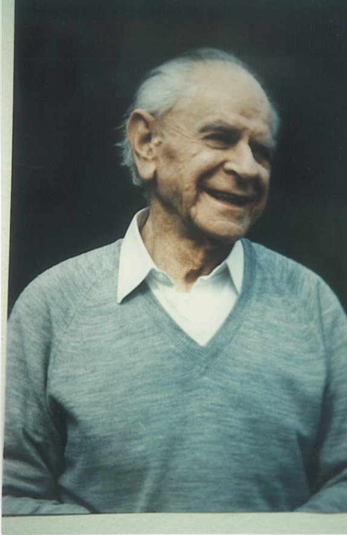
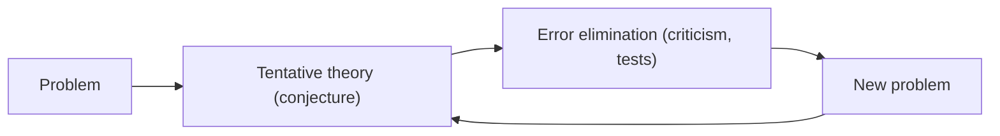

# Karl Popper

**Prerequisites:** [Philosophy of science](../06-philosophy-of-science.md)

*Karl Popper. Credit: DorianKBandy. License: [CC BY-SA 4.0](https://creativecommons.org/licenses/by-sa/4.0). Source: [File:Photo of Karl Popper.jpg](https://commons.wikimedia.org/wiki/File:Photo_of_Karl_Popper.jpg).*

## Life and context

Karl Raimund Popper (1902–1994) was born in Vienna to a family of Jewish origin that had converted to Lutheranism; his father was a lawyer with a large library. As a teenager after the First World War he was briefly attracted to Marxism, then repelled after a demonstration in 1919 in which young socialists were shot, which he came to see as a consequence of a theory that justified sacrifices for a predicted future. He worked as a cabinetmaker's apprentice, a social worker with neglected children, and a schoolteacher, while studying psychology and philosophy (his doctorate was in 1928). He was close to but never a member of the Vienna Circle, and sharply criticized its verificationism in *Logik der Forschung* (1934), published in English as [*The Logic of Scientific Discovery*](../texts/the-logic-of-scientific-discovery.md) (1959). Foreseeing the Nazi annexation of Austria, he emigrated in 1937 to New Zealand, where he taught at Canterbury University College and wrote *The Open Society and Its Enemies* (1945) and *The Poverty of Historicism*. From 1946 he taught at the London School of Economics, with Friedrich Hayek's support. He was knighted in 1965 and died in London in 1994.

## Core ideas

**Falsifiability.** Scientific theories cannot be verified, but they can be refuted. A theory is scientific if it prohibits some possible observations. This solves the demarcation problem, distinguishing science from pseudo-science and metaphysics (which Popper, unlike the positivists, did not call meaningless).

**Conjectures and refutations.** Science proceeds by bold hypotheses and severe attempts to refute them. Knowledge grows by error elimination, not by induction. Popper claimed this dissolved Hume's problem of induction.

**Critical rationalism.** Rationality consists in openness to criticism, not in proving one's beliefs. All knowledge is fallible and provisional.

**The open society.** *The Open Society and Its Enemies* attacked Plato, Hegel and Marx for historicism and utopian holism. A free society is one in which institutions can be criticized and changed without violence, and in which policies are improved by "piecemeal social engineering", trial and error. The key political question is not "who should rule?" but "how can we remove bad rulers without bloodshed?"

**The paradox of tolerance.** Unlimited tolerance may lead to the disappearance of tolerance; a tolerant society may need to refuse toleration to movements that reject rational argument and resort to violence (a note in *The Open Society*).

**Three worlds.** Later, Popper distinguished physical things (World 1), mental states (World 2) and objective products of mind such as theories and arguments (World 3).

## Influence and criticism

Popper's falsificationism became a widespread self-image among scientists; his political philosophy influenced postwar liberals and, through his student George Soros, the Open Society Foundations. [Kuhn](thomas-kuhn.md) argued that real science does not abandon theories at the first refutation; Imre Lakatos refined falsificationism into "sophisticated" form; Quine and Duhem noted that theories are tested only together with auxiliary assumptions, so a refutation can always be deflected. Classicists and Hegel scholars criticized his readings of Plato and Hegel as unfair.

## Key ideas

- Science is distinguished by falsifiability; theories are corroborated, never proved.
- Knowledge grows through conjectures and refutations.
- Open societies allow criticism and peaceful removal of rulers; historicism and utopianism threaten them.
- Rationality is openness to criticism.

## Where this leads

- Text: [*The Logic of Scientific Discovery*](../texts/the-logic-of-scientific-discovery.md)
- Next thinker: [Thomas Kuhn](thomas-kuhn.md)
- Back: [Hume](../../early-modern/thinkers/david-hume.md), [Bacon](../../early-modern/thinkers/francis-bacon.md)
- Economics: [Friedrich Hayek](../../../../../economics/microeconomics/10-history-of-thought/thinkers/11-friedrich-hayek.md), his ally
- Glossary: [falsifiability](../../../../glossary/modern/falsifiability.md)
