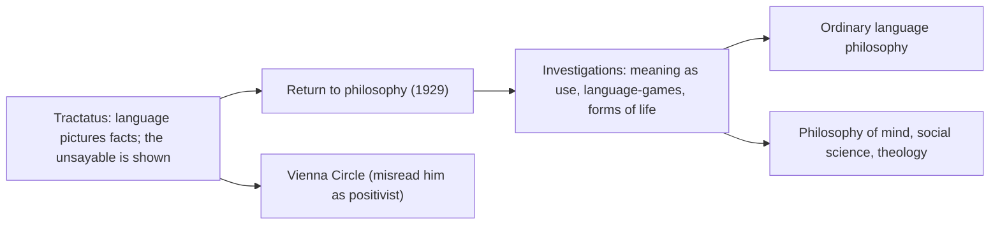

# Ludwig Wittgenstein

**Prerequisites:** [The analytic turn](../02-analytic-turn.md)

@@IMG@@

## Life and context

Ludwig Josef Johann Wittgenstein (1889–1951) was born in Vienna, the youngest of eight children of the steel magnate Karl Wittgenstein, in one of the wealthiest families in Europe; Brahms and Mahler were among the musicians who visited the household. Three of his brothers died by suicide. He studied engineering in Berlin and aeronautics in Manchester, became absorbed in the foundations of mathematics, and in 1911 went to Cambridge to study with [Russell](bertrand-russell.md), who soon regarded him as his intellectual heir. In the First World War he served in the Austrian army, volunteered for the front, and wrote the [*Tractatus*](../texts/tractatus-logico-philosophicus.md) in notebooks, finishing it around the time he became an Italian prisoner of war in 1918. During the war he carried Tolstoy's *Gospel in Brief*. He then gave away his inherited fortune to his siblings, trained as a schoolteacher and taught in remote Austrian villages (1920–26), worked as a gardener at a monastery, and designed a modernist house in Vienna for his sister. Returning to Cambridge in 1929, he submitted the *Tractatus* as his doctoral thesis and became professor in 1939, succeeding Moore. During the Second World War he worked as a hospital porter in London and a laboratory assistant in Newcastle. He resigned his chair in 1947, lived for periods in Ireland, and died of cancer in Cambridge in 1951. His last words were reported as "Tell them I've had a wonderful life." The [*Philosophical Investigations*](../texts/philosophical-investigations.md) appeared posthumously in 1953.

## Early philosophy

The *Tractatus* holds that the world is the totality of facts; propositions are pictures of possible states of affairs; logical propositions are tautologies that say nothing but show the form of the world; what can be said at all can be said clearly. Ethics, aesthetics, the meaning of life and "the mystical" cannot be said, only shown. The book ends: "Whereof one cannot speak, thereof one must be silent."

## Later philosophy

Wittgenstein came to reject the *Tractatus*'s single picture of language.

- **Meaning as use.** "For a large class of cases… the meaning of a word is its use in the language" (*Investigations* §43).
- **[Language-games](../../../../glossary/modern/language-game.md) and forms of life.** Language consists of many activities (giving orders, describing, telling jokes, praying), each with its own rules, embedded in human practices.
- **Family resemblance.** "Game" has no single common feature; games share overlapping similarities like members of a family.
- **Rule-following.** No rule can determine its own application; following a rule is a practice.
- **The private language argument.** A language whose words refer to private sensations only the speaker could know is impossible; meaning requires public criteria.
- **Philosophy as therapy.** Philosophical problems arise when "language goes on holiday"; the aim is "to shew the fly the way out of the fly-bottle".

## Influence and criticism

Wittgenstein is often ranked among the most important philosophers of the twentieth century. The *Tractatus* inspired the Vienna Circle, though he thought they misunderstood its mystical side. The *Investigations* shaped ordinary language philosophy, philosophy of mind, the social sciences (Peter Winch) and philosophy of religion. Critics, including Russell, complained that the later work abandoned serious philosophy for linguistic trivia; others find his anti-theoretical method frustratingly elusive. Readers continue to debate how much continuity there is between the two phases.

## Key ideas

- Early: language pictures facts; what cannot be said must be passed over in silence.
- Later: meaning is use within language-games embedded in forms of life.
- Family resemblance, rule-following and the private language argument transformed philosophy of language and mind.
- Philosophy is an activity of clarification that dissolves confusions rather than building theories.

## Where this leads

- Texts: [*Tractatus*](../texts/tractatus-logico-philosophicus.md), [*Philosophical Investigations*](../texts/philosophical-investigations.md)
- Next thinker: [Sigmund Freud](sigmund-freud.md)
- Back: [Augustine's *Confessions*](../../../medieval/texts/augustine-confessions.md), quoted at the start of the *Investigations*; [Tolstoy](../../nineteenth-century/thinkers/leo-tolstoy.md); [Schopenhauer](../../nineteenth-century/thinkers/arthur-schopenhauer.md)
- Glossary: [picture theory of meaning](../../../../glossary/modern/picture-theory-of-meaning.md), [language-game](../../../../glossary/modern/language-game.md), [family resemblance](../../../../glossary/modern/family-resemblance.md)
