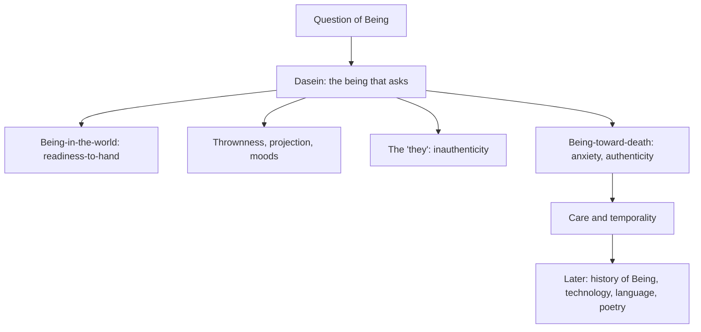

# Martin Heidegger

**Prerequisites:** [[phenomenology|Phenomenology]], [[edmund-husserl|Husserl]]

@@IMG@@

## Life and context

Martin Heidegger (1889–1976) was born in Messkirch, in Baden, southwestern Germany, son of the sexton of the Catholic church. He trained for the priesthood, turned to philosophy, and became Husserl's assistant at Freiburg in 1919. As a young lecturer at Marburg (1923–28) he attracted brilliant students, including [[hannah-arendt|Hannah Arendt]], with whom he had an affair, Hans-Georg Gadamer, Leo Strauss and Herbert Marcuse. [[being-and-time|*Being and Time*]] (1927) made him famous, and in 1928 he succeeded Husserl at Freiburg. In 1929, at Davos, he debated the neo-Kantian Ernst Cassirer in an encounter often seen as a parting of ways in European philosophy. In April 1933 he became rector of Freiburg University and joined the Nazi Party; his rectoral address and speeches supported the regime. He resigned the rectorship in 1934 but remained a party member until 1945. After the war, a denazification commission barred him from teaching until 1951. His private "Black Notebooks", published from 2014, contain antisemitic passages that intensified debate about the relation between his thought and his politics. He spent much of his later life at a hut in Todtnauberg in the Black Forest and died in Freiburg in 1976.

## Core ideas: *Being and Time*

**The question of Being.** What does it mean for anything to *be*? Western philosophy, Heidegger claimed, had forgotten this question, treating being as the presence of objects.

**Dasein.** He approaches the question through the being for whom its own being is an issue: the human being, which he calls *[[g:dasein|Dasein]]* ("being-there").

**Being-in-the-world.** Dasein is not a subject inside a head looking out at objects; it is always already engaged in a world of meaningful involvements. Things show up first as "ready-to-hand" (equipment in use), only secondarily as "present-at-hand" objects with properties.

**Thrownness and projection.** We find ourselves "thrown" into a situation we did not choose, and we project ourselves toward possibilities. Moods disclose this situation.

**The "they".** Usually we live as "one" lives (*das Man*), doing what one does, inauthentically.

**Being-toward-death and anxiety.** Anxiety reveals our finitude; owning our death as our ownmost possibility individualizes us and makes **[[g:authenticity|authenticity]]** possible.

**Care and temporality.** The being of Dasein is care, whose meaning is temporality: future, past and present ecstatically unified.

## The later Heidegger

After the "turn" (*Kehre*) of the 1930s, Heidegger wrote about the history of Being as a series of epochs, about poetry (Hölderlin), language ("the house of Being"), and about technology. In "The Question Concerning Technology" (1954) he argued that modern technology reveals everything as "standing-reserve", resources on call, a way of being that threatens to block other ways. He spoke of "releasement" (*Gelassenheit*) and dwelling.

## Influence and criticism

Heidegger shaped existentialism (Sartre), hermeneutics (Gadamer), deconstruction (Derrida), environmental philosophy, theology (Bultmann) and parts of cognitive science and AI critique (Hubert Dreyfus). Analytic critics, beginning with Carnap, dismissed his language as obscure or meaningless. His Nazi engagement raises questions about whether his philosophy had resources to resist it or even contributed to it; scholars range from those who separate the work from the man to those who see the politics woven into the thought.

## Key ideas

- The question of the meaning of Being is philosophy's forgotten question.
- Humans exist as being-in-the-world, engaged and thrown, not as detached subjects.
- Facing death in anxiety makes authentic existence possible.
- His later work criticized technological enframing; his Nazi involvement remains a grave issue.

## Where this leads

- Text: [[being-and-time|*Being and Time*]]
- Next thinker: [[bertrand-russell|Bertrand Russell]]
- Forward: [[jean-paul-sartre|Sartre]], [[hannah-arendt|Arendt]]
- Back: [[the-death-of-ivan-ilyich|*The Death of Ivan Ilyich*]], [[soren-kierkegaard|Kierkegaard]] on anxiety
- Glossary: [[g:dasein|Dasein]], [[g:being-in-the-world|being-in-the-world]], [[g:thrownness|thrownness]]
