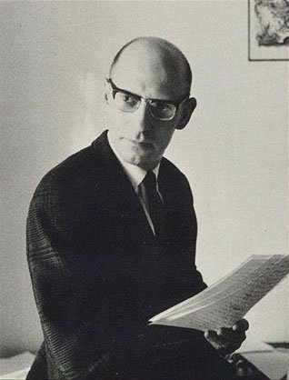
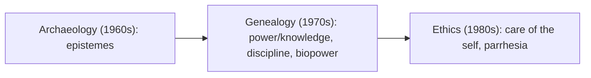

# Michel Foucault

**Prerequisites:** [Structuralism and after](../08-structuralism-and-after.md)

*Michel Foucault, from the dust jacket of the 1970 English edition of *The Order of Things*. Credit: Jerry Bauer. License: Public domain. Source: [File:Photo of Michel Foucault on 1970 dustjacket of The Order of Things.jpg](https://commons.wikimedia.org/wiki/File:Photo_of_Michel_Foucault_on_1970_dustjacket_of_The_Order_of_Things.jpg).*

## Life and context

Michel Foucault (1926–1984) was born in Poitiers, the son of a prominent surgeon who expected him to follow into medicine. He studied at the École Normale Supérieure, where he went through a period of severe depression, joined (and soon left) the Communist Party, and studied psychology as well as philosophy. He worked in Sweden, Poland and Germany in the 1950s. His doctoral thesis, *Madness and Civilization* (*Folie et déraison: Histoire de la folie à l'âge classique*, 1961), was followed by *The Birth of the Clinic* (1963) and *The Order of Things* (1966), an unexpected bestseller. After teaching in Tunisia, he was involved in May 1968's aftermath at the experimental university of Vincennes, and in 1970 was elected to the Collège de France, to a chair he named "History of Systems of Thought". He co-founded the Prison Information Group (GIP) in 1971 to let prisoners speak for themselves. [*Discipline and Punish*](../texts/discipline-and-punish.md) (1975) and the first volume of *The History of Sexuality* (1976) followed; volumes 2 and 3 appeared in 1984, shortly before his death from AIDS-related illness in Paris that June. He lectured often in the United States, especially at Berkeley.

## Core ideas

**Archaeology.** In the 1960s he studied the *episteme*, the underlying rules that determine what can count as knowledge in an era: for example, the shift from "resemblance" in the Renaissance to "representation" in the classical age to "man" as an object of knowledge around 1800. "Man is an invention of recent date. And one perhaps nearing its end" (*The Order of Things*).

**Genealogy.** From the 1970s, following [Nietzsche](../../nineteenth-century/thinkers/friedrich-nietzsche.md), he traced the contingent historical emergence of institutions and concepts we take as natural, to show that they could be otherwise.

**Power/knowledge.** Power is not only repressive or possessed by a sovereign; it is productive, circulating through practices, institutions and expert knowledges (psychiatry, medicine, criminology) that define norms and produce kinds of person.

**Discipline.** Modern societies discipline bodies through surveillance, normalization and examination, exemplified by Bentham's Panopticon. See [*Discipline and Punish*](../texts/discipline-and-punish.md).

**Biopower.** Modern states govern the life of populations: birth rates, health, hygiene, sexuality. *The History of Sexuality* argued that the modern West did not simply repress sex but multiplied discourses about it.

**Care of the self.** His late work returned to ancient Greek and Roman ethics (Stoics, Epicureans) as "practices of the self" and to *parrhesia*, frank speech.

## Influence and criticism

Foucault is among the most cited authors in the humanities and social sciences, shaping studies of prisons, medicine, sexuality, colonialism and governance ("governmentality"), queer theory and critical theory. Jürgen Habermas argued he could not justify his own critique since he rejected normative foundations; Nancy Fraser and Charles Taylor pressed similar points. Historians challenged his evidence about asylums and the "Great Confinement". His interviews praising the Iranian revolution of 1978–79 drew criticism. He resisted labels, including "structuralist" and "postmodernist".

## Key ideas

- Knowledge in each era is shaped by underlying rules (epistemes).
- Power is productive and intertwined with knowledge; it shapes norms and subjects.
- Modern societies use discipline and surveillance and govern life through biopower.
- Genealogy shows that what seems natural has a contingent history.

## Where this leads

- Text: [*Discipline and Punish*](../texts/discipline-and-punish.md)
- Next thinker: [René Girard](rene-girard.md)
- Back: [Nietzsche](../../nineteenth-century/thinkers/friedrich-nietzsche.md), [*On the Genealogy of Morality*](../../nineteenth-century/texts/on-the-genealogy-of-morality.md); the Stoics, e.g. [Seneca](../../../ancient/greek/thinkers/seneca.md)
- Glossary: [power/knowledge](../../../../glossary/modern/power-knowledge.md), [panopticism](../../../../glossary/modern/panopticism.md), [discourse](../../../../glossary/modern/discourse.md), [genealogy](../../../../glossary/modern/genealogy.md)
