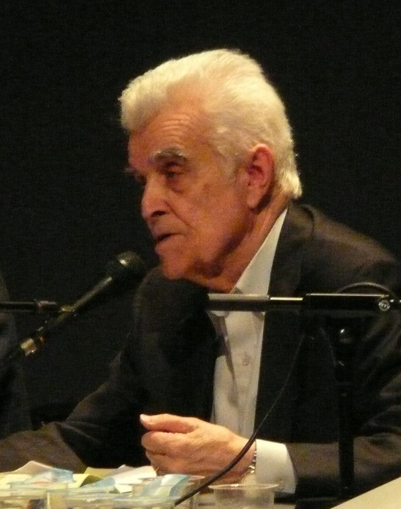
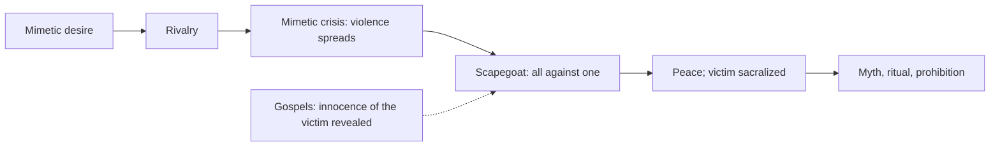

# René Girard

**Prerequisites:** [Mimetic theory](../09-mimetic-theory.md)

*René Girard. Credit: Vicq. License: Public domain. Source: [File:René Girard.jpg](https://commons.wikimedia.org/wiki/File:René_Girard.jpg).*

*Girard was a literary critic, historian and anthropologist rather than a professional philosopher; he is included here because his mimetic theory has become a major reference point in philosophy, theology and social thought.*

## Life and context

René Noël Théophile Girard (1923–2015) was born in Avignon, France, on Christmas Day. His father was a curator of the city's museum and archives. He trained as an archivist-paleographer at the École des Chartes in Paris, writing a thesis on private life in fifteenth-century Avignon. In 1947 he went to Indiana University on a one-year fellowship to teach French and stayed in the United States for the rest of his career, earning a PhD in history there (1950) and teaching at Duke, Bryn Mawr, Johns Hopkins, the State University of New York at Buffalo and, from 1981 until retirement, Stanford. Around 1959, while finishing his first book on the novel, he underwent a conversion back to the Catholic faith of his childhood. He was co-organizer of the famous 1966 Johns Hopkins symposium "The Languages of Criticism and the Sciences of Man", which introduced Derrida and Lacan to American audiences. He was elected to the Académie française in 2005. He died in Stanford, California, in 2015.

## Core ideas

**Mimetic desire.** *Deceit, Desire and the Novel* (1961) argued, from Cervantes, Stendhal, Flaubert, Proust and [Dostoevsky](../../nineteenth-century/thinkers/fyodor-dostoevsky.md), that we desire according to others: desire is triangular (subject, model, object). The "romantic lie" is the belief in spontaneous desire; "novelistic truth" exposes its mediation.

**Mimetic rivalry.** When the model is close (internal mediation), imitation leads to rivalry for the same object, then to escalating doubles who mirror each other's violence.

**The scapegoat mechanism.** In *Violence and the Sacred* (1972), he argued that archaic communities overwhelmed by mimetic violence resolved it by all-against-one violence: the unanimous killing of a victim held responsible for the crisis. The victim, having brought peace, is then sacralized. Myth, ritual sacrifice and prohibitions originate in this founding murder, concealed from those who perform it.

**The biblical revelation.** In *Things Hidden Since the Foundation of the World* (1978) and *I See Satan Fall Like Lightning* (1999), he argued that the Hebrew Bible and the Gospels progressively take the side of the victim (Joseph, Job, the Psalms, the Passion) and so expose the scapegoat mechanism. "Satan" names the mimetic process of accusation itself.

**Apocalypse.** In *Battling to the End* (2007), reading Clausewitz, he warned that with the sacrificial mechanism exposed but mimetic rivalry unchecked, modern violence risks escalating without limit.

## Influence and criticism

Girard's ideas influenced theologians (Raymund Schwager, James Alison), literary scholars, anthropologists and economists; the investor Peter Thiel, his former student, popularized mimetic theory in Silicon Valley. Anthropologists have criticized his single-cause theory of religion as unfalsifiable and selective in its evidence; scholars of religion object that he privileges Christianity; others question whether all desire is mimetic. Admirers consider it one of the boldest syntheses in the human sciences.

## Key ideas

- Desire is mimetic: we want what models want.
- Mimetic rivalry escalates into crisis, resolved by the unanimous expulsion of a scapegoat.
- Archaic religion, myth and ritual arise from concealed founding violence.
- The Bible reveals the victim's innocence, unmasking the mechanism.

## Where this leads

- Texts: [*Violence and the Sacred*](../texts/violence-and-the-sacred.md), [*I See Satan Fall Like Lightning*](../texts/i-see-satan-fall-like-lightning.md)
- Back: [*Notes from Underground*](../../nineteenth-century/texts/notes-from-underground.md), [*The Brothers Karamazov*](../../nineteenth-century/texts/the-brothers-karamazov.md)
- Bible: [Satan](../../../../../religion/abrahamic/christianity/bible/glossary/people/satan.md)
- Glossary: [mimetic desire](../../../../glossary/modern/mimetic-desire.md), [scapegoat mechanism](../../../../glossary/modern/scapegoat-mechanism.md), [mimesis](../../../../glossary/greek/mimesis.md)
