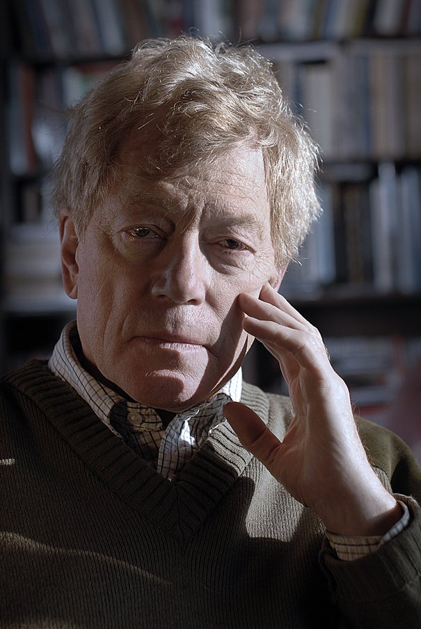
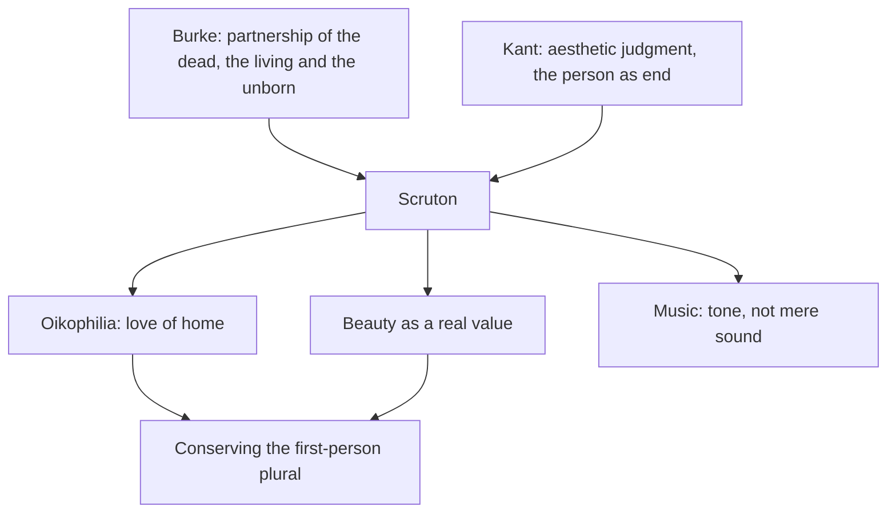

# Roger Scruton

**Prerequisites:** [Conservatism, tradition and beauty](../11-conservatism-and-beauty.md); helpful: [Immanuel Kant](../../early-modern/thinkers/immanuel-kant.md)

*Roger Scruton. Credit: Pete Helme. License: [CC BY-SA 3.0](https://creativecommons.org/licenses/by-sa/3.0). Source: [File:Roger Scruton by Pete Helme.jpg](https://commons.wikimedia.org/wiki/File:Roger_Scruton_by_Pete_Helme.jpg).*

## Life and context

Roger Vernon Scruton (1944–2020) was born on 27 February 1944 in Buslingthorpe, Lincolnshire, and raised in Buckinghamshire. He read moral sciences (philosophy) at Jesus College, Cambridge. A visit to Paris during the student protests of May 1968, which he later described as a turning point, pushed him toward [conservatism](../../../../glossary/modern/conservatism.md): he came to think that the civilisation being attacked was more fragile, and more valuable, than the protesters assumed.

He taught philosophy at Birkbeck College, London, from the early 1970s and became Professor of Aesthetics there, leaving full-time academic life in the early 1990s for writing, farming in Wiltshire, and public argument. His first major books were in aesthetics: *Art and Imagination* (1974) and *The Aesthetics of Architecture* (1979). *The Meaning of Conservatism* (1980) made him a prominent, and in the universities often unpopular, conservative thinker. In 1982 he founded the *Salisbury Review*. Through the Jan Hus Educational Foundation he helped run underground seminars in communist Czechoslovakia; he was detained and expelled from the country, and later honoured by the Czech Republic.

He wrote widely on Kant, Spinoza, sexual desire, the environment, the Church of England, wine, hunting and opera, and published novels and two opera libretti. He was knighted in 2016. In 2019 he briefly chaired a British government commission on beauty in the built environment; he was dismissed after a *New Statesman* interview whose edited quotations the magazine later apologised for, and was then reinstated for the remainder of the term. He died of cancer on 12 January 2020.

## Core ideas

**Conservatism as inheritance.** For Scruton, conservatism is not a market manifesto and not mere nostalgia. It is the attempt to conserve the institutions, manners and places that make first-person plural life — a "we" — possible: family, civil association, law, nation, the countryside. He often invoked Edmund Burke's idea of society as a partnership between the living, the dead and the yet unborn. The motive he named **[oikophilia](../../../../glossary/modern/oikophilia.md)**, love of home; its educated opposite he called **[oikophobia](../../../../glossary/modern/oikophobia.md)**, the impulse to denigrate one's own inheritance. [*How to Be a Conservative*](../texts/how-to-be-a-conservative.md) (2014) is the most accessible statement, organised as a search for the truth in rival modern "isms" as well as in conservatism itself.

**Beauty as a real value.** In [*Beauty*](../texts/beauty.md) (2009) and earlier aesthetic writings, he argued that beauty is not a private liking but a value we can be right or wrong about. Judgments of beauty, following [Kant](../../early-modern/thinkers/immanuel-kant.md)'s *Critique of Judgment*, are not deductions from concepts, yet they claim a kind of agreement: we point and say "look", and expect others to see what we see. Beauty, in nature, buildings and art, orients us, dignifies ordinary life, and helps us feel at home. Its flight — kitsch, mere shock, disposable architecture — is, for him, a moral as well as an aesthetic loss. The argument is a cousin of [C. S. Lewis](c-s-lewis.md)'s defence of objective value in [*The Abolition of Man*](../texts/the-abolition-of-man.md).

**Music.** [*The Aesthetics of Music*](../texts/the-aesthetics-of-music.md) (1997) is his most substantial technical book. He distinguishes physical sound from musical tone, and argues that we hear music by a rationally constrained kind of metaphorical hearing: movement, space, tension and expression in a "tonal space". He defends the tonal tradition as the setting in which that understanding is most at home, and is sharply critical of some modernist and popular music.

**Kant and the human person.** His Kant books, including *Kant: A Very Short Introduction* (2001), present Kant as a thinker of the limits of knowledge and of the person as an end. *Sexual Desire* (1986) and *On Human Nature* (2017) extend a view of persons as embodied, accountable beings, not just biological machines or free-floating wills.

## Influence and criticism

Scruton gave late-twentieth-century English conservatism a philosophical vocabulary that goes beyond policy: home, beauty, the sacred in the everyday, the limits of the market and of the state. He influenced architects, conservative journalists and some environmentalists (his "green" conservatism starts from love of a particular place, not only from global calculation). Philosophers of music and of architecture still argue with *The Aesthetics of Music* and *The Aesthetics of Architecture*.

Critics charge that his conservatism can excuse unjust inheritances of class, sex and empire; that "oikophobia" is too easily used to dismiss legitimate criticism of one's country; and that his judgments on popular culture, Islam and sexual ethics are harsh or ill-informed. The 2019 interview affair showed both how readily his reputation could be weaponised and how fierce the disagreements around him already were. He should be read as a serious aesthetician and political philosopher, not only as a combatant in the culture wars.

## Key ideas

- Conservatism, for Scruton, is the conservation of the home, institutions and "we" we inherit, motivated by oikophilia rather than by a mere market programme.
- Beauty is a real value, akin to Kantian aesthetic judgment, that helps us settle in the world; its loss is not a trivial matter of taste.
- His major technical work is a philosophy of music as tone and metaphorical hearing, in defence of the tonal tradition.
- He remains admired and disputed; the arguments about beauty and home can be assessed apart from the surrounding polemics.

## Where this leads

- Lesson: [Conservatism, tradition and beauty](../11-conservatism-and-beauty.md)
- Texts: [*How to Be a Conservative*](../texts/how-to-be-a-conservative.md), [*Beauty*](../texts/beauty.md), [*The Aesthetics of Music*](../texts/the-aesthetics-of-music.md)
- Back: [Kant](../../early-modern/thinkers/immanuel-kant.md), [C. S. Lewis](c-s-lewis.md), [political philosophy after catastrophe](../07-political-philosophy-after-catastrophe.md)
- Glossary: [conservatism](../../../../glossary/modern/conservatism.md), [oikophilia](../../../../glossary/modern/oikophilia.md), [oikophobia](../../../../glossary/modern/oikophobia.md), [aesthetics](../../../../glossary/general/aesthetics.md)
