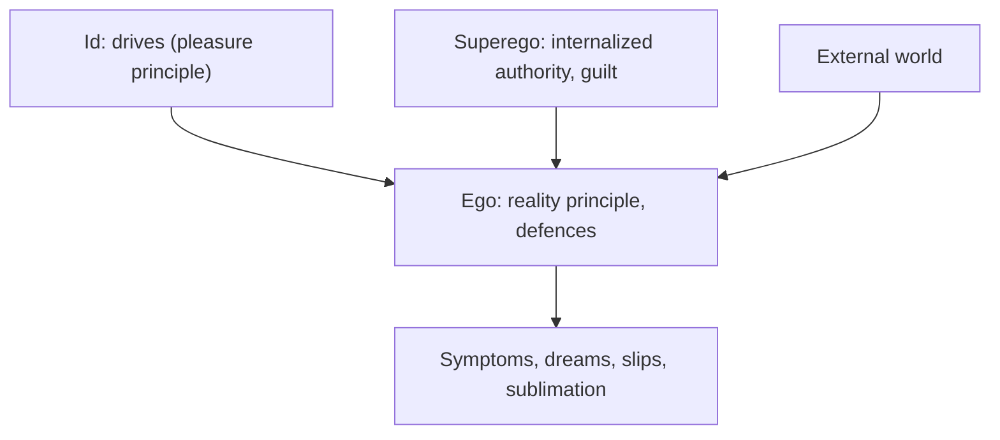

# Sigmund Freud

**Prerequisites:** [Psychoanalysis and depth psychology](../05-psychoanalysis-and-depth-psychology.md)

*Freud was a physician and the founder of psychoanalysis, not a philosopher. He is included because his theory of the unconscious reshaped philosophy, ethics, religion and cultural criticism.*

@@IMG@@

## Life and context

Sigmund Freud (1856–1939) was born in Freiberg, Moravia (now Příbor, Czech Republic), to a Jewish family that moved to Vienna when he was four. He studied medicine at the University of Vienna, did research in neuroanatomy, and in 1885–86 studied in Paris with the neurologist Jean-Martin Charcot, who used hypnosis on hysterical patients. With Josef Breuer he published *Studies on Hysteria* (1895), including the case of "Anna O.", who called the treatment "the talking cure". After his father's death in 1896 he undertook a self-analysis that led to [*The Interpretation of Dreams*](../texts/the-interpretation-of-dreams.md) (dated 1900). A circle formed around him in Vienna, later the International Psychoanalytical Association; Jung, Adler and others joined and several broke away. He developed cancer of the jaw in 1923 and underwent over thirty operations. When Nazi Germany annexed Austria in 1938, his books having been burned in Germany in 1933, he emigrated with his daughter Anna to London with help from Marie Bonaparte and others; four of his sisters later died in the Holocaust. He died in London in September 1939.

## Core ideas

- **The dynamic unconscious.** Mental processes can be active, meaningful and inaccessible to consciousness; repressed wishes return as symptoms, dreams and slips (*The Psychopathology of Everyday Life*, 1901).
- **Dreams** are the disguised fulfilment of repressed wishes, transformed by condensation, displacement and symbolization. The dream is "the royal road to a knowledge of the unconscious".
- **Sexuality** is broader than genital sexuality and begins in infancy (*Three Essays on the Theory of Sexuality*, 1905); development passes through oral, anal and phallic phases; the **Oedipus complex** is central.
- **Transference.** In therapy, patients transfer feelings from early relationships onto the analyst, which becomes a means of treatment.
- **The structural model** (1923): id, ego, superego.
- **Drives.** Eros and the death drive (*Beyond the Pleasure Principle*, 1920).
- **Culture and religion.** *Totem and Taboo* (1913) speculates that civilization began with the murder of a primal father; *The Future of an Illusion* (1927) treats religion as wish-fulfilment; [*Civilization and Its Discontents*](../texts/civilization-and-its-discontents.md) (1930) analyses the conflict between instinct and civilization; *Moses and Monotheism* (1939) offers a controversial theory of the origins of Judaism.

## Influence and criticism

Freud's vocabulary (unconscious, repression, ego, denial, projection, Freudian slip) entered everyday language. He influenced literature, art (surrealism), film, philosophy (the Frankfurt School, Ricœur, Lacan, Sartre's "existential psychoanalysis") and psychotherapy. Philosophers have debated whether psychoanalysis is a science or a hermeneutics of meaning. [Popper](karl-popper.md) called it unfalsifiable; Adolf Grünbaum and Frederick Crews criticized its evidence base; feminists criticized his account of female sexuality ("penis envy"), though some (Juliet Mitchell) reclaimed him as an analyst of patriarchy. [Girard](rene-girard.md) argued that the Oedipus complex mistakes mimetic rivalry for innate desire.

## Key ideas

- Much mental life is unconscious, and repressed wishes return in disguised forms.
- Childhood sexuality and the Oedipus complex shape personality.
- The mind is divided into id, ego and superego; civilization demands instinctual renunciation and produces guilt.
- His influence is immense; his scientific status remains contested.

## Where this leads

- Texts: [*The Interpretation of Dreams*](../texts/the-interpretation-of-dreams.md), [*Civilization and Its Discontents*](../texts/civilization-and-its-discontents.md)
- Next thinker: [Carl Jung](carl-jung.md)
- Back: [Schopenhauer](../../nineteenth-century/thinkers/arthur-schopenhauer.md), [Nietzsche](../../nineteenth-century/thinkers/friedrich-nietzsche.md)
- Glossary: [unconscious](../../../../glossary/modern/unconscious.md), [repression](../../../../glossary/modern/repression.md), [psychoanalysis](../../../../glossary/modern/psychoanalysis.md)
