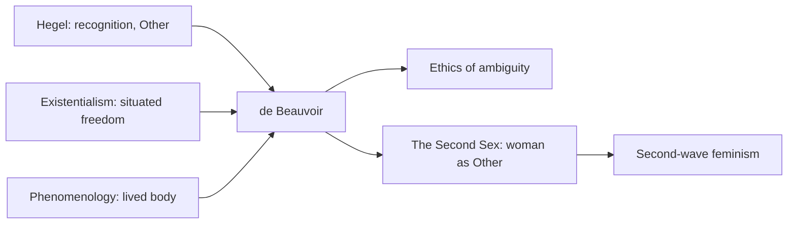

# Simone de Beauvoir

**Prerequisites:** [[existentialism|Existentialism]]; helpful: [[phenomenology-of-spirit|Hegel's master–slave dialectic]]

@@IMG@@

## Life and context

Simone de Beauvoir (1908–1986) was born in Paris into a bourgeois Catholic family whose fortunes declined after the First World War. A devout child, she lost her faith as a teenager. She studied philosophy at the Sorbonne and in 1929 placed second in the national *agrégation* examination, behind [[jean-paul-sartre|Sartre]] (some examiners reportedly debated giving her first place); at 21 she was the youngest person to pass it. She and Sartre formed a lifelong intellectual and personal partnership without marriage or exclusivity. She taught in lycées until 1943 and published her first novel, *She Came to Stay*, that year. Her philosophical essays *Pyrrhus and Cineas* (1944) and *The Ethics of Ambiguity* (1947) developed an existentialist ethics. [[the-second-sex|*The Second Sex*]] (1949) became a foundational text of modern feminism; the Vatican placed it on the Index of Forbidden Books. Her novel *The Mandarins* (1954) won the Prix Goncourt. She wrote a multi-volume autobiography, travel books on America and China, *A Very Easy Death* (1964) on her mother's death, and *Old Age* (1970). She signed the 1971 "Manifesto of the 343" women who declared they had had abortions, and was active in the French women's movement. She died in Paris in 1986 and is buried beside Sartre in Montparnasse cemetery.

## Core ideas

**Ambiguity.** Human beings are both free subjects and objects in the world, both individuals and members of a collective, both mortal bodies and projects. Ethics must accept this ambiguity rather than flee it into the "serious" (treating values as given things) or into nihilism.

**Freedom and others.** My freedom can only be fulfilled through the freedom of others: "to will oneself free is also to will others free". Oppression is wrong because it shuts others' freedom inside a "facticity" they did not choose.

**Woman as Other.** In *The Second Sex*, she asked "What is a woman?" and argued that in patriarchal cultures man is the Subject, the Absolute, and woman is defined as the Other, relative to him. This is not the result of biology, psychoanalysis or economics alone, but of a historical situation that women have been made to internalize.

**Becoming a woman.** "One is not born, but rather becomes, a woman" opens Volume II. Femininity is a situation and a set of expectations lived through upbringing, marriage, motherhood and social roles, not a fixed essence. (Later theorists would separate "sex" and "gender" more sharply than she did.)

**Old age and death.** She extended the analysis of "otherness" to the elderly, who are also made into objects by society.

## Influence and criticism

*The Second Sex* shaped second-wave feminism (Betty Friedan, Kate Millett) and gender theory (Judith Butler). For decades de Beauvoir was treated as Sartre's follower; scholars such as Margaret Simons and Kate and Edward Fullbrook have argued that she influenced key ideas of *Being and Nothingness*. Critics have found *The Second Sex* too negative about the female body and motherhood, too centred on middle-class Western women, or insufficiently attentive to race and class. Her conduct in some relationships with young women, including former students, has also been examined critically.

## Key ideas

- Human existence is ambiguous: free yet embodied and situated.
- My freedom requires willing the freedom of others; oppression denies it.
- Woman has been constructed as the Other of man; "one is not born, but rather becomes, a woman".
- She was a major philosopher in her own right and a founder of modern feminism.

## Where this leads

- Text: [[the-second-sex|*The Second Sex*]]
- Next thinker: [[hannah-arendt|Hannah Arendt]]
- Glossary: [[g:the-other|the Other]]
