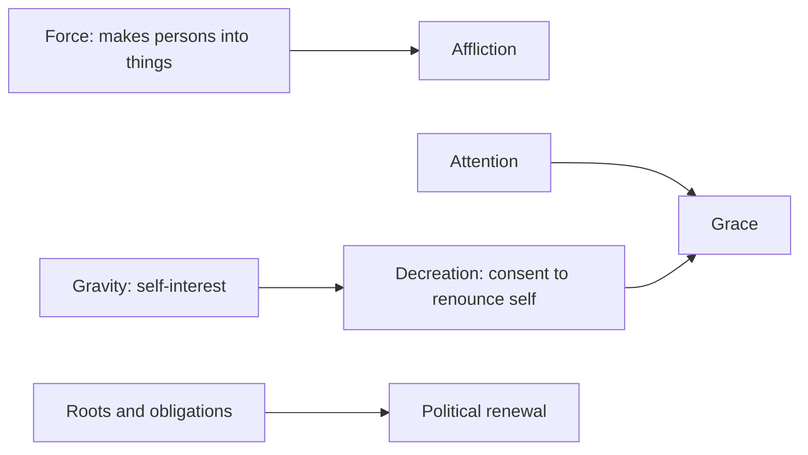

# Simone Weil

**Prerequisites:** [Political philosophy after catastrophe](../07-political-philosophy-after-catastrophe.md); helpful: [Plato](../../../ancient/greek/thinkers/plato.md)

@@IMG@@

## Life and context

Simone Weil (1909–1943) was born in Paris into a secular, prosperous Jewish family; her brother André became one of the century's great mathematicians. She studied with the philosopher Alain and at the École Normale Supérieure, where she was nicknamed "the Red Virgin" for her politics. As a lycée teacher she joined workers' demonstrations and gave much of her salary to the unemployed. In 1934–35 she took leave to work as an unskilled factory worker at Alsthom and Renault, experiencing what she called the "affliction" (*malheur*) of degrading labour. In 1936 she joined an anarchist unit in the Spanish Civil War, was injured in a cooking accident and evacuated, and was disillusioned by atrocities on her own side. In 1937–38 she had a series of mystical experiences, including at Assisi and at the Benedictine abbey of Solesmes while reciting George Herbert's poem "Love (III)", after which she felt "Christ himself came down and took possession of me". She never accepted baptism, explaining her reasons in letters to the Dominican priest Joseph-Marie Perrin. Fleeing occupied France with her parents in 1942, she spent time in Marseille, where she worked on a farm for the Catholic writer Gustave Thibon, and then New York, before going to London to work for the Free French. Ill with tuberculosis and eating very little (she refused more food than French civilians under occupation were allowed), she died at a sanatorium in Ashford, Kent, in August 1943, aged 34. Almost all her major works were published posthumously.

## Core ideas

**Force.** "The Iliad, or the Poem of Force" (1940): force turns a person into a thing, literally a corpse, or in life a being reduced to obedience; it intoxicates and destroys the strong too. The *Iliad*'s greatness lies in its equal bitterness toward all who suffer.

**Affliction (*malheur*).** More than suffering: physical pain, social degradation and distress of soul combined, which marks a person as if with a slave's brand. It is the place where the absence of God is felt most and, paradoxically, where love can reach.

**Attention.** Attention is the rarest and purest form of generosity. Even school exercises, rightly done, train the capacity for attention that prayer and love of neighbour need ("Reflections on the Right Use of School Studies with a View to the Love of God").

**Gravity and grace.** The soul is subject to a moral "gravity" pulling it toward self-interest and force; only grace, which comes from outside, lifts it. See [*Gravity and Grace*](../texts/gravity-and-grace.md).

**Decreation.** We must consent to "undo the creature in us", renouncing the self that claims to be the centre of the world, so that God can love through us.

**Roots and obligations.** In *The Need for Roots* (1943), written for the Free French, she argued that obligations are prior to rights, listed "needs of the soul" (order, liberty, obedience, responsibility, equality, hierarchy, honour, punishment, freedom of opinion, security, risk, private and collective property, truth), and diagnosed uprootedness as the sickness of modern societies, caused by conquest, money and modern industrial work.

## Influence and criticism

Camus called her "the only great spirit of our times" and edited her works for Gallimard; T. S. Eliot introduced the English translation of *The Need for Roots*; Iris Murdoch built her moral philosophy of attention partly on Weil; Charles de Gaulle reportedly thought her mad. Critics note her harsh judgments of the Hebrew Bible and Judaism, which she rejected while drawing on Plato, Christianity and Hindu texts; her ascetic self-denial, which some see as pathological; and the impracticality of some political proposals (she wanted all political parties abolished). Admirers see in her an unmatched moral seriousness.

## Key ideas

- Force reduces human beings to things; the *Iliad* shows it impartially.
- Affliction, attention and grace are central to her religious philosophy.
- Decreation means consenting to renounce the self's claim to be the centre.
- Uprootedness is modernity's disease; obligations precede rights.

## Where this leads

- Text: [*Gravity and Grace*](../texts/gravity-and-grace.md)
- Next thinker: [Karl Popper](karl-popper.md)
- Back: [Plato](../../../ancient/greek/thinkers/plato.md); [Tolstoy on non-violence](../../nineteenth-century/texts/the-kingdom-of-god-is-within-you.md)
- Glossary: [attention](../../../../glossary/modern/attention.md), [decreation](../../../../glossary/modern/decreation.md)
