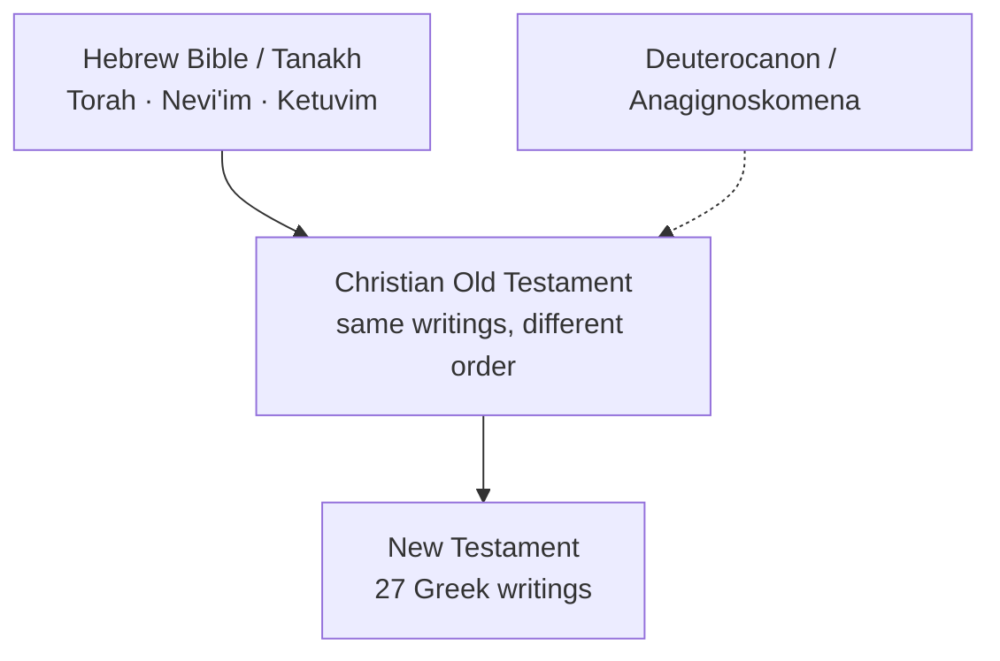

# What the Bible is

**Prerequisites:** [The Bible](README.md)
**Key ideas:** a library of books; "Bible" names different collections in different communities; scripture as writing that a community reads as authoritative; story, law, song, and letter bound together.

*Gutenberg Bible on display at the New York Public Library Credit: Joshua Keller. License: [CC BY 2.0](https://creativecommons.org/licenses/by/2.0). Source: [File:Gutenberg Bible, New York Public Library, USA. Pic 01.jpg](https://commons.wikimedia.org/wiki/File:Gutenberg_Bible,_New_York_Public_Library,_USA._Pic_01.jpg).*
The English word "Bible" comes from Greek *ta biblia*, "the books." That plural is the first thing to notice. What people hold as one volume is a small library: in a typical Protestant edition, sixty-six books; in a Catholic edition, more; in an Ethiopic Orthodox edition, more still. The books do not all sound alike. Genesis is not Psalms, and Psalms is not Romans.

To call this library **scripture** is to say more than "old literature." It is to say that some community takes these writings as uniquely binding or revealing — as a standard (*kanon*, a measuring rod) for worship, belief, and life. Different communities draw the line in different places, which is why the next lesson is about [canon](02-canon-and-hebrew-bible-vs-old-testament.md). The same physical stories can be scripture in one community and not, or not in the same way, in another.

## One volume, many voices

Even inside a single community's canon, the books disagree in emphasis and sometimes in detail. There are two creation accounts at the start of Genesis. Kings and Chronicles tell overlapping royal history with different tones. The four Gospels narrate Jesus with different structures and theologies. Traditional readers often harmonize these (they must fit, because they share a divine author). Scholarly readers often let the tensions stand (they are evidence of multiple traditions and purposes). You will get further, as a student, if you can do a third thing: *hear* the tension first, before deciding what to do with it.

The library was not written in the order you now read it, and it was not written to be a single "book" in the modern sense. Scrolls were separate. "Binding it as one book" is a later technology and a later idea. The unity that believers claim for it — one God, one large story from creation to new creation — is a reading, and a powerful one, but it is a reading of many documents.

## A story with a shape (and a frame)

In the Christian arrangement, a large narrative can be sketched: God creates a good world; human beings fracture their relationship with God and one another; God calls a people (Israel) through covenant; that people is given law, land, kingship, and prophets; they suffer exile; some return; in the New Testament, Jesus is announced as the turning point of that story, and communities form to live in what they take to be its fulfillment, awaiting a final renewal.

That sketch is already Christian in shape. The Hebrew Bible's own arrangement ends not with prophets pointing forward into a Gospel, but with Writings, and in the traditional Jewish order the narrative energy of the end is more about return and the rebuilding of life under Torah (Chronicles, in the common Tanakh order, closes with Cyrus's permission to go up and build). Same many books; different spine.

None of this tells you, yet, whether the events "happened as written." That is a separate question, and it does not have one answer for every book. Jonah is not doing the same kind of work as a list of kings, and a Gospel is not doing the same kind of work as a proverb. Foundations first: what kind of collection this is. Then genres, then stories.

## Where this leads

- Next: [Canon, and the Hebrew Bible versus the Christian Old Testament](02-canon-and-hebrew-bible-vs-old-testament.md)
- Then: [languages, dating, and composition](03-languages-dating-and-composition.md)
