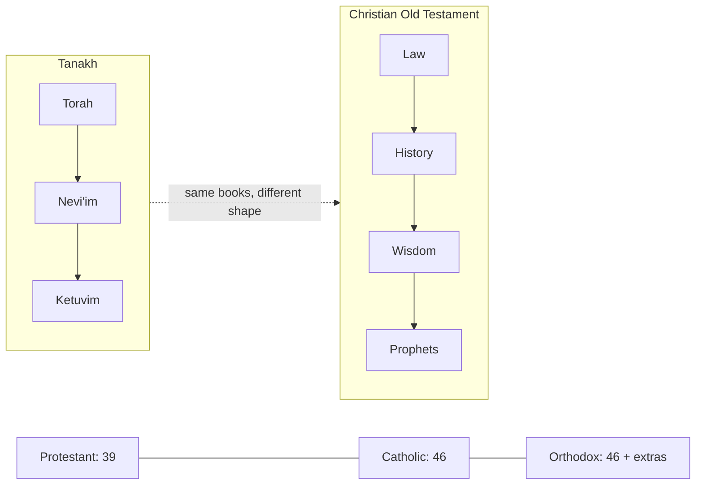

# Canon, and the Hebrew Bible versus the Christian Old Testament

**Prerequisites:** [What the Bible is](01-what-the-bible-is.md)
**Key ideas:** a canon is a list a community treats as scripture; the Tanakh and the Protestant Old Testament contain the same books in a different order and frame; Catholic and Orthodox canons include additional books; "Old Testament" is already a Christian name.

A **canon** is not just "the table of contents." It is a decision, usually gradual, about which writings count as the rule of a community's faith. Nobody in 800 BCE was carrying "the Bible." Books were written, used, copied, sometimes lost, sometimes disputed, and only later closed into a list.

## The Hebrew Bible (Tanakh)

Jewish scripture is commonly called the **Tanakh**, an acronym of its three parts:

- **Torah** ("instruction" or "law"): Genesis, Exodus, Leviticus, Numbers, Deuteronomy — also called the Pentateuch, the "five books."
- **Nevi'im** ("prophets"): the Former Prophets (Joshua, Judges, Samuel, Kings) and the Latter Prophets (Isaiah, Jeremiah, Ezekiel, and the Twelve shorter books).
- **Ketuvim** ("writings"): a mixed collection including Psalms, Proverbs, Job, the five Megillot (Song of Songs, Ruth, Lamentations, Ecclesiastes, Esther), Daniel, Ezra–Nehemiah, and Chronicles.

The Torah stands first in authority in Jewish life. The order of the whole tells a story that does not need a New Testament to complete it. In this arrangement, Daniel is among the Writings, not among the Prophets — a classification that already differs from Christian Bibles.

When the biblical books were translated into Greek (the **Septuagint**, begun in the third century BCE for Greek-speaking Jews, especially in Alexandria), some collections included additional works and a different order. That Greek library became the Old Testament of many early Christians.

## The Christian Old Testament

Christians inherited Israel's scriptures and reread them as pointing to Christ. They also renamed them the **Old Testament**, pairing them with a **New Testament**. The name is theological: it implies old and new covenants.

**Protestant** Old Testaments eventually settled on the same books as the Tanakh, but in a different order, closer to the Septuagint's narrative-then-poetry-then-prophets shape, and ending with Malachi (so that the next page, in a bound Christian Bible, is Matthew). **Catholic** and **Orthodox** Old Testaments include additional books often called **deuterocanonical** (by Catholics) or simply canonical (by Orthodox), and called **Apocrypha** by many Protestants: such as Tobit, Judith, Wisdom of Solomon, Sirach, Baruch, and 1–2 Maccabees, with Orthodox lists a little wider still (for example 3 Maccabees, Psalm 151, in some churches).

These extra books are not a footnote if you want to understand Christian history. They were widely read in the early church. The Reformation's choice to follow the Hebrew list for the Old Testament was itself a decision about canon.

## New Testament canon

The New Testament's twenty-seven books (four Gospels, Acts, letters, Revelation) were not voted into place on a single afternoon in the first century. Gospels and Paul's letters circulated early; other writings (Hebrews, James, Revelation, 2 Peter, some short letters) were disputed longer. By the late fourth century, the twenty-seven-book list was widely established in the Greek and Latin churches, though usage and local variation had a long tail. Other early Christian writings (the *Didache*, *Shepherd of Hermas*, the Gospel of Thomas) were influential in some circles and did not land inside this canon.

Traditional accounts often emphasize apostolic origin and divine guidance in the process. Historical accounts emphasize use in worship, perceived consistency with a rule of faith, and the church's slow sorting. Both describe the same centuries; they differ on what finally explains the outcome.

The practical lesson is simple: when someone says "the Bible says," ask *which Bible*, and remember that order and inclusion already steer interpretation.

## Where this leads

- Next: [Languages, dating, and composition](03-languages-dating-and-composition.md)
- For how this framing shows up in narrative sequence, see [Old Testament](old-testament/README.md) and [New Testament](new-testament/README.md)
