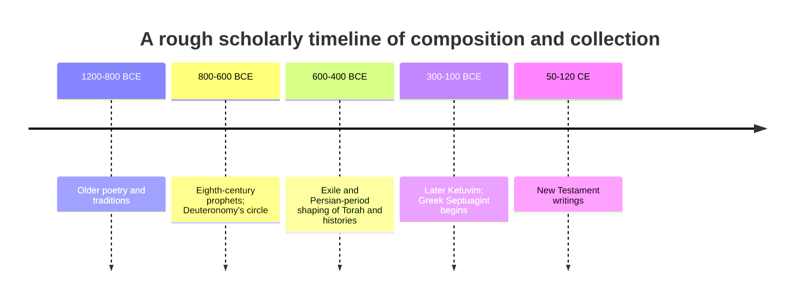

# Languages, dating, and composition

**Prerequisites:** [Canon](02-canon-and-hebrew-bible-vs-old-testament.md)
**Key ideas:** Hebrew, Aramaic, and Greek as the biblical languages; translation is already interpretation; books often grew over time; traditional authorship and historical-critical models often diverge.

## Languages

Most of the Hebrew Bible is written in **Hebrew**. A few sections (parts of Daniel and Ezra, a verse in Jeremiah, and a phrase here and there) are in **Aramaic**, a related Semitic language that became a common tongue of the Near East and, by Jesus' time, the everyday speech of many Jews in Palestine.

The New Testament is written in **Greek** — not the archaic Greek of Homer, but the common (*koine*) Greek of the Hellenistic and Roman east. That fact already places the early churches in the world after Alexander, the same broad world as the [Hellenistic philosophical schools](../../../../philosophy/history/ancient/greek/06-hellenistic-schools.md). Jesus himself, most scholars hold, taught mainly in Aramaic; the Gospels are already translations, in that sense, even in their "original" Greek.

Before the New Testament existed, many Jews and then almost all Greek-speaking Christians knew Israel's scriptures through the **Septuagint**. New Testament writers often quote that Greek, not a Hebrew text identical to the later Masoretic tradition. When a citation in Matthew or Hebrews does not quite match a modern Old Testament, translation history is often the reason.

To read the Bible in English is to stand at one more remove. Good translations disagree because Hebrew and Greek syntax, idioms, and theological words (*hesed*, *ruach*, *logos*, *dikaiosyne*) do not have perfect one-word equivalents. Comparing two translations of a difficult verse is already a form of study.

## Dating and composition

Traditional Jewish and Christian teaching has often assigned books to named authors and early dates: Moses wrote the Torah; David wrote many Psalms; Solomon wrote Proverbs, Ecclesiastes, and the Song; the prophets wrote their own books; Matthew, Mark, Luke, and John wrote the Gospels that bear their names; Paul wrote the letters under his name.

Historical-critical scholarship, developing especially since the eighteenth and nineteenth centuries, typically argues that many books are **composite** and that authorship is often **traditional rather than literal**. The most famous model for the Torah is the **documentary hypothesis** (classically, sources labeled J, E, D, and P, woven together over centuries, with a major edition after or during the exile). That model has been revised, challenged, and reformulated, but the underlying observation is widely held in academic biblical studies: the Pentateuch shows different vocabularies, different divine names, and doublets (two flood stories braided together, two creation accounts) that suggest a long compositional history. Conservative and traditional scholars dispute the extent of this, and some argue for substantial Mosaic origins with later editorial updating.

Similar debates attach to Isaiah (one prophet or a book that grew across more than a century), Daniel (sixth century BCE setting versus a second-century BCE composition for much of the book, in the scholarly majority view), and the New Testament (see [the four Gospels](new-testament/02-the-four-gospels.md) and [Paul](new-testament/05-pauls-letters.md)). Dates, when scholars offer them, are often ranges, built from language, historical references, and how books seem to know one another.

None of this settles the religious question of inspiration. It does settle a study habit: a biblical "book" may be a layered work, and a heading "Isaiah" may name a scroll with a history, not only a single man with a pen.

## Oral tradition and memory

Behind writing there is often speech. Stories of ancestors, legal customs, prophetic oracles, and Jesus' sayings likely circulated orally before they were fixed. Oral tradition can be conservative (carefully remembered) and fluid (adapted to new situations) at the same time. This matters for how one thinks about "the original" of a story such as the Flood or a parable. Sometimes the honest object of study is a tradition, not a single first draft.

## Where this leads

- Next: [Genres](04-genres.md)
- These issues return in almost every narrative lesson, especially [creation](old-testament/01-creation-and-eden.md) and [the Gospels](new-testament/02-the-four-gospels.md)
