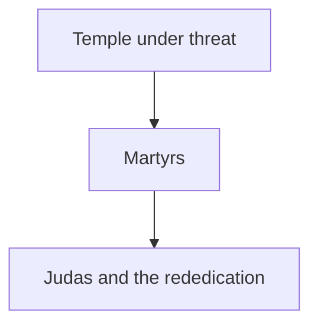

# 2 Maccabees

**Name and meaning.** Not a sequel to 1 Maccabees but a parallel, more theological telling of a shorter span (from Onias III to Judas's victory over Nicanor), presented as an epitome of a five-volume work by Jason of Cyrene. It is the great deuterocanonical book of martyrdom, resurrection, and temple theology, and it includes the most important early texts about prayer for the dead in the Christian Old Testament.

**Prerequisites:** [1 Maccabees](1-maccabees.md) and [deuterocanon](README.md).

## Dating and authorship

The epitomist writes in Greek, probably in the late second century BCE, using Jason's lost history. Two letters at the beginning, urging Egyptian Jews to keep the festival of the temple's purification, may have been attached later. The tone is rhetorical, emotional, and explicitly theological, with speeches and miracle stories that 1 Maccabees would not have told in this way.

## Context

The same Antiochan crisis, told not as a Hasmonean dynastic history but as a drama of the temple, of pious sufferers, and of a God who defends his place and raises the dead. The book opens with a story of Heliodorus, who tries to plunder the temple treasury and is struck down, and it climaxes in the deaths of Eleazar and of a mother and her seven sons, and in Judas's later campaigns.

## Outline

- **1–2.** Festal letters; the author's preface about the labor of epitome.
- **3–4.** Heliodorus; the corruption and hellenizing of the high priesthood (Jason, then Menelaus).
- **5–7.** The persecution; Eleazar the scribe; the mother and seven sons, with explicit confession of resurrection.
- **8–10.** Judas's early victories; the temple's purification; the institution of the eight-day festival.
- **11–15.** Further wars; a story of Judas's collection for a sin offering on behalf of fallen soldiers (12:38–45); the defeat and death of Nicanor; a closing word from the epitomist.

## Key passages and ideas

Chapter 7 is the theological center for later Jewish and Christian martyrdom literature: the sons and their mother refuse the king's command, confess God as creator who will "give life and breath back" to them, and die. 12:44–45, Judas's provision for a sin offering for the dead, became a load-bearing text in later Catholic teaching on prayer for the dead and on purgatory, and a disputed text in Reformation debate. A first-principles reading should state what the book itself claims (that it was "a holy and pious thought" to pray for the fallen, who had concealed pagan amulets) and then note, fairly, how later doctrines used it, and why Protestants often did not accept the book as a doctrinal source.

The letters and the temple-defense stories make 2 Maccabees a festival book as well as a war book. Hanukkah here is "the purification of the temple," with a second festival (Nicanor's Day) that later faded.

## Themes and reception

Themes include martyrdom, resurrection, creation, temple, and a more miraculous historiography. The book is scripture in Catholic and Orthodox canons. [Hebrews](../new-testament/books/general-epistles/hebrews.md) 11:35, the ones "tortured, refusing to accept release, in order to obtain a better resurrection," almost certainly looks toward this tradition. 4 Maccabees will later rewrite the same martyrdoms as a philosophical treatise. Read 1 and 2 Maccabees together: one is closer to a chronicle, the other to a theological oration.

The author's preface, which compares the work of epitome to a host arranging a banquet, is a rare and charming first-person moment in biblical historical writing. It also warns the reader that this is a shaped, shortened, rhetorical work, not a naive archive.

## Where this leads

- Next (Orthodox extras begin): [1 Esdras](1-esdras.md)
- Glossary: [resurrection](../glossary/resurrection.md), [martyrdom](../glossary/martyrdom.md), [Hanukkah](../glossary/hanukkah.md), [purgatory](../glossary/purgatory.md)
