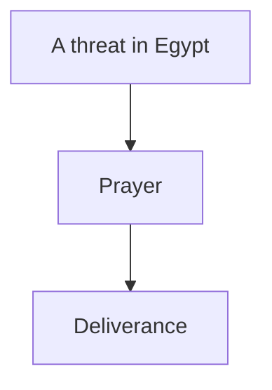

# 3 Maccabees

**Name and meaning.** A Greek narrative, misleadingly titled, that is not about the Maccabees at all. It tells of a persecution of Jews in Ptolemaic Egypt under Ptolemy IV Philopator (late third century BCE, in the story), of a failed attempt to have them trampled by drunken elephants in the hippodrome of Alexandria, and of a deliverance and a festival. The book is in most Eastern Orthodox canons and in the Protestant Apocrypha; it is not in the Catholic deuterocanon.

**Prerequisites:** [1 Maccabees](1-maccabees.md), [2 Maccabees](2-maccabees.md) (for comparison of festival-and-deliverance tales), and [deuterocanon](README.md). Helpful: [Esther](../old-testament/books/history/esther.md).

## Dating and authorship

Anonymous, written in Greek, commonly dated in the first century BCE or the first century CE, perhaps in Alexandria, using a story that may have older roots. The historical Ptolemy IV did fight at Raphia (217 BCE) and did deal with Egypt's temples; the elephant episode is not confirmed in external sources and is usually read as a festival legend, possibly related to a tale also known, in another form, to Josephus. Traditional Orthodox use receives the book as scripture. Critical study treats it as historical fiction or as a legendary charter for a festival.

## Context

The plot begins at Jerusalem, where the victorious Ptolemy insists on entering the holy of holies and is supernaturally stopped, then shifts to Egypt, where he turns on the Jewish population, trying to enroll them in a Dionysiac registration or to destroy those who refuse. The hippodrome, the elephants, an angelic intervention, and the king's sudden change of heart form the climax. A festival is instituted, and the king provides the feast. The book is therefore a diaspora counterpart to Esther and to 2 Maccabees: a story of near-destruction and a memorial meal.

## Outline

- **1–2.** The Raphia aftermath; the attempt on the Jerusalem temple; the high priest Simon's prayer; the king struck down.
- **3–5.** The decree against the Jews in Egypt; the gathering in the hippodrome; delays in the execution (including a royal sleep and a forgetfulness); the preparation of the elephants.
- **6–7.** The priest Eleazar's prayer; two angels appear; the elephants turn on the king's troops; the king repents; a festival is established; a royal letter of protection; the Jews' settled life in the land.

## Key passages and ideas

The prayers of Simon and of Eleazar are the theological centers, rehearsing God's past deliverances. The elephant episode is unforgettable and almost grotesque, which is part of its festival energy. The book is also interested in civic status: who is a loyal subject, what registration means, and how a minority keeps its law in a Greek city. That social question, more than the zoology, is why historians of diaspora Judaism still read it.

Comparison with 2 Maccabees (another festival book with a persecuting king and a heavenly intervention) and with Esther (another reversal and feast) is the right method. 3 Maccabees is more ornate in its Greek and more Egyptian in its setting. The "Maccabee" title is a later grouping, not a claim about Judas and his brothers.

## Themes and reception

Themes include temple sanctity, diaspora danger, festival memory, and a king who can be stopped and changed. The Orthodox canon keeps the book; Western canons generally do not, except in Apocrypha appendices. It is one of the clearer proofs that "the deuterocanon" is not a single identical list even among churches that go beyond the Hebrew Bible.

Read it as Egyptian Jewish literature, not as a footnote to the Hasmoneans, and it becomes useful: a window on how a community told its own survival in the language of prayer, royal letters, and a yearly table.

## Where this leads

- Next: [2 Esdras](2-esdras.md)
- Glossary: [diaspora](../glossary/diaspora.md), [Alexandria](../glossary/alexandria.md), [festival](../glossary/festival.md)
