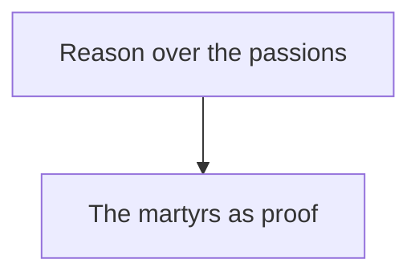

# 4 Maccabees

*Gutenberg Bible on display at the New York Public Library Credit: Joshua Keller. License: [CC BY 2.0](https://creativecommons.org/licenses/by/2.0). Source: [File:Gutenberg Bible, New York Public Library, USA. Pic 01.jpg](https://commons.wikimedia.org/wiki/File:Gutenberg_Bible,_New_York_Public_Library,_USA._Pic_01.jpg).*
**Name and meaning.** A Greek philosophical oration, sometimes titled "On the supremacy of pious reason," that retells the martyrdoms of Eleazar and of the mother and seven sons from [2 Maccabees](2-maccabees.md) as a demonstration that reason, trained by the Jewish law, can master the passions. It is included in some Orthodox Bibles or in an appendix, and in many scholarly editions of the Septuagint; it is not in the Catholic deuterocanon.

**Prerequisites:** [2 Maccabees](2-maccabees.md) 6–7 and [deuterocanon](README.md). Helpful: Greek [ethics](../../../../../philosophy/concepts/ethics/README.md), especially [virtue](../../../../../philosophy/concepts/ethics/virtue-and-arete.md) and [Stoic](../../../../../philosophy/history/ancient/greek/06-hellenistic-schools.md) discussion of the passions.

## Dating and authorship

Anonymous, written in a high rhetorical Greek, often dated in the first century CE (dates from the first century BCE to the early second century CE are argued), perhaps in Antioch or another Greek city with a Jewish community. The author is a learned Jew who can use Stoic and Platonic vocabulary without surrendering the law of Moses as the true training of reason. Traditional ascriptions to Josephus (in some manuscripts) are not accepted today.

## Context

The audience is imagined as able to follow a philosophical thesis and a martyr narrative at once. The book is, among other things, a synagogue or civic oration in written form, possibly connected with a commemoration of the martyrs. It shows how far some Hellenistic Jews were willing to go in translating their faith into the language of *arete*, *sophrosyne*, and the mastery of *pathos*, while still insisting on dietary law, monotheism, and the hope of the martyrs.

## Outline

- **1–3.** The philosophical thesis: pious reason masters the passions; definitions; examples from Joseph, Moses, David, and others; a short treatment of anger and of the "passions" of the soul.
- **4–7.** Historical setup (a version of the Seleucid crisis) and the long martyrdom of Eleazar, with speeches.
- **8–12.** The seven brothers, each given extended speeches of defiance and of hope, in a still more rhetorical key than 2 Maccabees.
- **13–18.** The mother's resolve and death; a eulogy of the martyrs; the author returns to the thesis; a closing address, in some forms, to Israel to obey the law.

## Key passages and ideas

The opening thesis is the book's claim to originality relative to 2 Maccabees: the same deaths now prove a philosophical point. Whether that improves or thins the earlier theology of resurrection is a fair question. 4 Maccabees still speaks of the martyrs' living with God and of the nation's purification by their death, language that later Christian martyrology and, some have argued, later atonement language could hear. The speeches are long on purpose: this is epideictic rhetoric, praise as argument.

The use of Joseph and of David as examples of self-control ties the oration back into the Hebrew narrative. The law is not a barrier to reason. It is reason's curriculum. That is a first-principles claim about Torah in a Greek city, and it belongs in conversation with [Sirach](sirach.md), [Wisdom of Solomon](wisdom-of-solomon.md), and, later, with Philo and with Paul (who would not have granted the same function to the law in the same way).

## Themes and reception

Themes include reason and the passions, Torah, martyrdom, and the translation of Jewish faith into philosophical terms. The book is a primary text for Hellenistic Judaism and for the history of martyrdom literature. Some Orthodox traditions keep it; most Western canons do not. Christian writers knew the story, whether from 2 or 4 Maccabees. Modern students of philosophy and of religion should not let the "Maccabee" title hide the fact that this is, in large part, an ethical treatise with a narrative proof.

Read it after 2 Maccabees and after a basic lesson in Stoic ethics, and the author's project becomes clear: to show that the people of the law already possess the virtue the schools praise, and that they have proved it in the body.

## Where this leads

- The deuterocanon folder ends here. Return to the [Bible](../README.md) path, or go on to the [New Testament](../new-testament/README.md)
- Glossary: [martyrdom](../glossary/terms/martyrdom.md), [reason](../../../../../philosophy/glossary/general/reason.md), passions, [Torah](../glossary/terms/torah.md)
