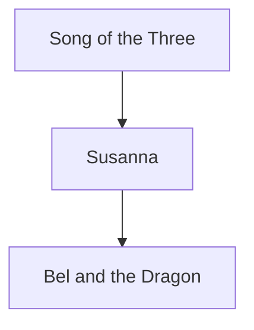

# Additions to Daniel

*Gutenberg Bible on display at the New York Public Library Credit: Joshua Keller. License: [CC BY 2.0](https://creativecommons.org/licenses/by/2.0). Source: [File:Gutenberg Bible, New York Public Library, USA. Pic 01.jpg](https://commons.wikimedia.org/wiki/File:Gutenberg_Bible,_New_York_Public_Library,_USA._Pic_01.jpg).*
**Name and meaning.** Three Greek additions to the book of [Daniel](../old-testament/books/major-prophets/daniel.md), found in the Septuagint and in Catholic and Orthodox Bibles: the Prayer of Azariah and the Song of the Three Jews (inserted in the fiery-furnace story of Daniel 3); Susanna (usually before Daniel 1, or as chapter 13); and Bel and the Dragon (usually as chapter 14). They are tales and prayers of fidelity, wisdom, and the unmasking of idols.

**Prerequisites:** [Daniel](../old-testament/books/major-prophets/daniel.md) and [deuterocanon](README.md).

## Dating and authorship

The additions were composed, probably in Hebrew or Aramaic for some and in Greek for others, in the Hellenistic period, and were attached to the Daniel cycle. They are not in the Masoretic Hebrew/Aramaic book. Two Greek forms of Daniel (the Old Greek and Theodotion) carry them, and Theodotion's form became the church's usual Greek Daniel. Traditional reading took them as part of Daniel's story; the Protestant and Jewish canons do not.

## Context

The stories belong to the same diaspora-court world as Daniel 1–6: Jews under foreign kings, tests of worship, and the exposure of false cults. Susanna is a domestic tale of a false accusation in a Jewish community in Babylon, solved by the young Daniel's cross-examination. Bel and the Dragon is a pair of almost comic detections that show a statue and a living serpent to be no gods. The Prayer and Song supply the liturgy that Daniel 3, in the Hebrew/Aramaic, skips: what the three men said in the fire.

## Outline

- **Prayer of Azariah.** A confession in the furnace: "we have sinned," a plea for mercy for the sake of the covenant, and a request that the sacrifice of a contrite heart be accepted in the absence of temple offerings.
- **Song of the Three.** A doxology inviting all creation, from the heavens to the animals and the "holy and humble of heart," to bless the Lord; preceded, in the narrative, by an angel who makes the fire like a moist wind.
- **Susanna.** Two elders who desire Susanna and, when refused, accuse her of adultery; her prayer; the young Daniel's separate questioning, which exposes their contradictory testimony; their punishment; her vindication.
- **Bel and the Dragon.** Daniel proves that the priests of Bel, not the idol, eat the offerings (by scattering ashes to catch their footprints); he kills a worshiped serpent, is thrown into a lions' den, and is fed miraculously by the prophet Habakkuk (in a folkloric supplement); the king confesses the Lord.

## Key passages and ideas

The Prayer of Azariah is an important exilic (or typologically exilic) confession: without a temple, a contrite heart may still be offered. The Song of the Three became one of the church's great canticles (*Benedicite*). Susanna has been a foundation text for later ideas of due process, of the vulnerability of a righteous woman, and of youthful wisdom; it has also had a large afterlife in art. Bel and the Dragon is a more popular, almost detective-story cousin of the prophetic idol satires.

Together these additions show that the Daniel tradition kept growing in Greek-speaking and Hebrew-speaking Judaism. They should be read as a cycle, not as random extras.

## Themes and reception

Themes include confession in danger, cosmic praise, sexual slander and vindication, and the unmasking of idols. Catholic and Orthodox canons include them; the Protestant Apocrypha usually prints them; the Jewish canon does not, though Susanna and the furnace stories were not forgotten in later telling. A first-principles study of Daniel is incomplete without knowing what the Greek book also contains, even if one's own community does not call it scripture.

Jerome already noted that he did not find these pieces in the Hebrew, and he translated them with a mark of distinction. The modern student can be equally honest and still take the stories seriously as Second Temple literature and, in some churches, as canonical prayer and narrative.

## Where this leads

- Next: [1 Maccabees](1-maccabees.md)
- Glossary: [Daniel](../glossary/people/daniel.md), Susanna, [idolatry](../glossary/terms/idolatry.md)
