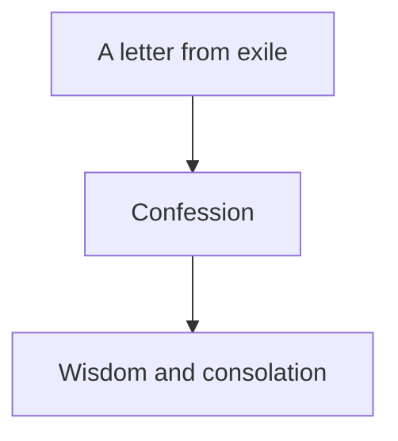

# Baruch

**Name and meaning.** A short book attributed to Baruch son of Neriah, Jeremiah's scribe, written as from the Babylonian exile. It includes a prose introduction, a long communal confession, a wisdom poem, and a consolation of Jerusalem. In some Bibles the [Letter of Jeremiah](letter-of-jeremiah.md) is printed as Baruch chapter 6; this encyclopedia treats that letter in its own file.

**Prerequisites:** [Jeremiah](../old-testament/books/major-prophets/jeremiah.md), [Lamentations](../old-testament/books/major-prophets/lamentations.md), and [deuterocanon](README.md).

## Dating and authorship

The historical Baruch lived in the sixth century BCE. The book as we have it is almost certainly a later Jewish work, written in a Semitic language and preserved in Greek, often dated in the second or first century BCE (after the exile it depicts, and perhaps after or during later crises that made the exile a typological language). Traditional attribution followed the narrative frame. Critical study treats the Baruch name as a literary claim, like other Second Temple pseudepigrapha, and sometimes sees more than one section joined together.

## Context

The opening says that Baruch wrote the book in Babylon and read it to the exiles, who then sent a collection and the book itself to Jerusalem, to be read in the temple on feast days. Whether or not that happened as told, the intended use is liturgical: a community confesses, seeks wisdom, and hears comfort addressed to a grieving Zion. The theology is Deuteronomic: the exile is just, the law is still wisdom, and return is possible.

## Outline

- **1:1–14.** Narrative frame: the book, the assembly, the collection of money for the temple, a request that prayer be made for the king of Babylon (a striking, almost Jeremianic note).
- **1:15–3:8.** A long confession: "righteousness belongs to the Lord, but to us shame," rehearsing the failures from the exodus to the present, and asking for mercy.
- **3:9–4:4.** A wisdom poem: "learn where there is wisdom"; she was given to Israel as the law; "this is the book of the commandments of God."
- **4:5–5:9.** A consolation: Zion speaks and is spoken to; the children will be brought back; a pilgrimage of mercy.

## Key passages and ideas

The confession is close in spirit to Daniel 9, Ezra 9, and Nehemiah 9: later Judaism learned how to pray historically. The wisdom poem's identification of Wisdom with Torah (4:1) belongs with [Sirach](sirach.md) 24 as a major Second Temple claim. The consolation's language of putting on the robe of righteousness and of being led back in joy has been used in Christian Advent and Christmas liturgies (especially 5:1–9). The request to pray for the foreign king (1:11) keeps the book from being merely nationalist.

The opening collection of money for sacrifices in Jerusalem, sent from Babylon, is easy to skim and is historically interesting: it imagines a diaspora still fiscally and liturgically tied to the temple, praying even for the conqueror's court. That combination — shame for sin, loyalty to Zion, and a prayer for the emperor — is the book's political theology in a sentence. It is not quietism, and it is not revolt. It is a way of remaining Israel under a foreign king.

## Themes and reception

Themes include confession, the exile as typological setting, Wisdom-Torah, and comfort for Zion. The book is scripture in Catholic and Orthodox canons. It is a good first-principles example of a later writer speaking in a classic name in order to give a community words of repentance and hope. Read it after Jeremiah and Lamentations, and then read the Letter of Jeremiah as a related but distinct polemic against idols.

The style is not flashy. Its gift is accumulation: shame, memory, law, and then a rising consolation that does not cancel the confession that came first.

## Where this leads

- Next: [Letter of Jeremiah](letter-of-jeremiah.md)
- Glossary: [Baruch](../glossary/baruch.md), [exile](../glossary/exile.md), [wisdom](../glossary/wisdom.md)
