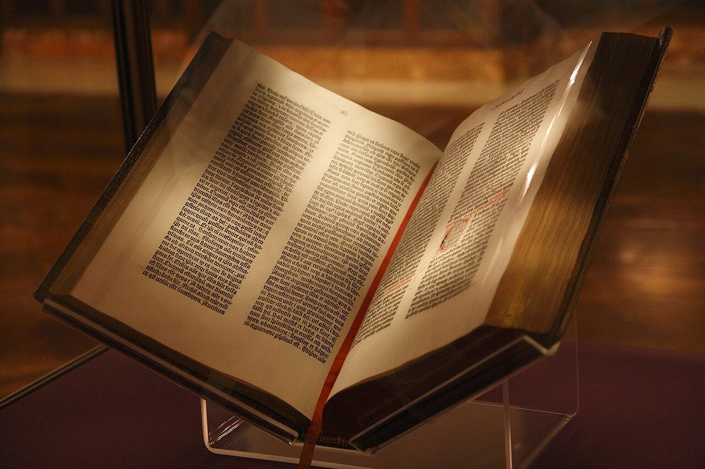
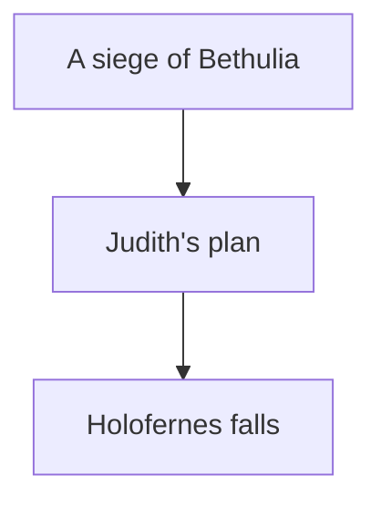

# Judith

*Gutenberg Bible on display at the New York Public Library Credit: Joshua Keller. License: [CC BY 2.0](https://creativecommons.org/licenses/by/2.0). Source: [File:Gutenberg Bible, New York Public Library, USA. Pic 01.jpg](https://commons.wikimedia.org/wiki/File:Gutenberg_Bible,_New_York_Public_Library,_USA._Pic_01.jpg).*
**Name and meaning.** Named for Judith ("Jewish woman" or "Jewess"), a pious widow of Bethulia who saves her people by entering the camp of Holofernes, the Assyrian general, and beheading him. The book is a short, deliberate tale of courage, prayer, and deceit in a holy cause.

**Prerequisites:** [deuterocanon](README.md) and [Exile and return](../old-testament/10-exile-and-return.md). Helpful: the stories of Jael in [Judges](../old-testament/books/history/judges.md) and of Esther in [Esther](../old-testament/books/history/esther.md).

## Dating and authorship

Anonymous, composed in Hebrew (most scholars think) and preserved in Greek, probably in the late second or early first century BCE, after the Maccabean crisis, though the story is set in a deliberately mixed past (Nebuchadnezzar is called "king of the Assyrians," and other historical markers do not add up). The anachronisms are widely taken as a sign of didactic fiction, not of incompetence: the enemy is a composite empire, and Judith is a composite deliverer. Traditional readers have sometimes tried to salvage a historical core. The overview reports the tale and the usual critical judgment about genre.

## Context

A vast army cuts off a hill town's water. The elders prepare to surrender in five days if the Lord does not act. Judith, beautiful, wealthy, and rigorously observant, rebukes their test of God, prays, dresses, and goes out with her maid. The theology is Deuteronomic and Maccabean at once: zeal, prayer, and a woman's hand against a general who had imagined himself unstoppable.

## Outline

- **1–7.** The campaign of Nebuchadnezzar's general Holofernes; the war council; Achior the Ammonite's speech about Israel and his expulsion to Bethulia; the siege.
- **8–9.** Judith's rebuke and prayer.
- **10–13.** The entrance into the camp, the banquet, the beheading, the return to Bethulia with the head in a food bag.
- **14–16.** Panic and rout of the army; Achior's circumcision; Judith's victory hymn; her long, chaste widowhood, and her death.

## Key passages and ideas

Achior's speech (chapter 5) is a little summary of Israel's story, put in a foreigner's mouth, and it costs him his place in the enemy council. Judith's prayer (chapter 9) remembers the Dinah story of Genesis 34 in a way modern readers may find hard, and asks for a deceitful tongue to be used for a true end. The hymn of chapter 16 is a sister of the Song of the Sea and of Deborah's song, and Mary's Magnificat in [Luke](../new-testament/books/gospels/luke.md) is often compared with this tradition of women's victory songs, even if the literary dependence is debated.

The book is frank about Judith's use of beauty and of lying. Later Jewish and Christian readers have praised her as a type of virtue and have also been uneasy. A first-principles reading should not sanitize the tale.

The book's patriotism is not naïve about danger. The men of Bethulia are ready to surrender on a schedule; Judith will not bargain with the timetable of heaven. That conflict, between official caution and a woman's initiative, is as important as the beheading itself. After the victory she refuses marriage and lives to a great age, which is the narrator's way of saying that the story was never a romance of Holofernes, only a brief, terrible use of his desire.

## Themes and reception

Themes include trust versus putting God to the test, the unexpected deliverer, sexual danger and self-control, and the shame of an empire. The book is scripture in Catholic and Orthodox canons. It has had an enormous afterlife in art (Donatello, Caravaggio, Artemisia Gentileschi) and in later political allegory. Historically, it belongs with other Second Temple stories in which a woman saves the people (Esther, and, in a different key, Susanna).

Bethulia itself is not a known town; the name may play on *betulah*, "virgin," or on Beth-El. The geography is as stylized as the chronology. The theological map is clearer: a town on a hill, a spring cut off, a widow who keeps kosher even in the enemy camp, and a God who "crushes wars."

## Where this leads

- Next: [Additions to Esther](additions-to-esther.md)
- Glossary: [deuterocanon](../glossary/terms/deuterocanon.md), widow
