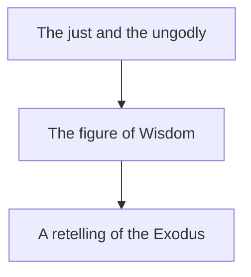

# Wisdom of Solomon

**Name and meaning.** Also called the Book of Wisdom. A Greek work of Jewish theology and exhortation, written in the name of Solomon, addressing rulers, praising Wisdom as a spirit who is with God, arguing for the immortality of the righteous, and offering a long midrash on the exodus and a critique of idolatry.

**Prerequisites:** [Proverbs](../old-testament/books/wisdom-poetry/proverbs.md), [Ecclesiastes](../old-testament/books/wisdom-poetry/ecclesiastes.md), and [deuterocanon](README.md). Helpful: [philosophy](../../../../philosophy/README.md), because the book thinks in a Hellenistic philosophical vocabulary.

## Dating and authorship

The Solomonic voice is a literary persona, as in some other wisdom books. The work is almost always dated to the late first century BCE or the early first century CE, often in Alexandria, because of its Greek style, its philosophical terms, and its engagement with a cultured Gentile and Jewish audience. It is not by Solomon, and no serious modern study claims that it is. Traditional ascriptions followed the literary voice.

## Context

Alexandrian Judaism (if that setting is right) lived among Greek philosophy, imperial cult, and the memory of the exodus. The book's opponents include idolaters, unjust rulers, and a group who say that life is short and that the weak may be oppressed with impunity. Its answer is that the souls of the righteous are in the hand of God, that Wisdom is a breath of the power of God, and that Egypt's plagues were a measured education as well as a judgment.

## Outline

- **1–5.** A call to love righteousness; the error of the ungodly; the suffering and vindication of the righteous one; the surprise of the wicked at the judgment.
- **6–9.** An address to kings; the praise of Wisdom (including 7:22–8:1, a famous chain of attributes); Solomon's prayer for Wisdom.
- **10–19.** Wisdom's role in early biblical history; a long reflection on the exodus, with antitheses between Israel's gifts and Egypt's punishments; a critique of idolatry (especially chapter 13–15).

## Key passages and ideas

2:12–20, the plot against the "righteous one" who calls himself a child of God, was later read by Christians of the Passion. In its own context it is a typological portrait of the persecuted just, not yet a named Jesus. 3:1–9, "the souls of the righteous are in the hand of God," and the language of immortality and testing, mark a development beyond most of the Hebrew Bible's earlier silence about a robust afterlife (compare [Daniel](../old-testament/books/major-prophets/daniel.md) 12). 7:24–27, Wisdom as a pure emanation, a spotless mirror of God's working, became important for later Christian Logos and wisdom Christology (and should first be heard as Jewish theology of Wisdom). The idol critique (13–15) is among the most sophisticated in the tradition, distinguishing woodcutters, sailors, and the political making of images.

The middle section, in which "Solomon" recounts his prayer for Wisdom and describes her as a spirit of many names, is also a quiet theory of kingship: a ruler who does not ask for Wisdom is a tyrant waiting to happen. That is why the book can address "kings of the earth" without leaving its Jewish monotheism. The exodus midrash then shows the same Wisdom at work in national memory, so that philosophy and narrative are not two religions but two registers of one claim.

## Themes and reception

Themes include immortality, justice, Wisdom as a divine figure, kingship, and the folly of idols. The book is scripture in Catholic and Orthodox canons and was widely quoted by early Christian writers. Jewish tradition did not canonize it, but it belongs to the same Hellenistic Jewish world as Philo (who is later and more philosophical still). A first-principles reader of the New Testament, especially of John and of Paul in Romans 1, should know this book.

It is also a political exhortation: rulers are told that their power is given and will be examined. The Solomonic mask lets a Jewish author address kings in a language they might, in theory, understand.

## Where this leads

- Next: [Sirach](sirach.md)
- Glossary: [wisdom](../glossary/wisdom.md), [immortality](../glossary/immortality.md), [idolatry](../glossary/idolatry.md)
