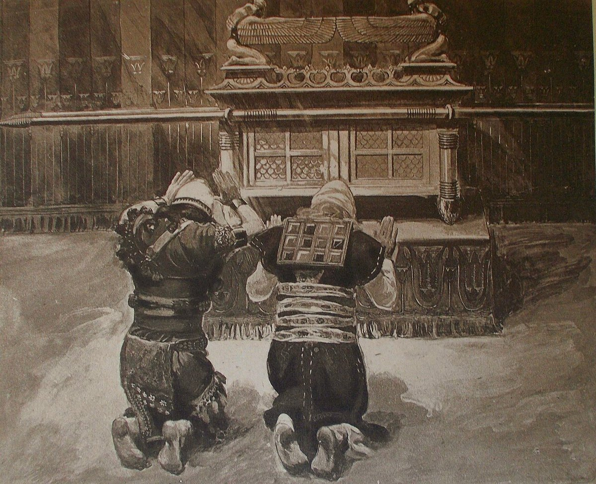
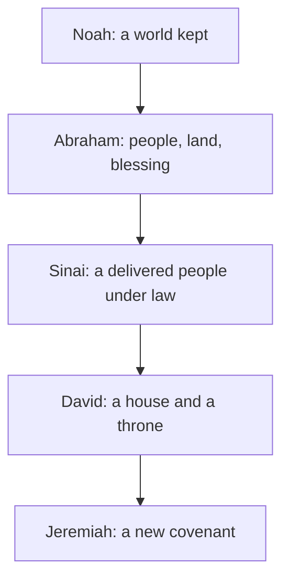

# Covenant

*Printed reproduction M. de Brunoff & Cie, 1904: all 400 paintings were based on James Tissot's sketches; the first 200 were painted by him; the last… Credit: Phillip Medhurst. License: [CC BY-SA 4.0](https://creativecommons.org/licenses/by-sa/4.0). Source: [File:Moïse assisté de Josué dans le tabernacle (Deuteronomy 31 14) • invenit James Tissot • pinxit James Tissot • excudit Maurice de Brunoff apud Philip de Vere • praesentat Phillip Medhurst.jpg](https://commons.wikimedia.org/wiki/File:Moïse_assisté_de_Josué_dans_le_tabernacle_(Deuteronomy_31_14)_•_invenit_James_Tissot_•_pinxit_James_Tissot_•_excudit_Maurice_de_Brunoff_apud_Philip_de_Vere_•_praesentat_Phillip_Medhurst.jpg).*
A covenant (*berit*) is a binding relationship, often with terms, signs, and consequences, more like a treaty or a marriage than like a casual promise. It is one of the load-bearing ideas of the whole Bible, and it is the idea behind the Christian names "Old Testament" and "New Testament."

In [Genesis](../../old-testament/books/law-torah/genesis.md) the Lord makes a covenant with Noah after the flood (a sign in the cloud, a promise to flesh), and then with [Abraham](../people/abraham.md): a people, a land, a blessing that reaches other families, with circumcision as a sign. At [Sinai](../places/sinai.md), in [Exodus](../../old-testament/books/law-torah/exodus.md) and again in [Deuteronomy](../../old-testament/books/law-torah/deuteronomy.md), the people delivered from Egypt are bound to the Lord who delivered them; law here is how a covenant people lives, not a ladder up to a previously unknown God. [2 Samuel](../../old-testament/books/history/2-samuel.md) 7 promises David a house, a throne, and a son; later hope will read that promise through exile and failure. [Jeremiah](../../old-testament/books/major-prophets/jeremiah.md) 31 promises a [new covenant](../terms/new-covenant.md), a law written on the heart.

New Testament writers take up all of these. The last supper speaks of blood of the covenant; [Hebrews](../../new-testament/books/general-epistles/hebrews.md) works Jeremiah 31 at length; Paul argues, from Abraham, that the promise was never only a matter of circumcision. Christian framing of an "old" and a "new" covenant is a real reception of those texts, and it has sometimes been used to dismiss Israel's ongoing life. The first task is to hear covenant as Israel's own way of naming a relationship that can be broken, remembered, judged, and renewed.

**See also:** [Hesed](../terms/hesed.md), [Torah](../terms/torah.md), [Testament](../terms/testament.md), [Circumcision](../terms/circumcision.md)
