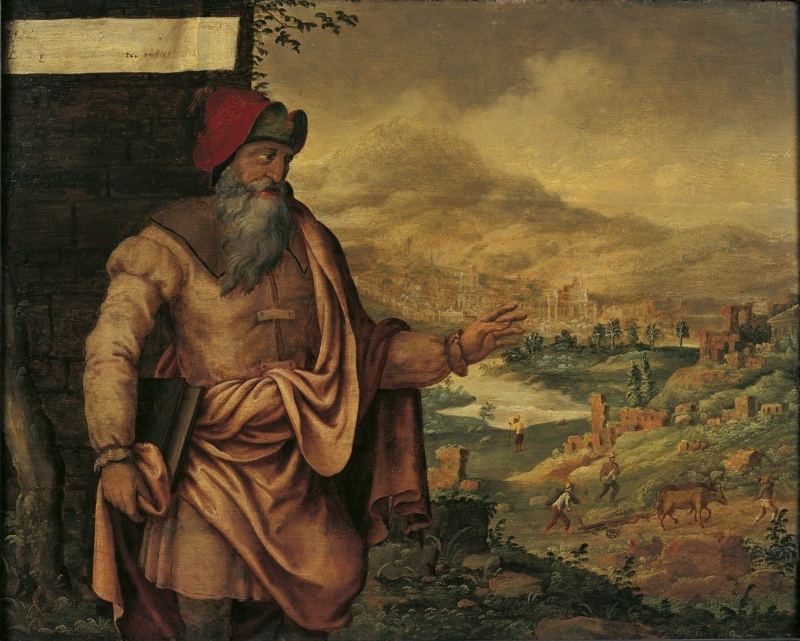

# Exile and return

*Prophet Isaiah predicts the return of the Jews from exile Credit: Maarten van Heemskerck. License: Public domain. Source: [File:Maarten van Heemskerck - Prophet Isaiah predicts the return of the Jews from exile 1560-1565 FHM01 OS-I-173.jpg](https://commons.wikimedia.org/wiki/File:Maarten_van_Heemskerck_-_Prophet_Isaiah_predicts_the_return_of_the_Jews_from_exile_1560-1565_FHM01_OS-I-173.jpg).*
Exile is the removal from the land: the north in 722/721, Judah in 597 and 586, with the temple burned and a people in Babylon. Return is the limited, staged restoration under Persia: a rebuilt altar and house, a wall, a community around Torah, and a disappointment as well as a hope. The survey lesson is [Exile and return](../../old-testament/10-exile-and-return.md).

Theologically, the Bible refuses to treat the disaster as the Lord's defeat. Deuteronomy had already named exile as covenant curse; the prophets interpret, warn, and then comfort; Lamentations prays inside the ruin; Chronicles and Ezra–Nehemiah tell a rebuilding. "Exile" also becomes a typological language for later crises (Daniel, Baruch, 4 Ezra after 70 CE) and, in 1 Peter, for a Christian minority's life in the empire.

Return is not a simple reversal. Many remain in the [diaspora](../terms/diaspora.md). The Second Temple is smaller, in some memories, than the first. There is no independent Davidic king. The tensions of Ezra–Nehemiah (identity, intermarriage, the people of the land) belong to that incomplete restoration. New Testament hope of a kingdom and of a new Jerusalem still lives on this unfinished map.

**See also:** [Babylon](../places/babylon.md), [Cyrus](../people/cyrus.md), [Remnant](../terms/remnant.md), [Second Temple](../terms/second-temple.md)
