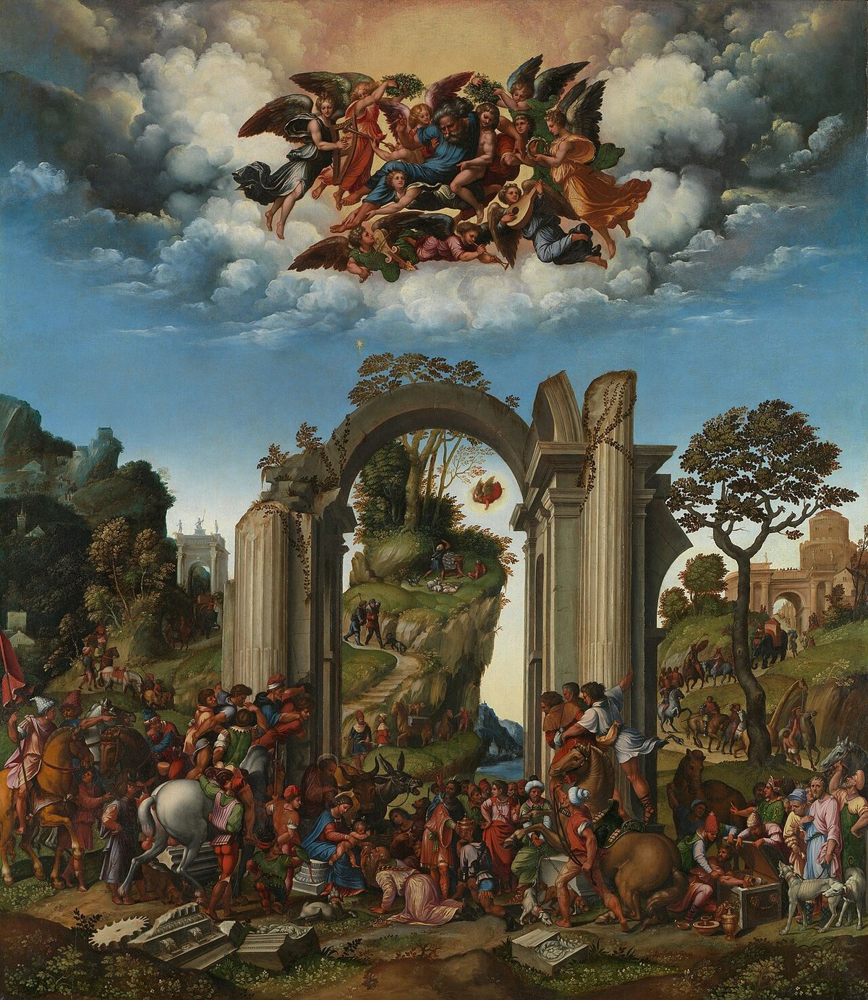

# Kingdom of God

*adoration of the Magi Credit: After Baldassare Peruzzi / Girolamo da Treviso the Younger. License: Public domain. Source: [File:Girolamo da Treviso Adoration of the kings.jpg](https://commons.wikimedia.org/wiki/File:Girolamo_da_Treviso_Adoration_of_the_kings.jpg).*
The kingdom of God (in Matthew, often "kingdom of heaven") is the central theme of Jesus' preaching in the Synoptics: not first a place one goes after death, but the reign of God breaking in, announced, signed by healings and exorcisms, taught in [parables](../../new-testament/stories/05-parables.md), and still awaited in fullness. It has a deep Old Testament background: the Lord as king, the hope of a just Davidic rule, the prophets' vision of nations streaming to Zion.

Jesus' particular note is the mixture of presence and hiddenness: the kingdom is "at hand," already among you, and also a future banquet and a coming of the Son of Man. The [Sermon on the Mount](../../new-testament/stories/03-sermon-on-the-mount.md) is a way of life for that reign. Later church talk of "building the kingdom" or of a purely inward kingdom should be tested against this already/not-yet tension, and against the political sharpness of a reign that is not Rome's.

**See also:** [Parable](../terms/parable.md), [Messiah](messiah.md), [Beatitudes](../terms/beatitudes.md), [The four Gospels](../../new-testament/02-the-four-gospels.md)
