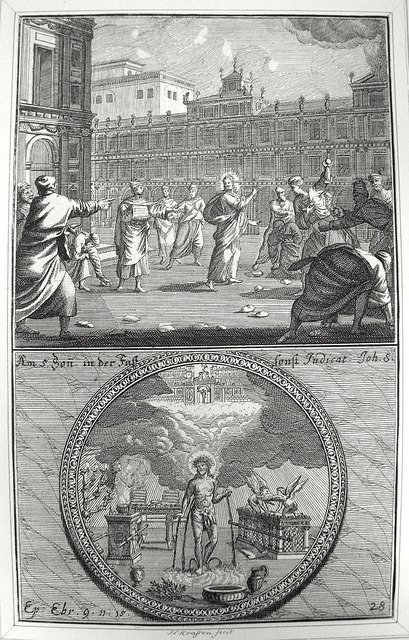

# Sacrifice and atonement

*JOHN'S GOSPEL IN THE BOWYER BIBLE. Robert Bowyer (1758-1834) expanded his own copy of the Macklin Bible to 45 volumes after acquiring and inserting over… Credit: Phidev74. License: [CC BY-SA 4.0](https://creativecommons.org/licenses/by-sa/4.0). Source: [File:Bowyer Bible print 5409 Stones are cast at Jesus John 8 Christ the perfect sacrifice Hebrews 9 11-15 Kraussen.jpg](https://commons.wikimedia.org/wiki/File:Bowyer_Bible_print_5409_Stones_are_cast_at_Jesus_John_8_Christ_the_perfect_sacrifice_Hebrews_9_11-15_Kraussen.jpg).*
Sacrifice, in the Torah, is the ordered offering of animals, grain, and incense at the sanctuary: burnt offerings, well-being offerings, purification and reparation offerings, and the great rite of the Day of Atonement in [Leviticus](../../old-testament/books/law-torah/leviticus.md) 16. Atonement (*kippur*) is the covering or purging of guilt and uncleanness so that a holy God can dwell with a people. The system is a grammar, not a single theory.

The prophets can attack sacrifice that is detached from justice (Amos, Isaiah, Micah, Jeremiah) without, in most cases, abolishing the cult. After the temple's destruction, Jews and Christians both had to say how atonement and worship continue. [Hebrews](../../new-testament/books/general-epistles/hebrews.md) reads Jesus' death as a once-for-all offering in a heavenly sanctuary. Paul speaks of blood, of a mercy seat, of reconciliation. The Gospels time the death in relation to [Passover](../terms/passover.md). Later doctrines (satisfaction, substitution, victory, moral influence) are attempts to systematize that language. They should not be treated as if one of them were simply "the" biblical theory, and they should not be used to sneer at the Levitical grammar they reread.

**See also:** [Priest](../terms/priest.md), [Temple](temple.md), [Passover](../terms/passover.md), [Crucifixion](../terms/crucifixion.md), [Leviticus](../../old-testament/books/law-torah/leviticus.md)
