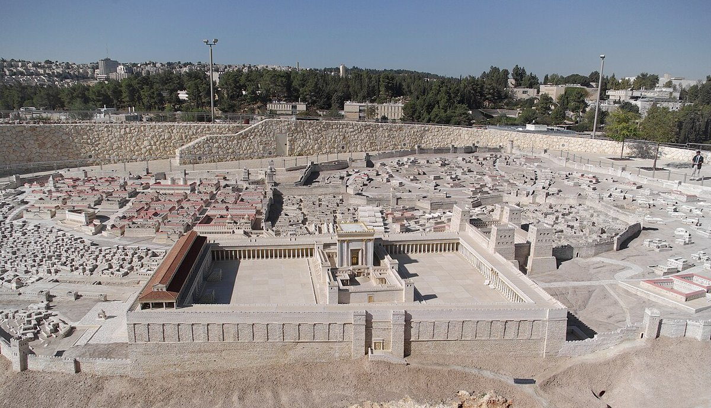

# Temple

*Holyland Model of Jerusalem. A model of Herod's Temple adjacent to the Shrine of the Book exhibit at the Israel Museum, Jerusalem. Credit: Berthold Werner. License: Public domain. Source: [File:Jerusalem Modell BW 2.JPG](https://commons.wikimedia.org/wiki/File:Jerusalem_Modell_BW_2.JPG).*
The temple in Jerusalem is the house of the Lord's name and presence, the place of sacrifice, pilgrimage, and, in later centuries, of international Jewish identity. It has a history, not only a symbolism: a first house built by [Solomon](../people/solomon.md), destroyed in 586; a [Second Temple](../terms/second-temple.md) rebuilt under Persia, later enlarged by Herod, destroyed by Rome in 70 CE.

Biblical theology of the temple includes both high claims (the glory fills the house; this is the place the Lord chose) and severe warnings (Jeremiah's temple sermon; Micah's plowed Zion; Jesus' word about stones). [Ezekiel](../people/ezekiel.md) sees glory leave and return, and is shown a future house. [Revelation](../../new-testament/books/prophecy/revelation.md) imagines a city with no temple, because the Lord and the Lamb are its temple.

For the New Testament, almost everything happens in the Second Temple's shadow: Jesus teaches there, acts in its courts, and is killed just outside the city that holds it. After 70, Judaism and the churches both had to learn how to live without that house, in different ways (synagogue and Torah; a rereading of sacrifice in Hebrews and in Christian worship).

**See also:** [Priest](../terms/priest.md), [Jerusalem](../places/jerusalem.md), [Sacrifice and atonement](sacrifice-and-atonement.md), [1 Kings](../../old-testament/books/history/1-kings.md)
