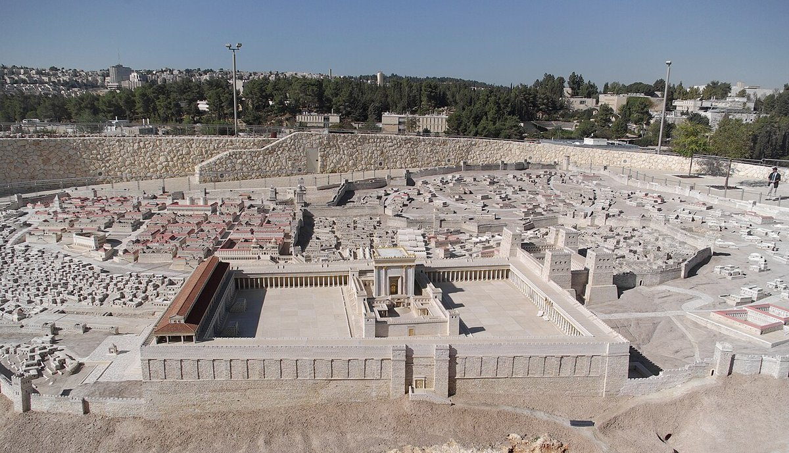
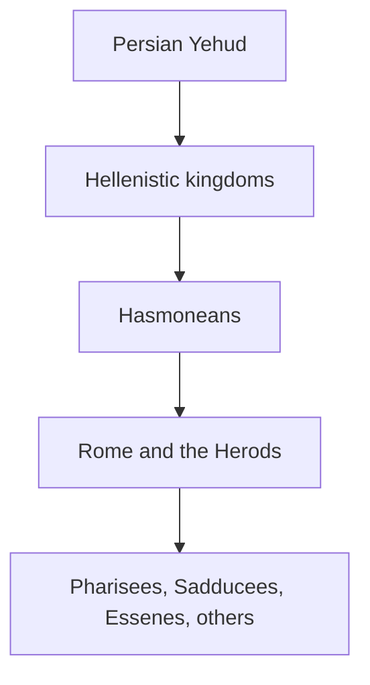

# Second Temple Judaism and Rome

**Prerequisites:** [Exile and return](../old-testament/10-exile-and-return.md) and the [New Testament overview](README.md)
**Key ideas:** Judaism after the exile is a scripture-and-temple religion under empire; Hellenistic crisis and the Maccabean revolt; Herod and Roman occupation; parties and hopes (Pharisees, Sadducees, Essenes, zealots, messiah); the world the Gospels assume.

*Holyland Model of Jerusalem. A model of Herod's Temple adjacent to the Shrine of the Book exhibit at the Israel Museum, Jerusalem. Credit: Berthold Werner. License: Public domain. Source: [File:Jerusalem Modell BW 2.JPG](https://commons.wikimedia.org/wiki/File:Jerusalem_Modell_BW_2.JPG).*
The Second Temple stands, in some form, from the late sixth century BCE until the Romans destroy it in 70 CE. Almost everything in the New Testament happens in the last century of that period, or (for some writings) in the generation just after the destruction. "Second Temple Judaism" is the name for the many-sided Jewish world of those centuries. There is no single Judaism here, and there is not yet a "Christianity" separate from it at the beginning.

## After Persia: Greeks and a revolt

Persian rule, the setting of Ezra and Nehemiah, gives way after Alexander the Great (d. 323 BCE) to Hellenistic kingdoms. Greek language and civic life spread (this is the world that produced the [Septuagint](../03-languages-dating-and-composition.md)). Under the Seleucids, in the second century BCE, a crisis erupts: some Jews adopt Greek customs; Antiochus IV Epiphanes profanes the temple and outlaws Jewish practice, in the traditional memory of the event. The **Maccabean revolt** retakes and rededicates the temple (the origin of Hanukkah). 1 and 2 Maccabees, in the Catholic and Orthodox canons, tell this story.

The Hasmonean dynasty that follows is Jewish self-rule, but it is also a political and religious quarrel: priest-kings, forced conversions, and the emergence of groups who disagree about law, purity, and legitimate authority. In 63 BCE **Rome**, in the person of Pompey, takes Jerusalem. From then on, Jewish politics in the land happens under the Roman umbrella.

## Herod, prefects, and the temple

**Herod the Great**, a client king backed by Rome (reigned 37–4 BCE), is a builder and a tyrant in both memory and, where it can be checked, history. He expands the temple mount into one of the great sanctuaries of the ancient world. After his death the kingdom is divided; Judea eventually comes under Roman prefects or procurators (Pontius Pilate among them, 26–36 CE). Galilee, where Jesus' public activity is largely set, is under Herod Antipas, a son of Herod.

Rome brings roads, tax, the possibility of a brutal peace, and the scandal of a foreign power in the land promised to David. The emperor's cult, more developed in some parts of the empire than others, will matter especially when we reach [Revelation](06-revelation.md). Crucifixion is a Roman punishment for slaves and rebels — a political fact that sits behind the Gospel passion narratives.

## Parties, institutions, and hopes

The **temple** remains the center of sacrifice and pilgrimage. The **synagogue**, developed especially in the diaspora and in towns far from Jerusalem, is a place of prayer and of reading Torah. Scribes are experts in the writings. The **Pharisees** are a movement known for careful interpretation of the law, including a body of ancestral tradition, and for beliefs in resurrection and angels (the New Testament argues with them often; later rabbinic Judaism is historically closer to this stream than to others). The **Sadducees**, associated with priestly and aristocratic circles, are more conservative about the authority of the written Torah and are described as denying resurrection. The **Essenes**, known from ancient writers and often associated (not without debate) with the Dead Sea Scrolls community at Qumran, practice a stricter separation and, in the Scrolls, a sharp dualism of sons of light and darkness. Various **revolutionary** or zealot impulses want Roman rule ended by force; the war of 66–73 CE, which ends in the temple's destruction, is their historical climax and tragedy.

**Messianic hope** is not one fixed checklist. Some hoped for a Davidic king, some for a priestly figure, some for a prophet like Moses, some for a cosmic intervention, some for none of these in an urgent way. "Messiah" (*mashiach*, Greek *christos*) means "anointed one." The New Testament's claim that Jesus is the Messiah is an argument *inside* this field of hopes, not a word imported from nowhere.

This is the air the Gospels breathe: Torah and temple, Roman crosses, Galilee and Jerusalem, dispute about purity and sabbath, and a question hanging over the land — how long, and by what means, will God redeem Israel?

## Where this leads

- Next: [the four Gospels](02-the-four-gospels.md)
- For the philosophical world of the same Hellenistic-Roman east, see [Hellenistic schools](../../../../../philosophy/history/ancient/greek/06-hellenistic-schools.md)
