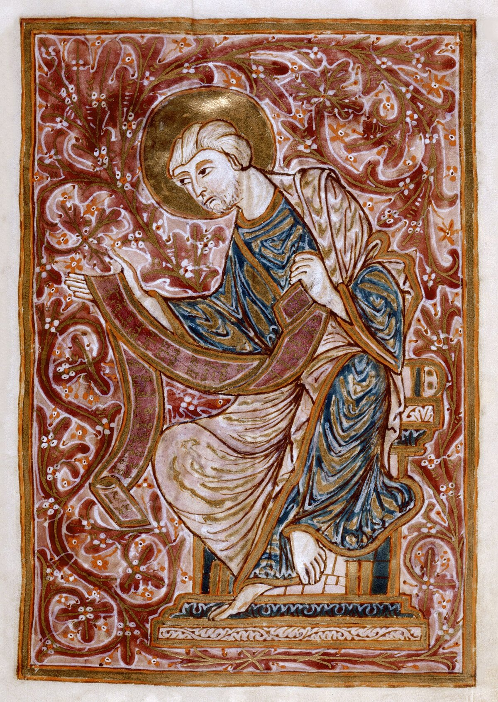
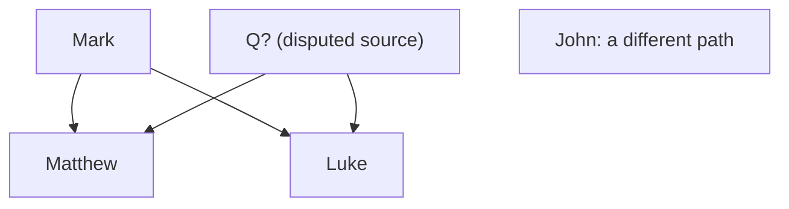

# The four Gospels

**Prerequisites:** [Second Temple Judaism and Rome](01-second-temple-judaism-and-rome.md) and [genres](../04-genres.md)
**Key ideas:** a gospel is a proclamation in narrative form; Mark, Matthew, and Luke are "synoptic" and closely related; John is distinct in style and Christology; traditional authorship versus scholarly dating and sources.

** Listed in De Ricci, Seymour, Census of Medieval and Renaissance Manuscripts in the United States and Canada. New York. N.Y.: H.W. Wilson, 1935; and… Credit: Scan by NYPL. License: Public domain. Source: [File:Full-page portrait of John in gold frame on purple background (NYPL b12455533).jpg](https://commons.wikimedia.org/wiki/File:Full-page_portrait_of_John_in_gold_frame_on_purple_background_(NYPL_b12455533).jpg).*
"Gospel" means good news. The four canonical gospels — Matthew, Mark, Luke, and John — are narratives written to announce and interpret Jesus: who he is, what he did and taught, how he died, and that he was raised. They are not novels, and they are not modern biographies. They select, arrange, and preach as they tell.

## The Synoptics

Matthew, Mark, and Luke are called **synoptic** because they can be viewed together: they share a broad outline (Galilean ministry, journey, last week in Jerusalem), much language, and many of the same scenes. The most common scholarly explanation is that **Mark was written first** (often shortly before or after 70 CE, around the temple's destruction), and that Matthew and Luke used Mark, plus other material. Many scholars also posit a lost sayings source, **Q**, to explain material Matthew and Luke share that Mark lacks; others explain the same data differently. Traditional ascriptions run the other way in some church memory (Matthew first), and treat the authors as the apostle Matthew, John Mark as Peter's interpreter, and Luke as Paul's companion. The names themselves are attached in manuscript tradition early, but the books are formally anonymous in their opening lines (Luke's preface is a partial exception: a researched account for "Theophilus").

**Mark** is the shortest, the most urgent ("immediately"), and in some ways the starkest. Jesus proclaims the kingdom of God, heals, casts out demons, and silences announcements of his identity (the "messianic secret"). The disciples repeatedly fail to understand. The longer ending of Mark (16:9–20) is missing from the earliest manuscripts; in the shortest form the book ends with the women fleeing the empty tomb in fear and saying nothing to anyone. It is a demanding, unsentimental gospel.

**Matthew** is more explicitly oriented to a Jewish-Christian audience: "fulfillment" citations from scripture are frequent, Jesus is a new Moses (a flight to Egypt, a mountain of teaching), and the **Sermon on the Mount** gathers a dense body of ethical teaching (the Beatitudes, love of enemy, the Lord's Prayer, the demand for a righteousness that exceeds the scribes'). The book opens with a genealogy that runs through Abraham and David and includes several unexpected women, and it closes with a commission to make disciples of all nations.

**Luke** is the first volume of a two-volume work with [Acts](04-acts.md). It has its own preface, a more formal Greek, and a special interest in the poor, in women, in prayer, in the Spirit, and in a geography of salvation that will reach from Jerusalem to the Gentile world. Many of the best-loved parables (the Good Samaritan, the Prodigal Son) are only here. Luke's infancy narrative (parallel to, and different from, Matthew's) is also distinctive.

## John

**John** is another world of style. It is built around "signs," long dialogues, and "I am" sayings (bread of life, light of the world, the way, the vine). The public ministry is oriented more to Jerusalem festivals. The temple incident is placed early. There is no Synoptic-style parable collection and no Last Supper institution of bread and cup in the same form; instead there is a foot-washing and a long farewell. The prologue — "In the beginning was the *Logos*" — frames Jesus in terms that a reader of [Greek philosophy](../../../../../philosophy/history/ancient/greek/01-foundational-concepts.md) would hear, and that a reader of Genesis would also hear: this Word was with God and was God, and became flesh.

Traditional ascription is to John the son of Zebedee, the "beloved disciple." Many scholars date the gospel late in the first century and see a long compositional history in a "Johannine" community; they note its high, explicit Christology as a developed theological interpretation. Christians who hold both the Synoptics and John as scripture have always had to explain how they fit; the honest starting point is that the church kept four portraits, not one harmonized film.

Reading the Gospels well means reading them *each*, then together, and keeping the Second Temple setting in view. The next lesson turns from the four books as books to the stories they share and the ones they uniquely tell.

## Where this leads

- Next: [key stories and parables](03-key-stories-and-parables.md)
- Then: [Acts](04-acts.md), Luke's second volume
