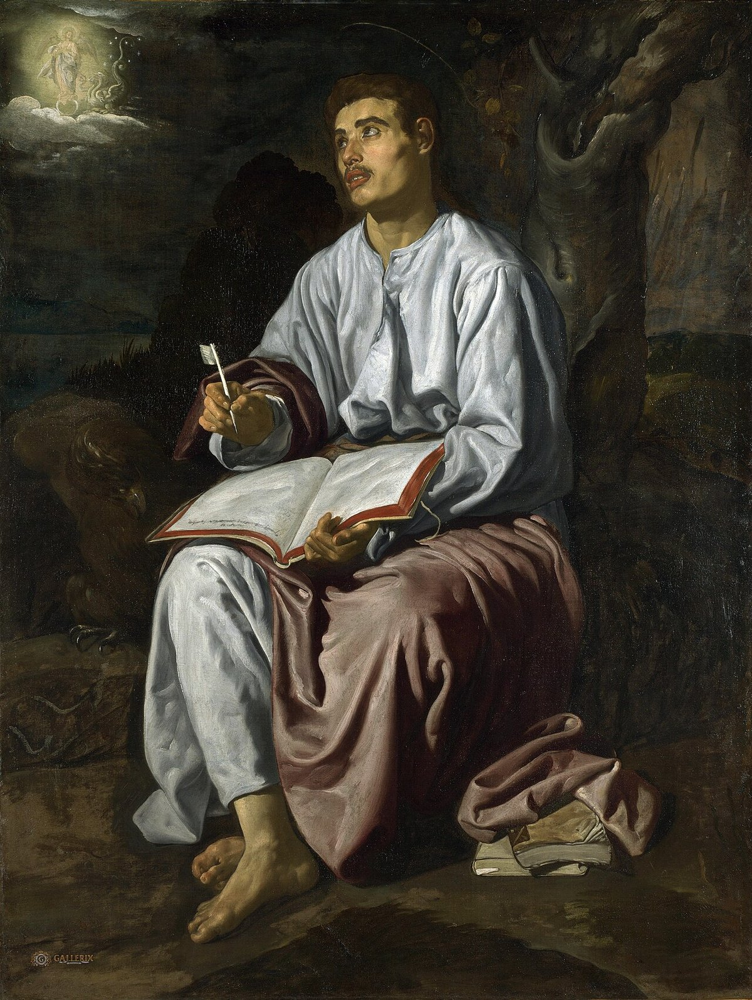
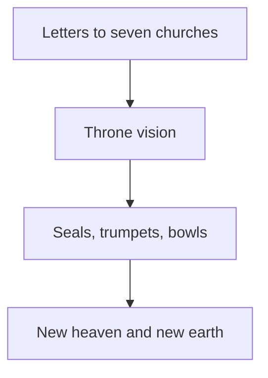

# Revelation

**Prerequisites:** [Genres](../04-genres.md) (the apocalyptic section) and at least [Second Temple Judaism and Rome](01-second-temple-judaism-and-rome.md)
**Key ideas:** apocalyptic as a genre of unveiling, not a modern timetable; a letter to seven churches under empire; visions of worship, conflict, and a new heaven and earth; traditional prophecy versus historical readings centered on Rome.

*Saint John on the island of Patmos Credit: Diego Velázquez. License: Public domain. Source: [File:Diego Velázquez 018 (John the Evangelist from Patmos).jpg](https://commons.wikimedia.org/wiki/File:Diego_Velázquez_018_(John_the_Evangelist_from_Patmos).jpg).*
The last book of the Christian Bible names itself an **apocalypse** (an unveiling) and a **prophecy**, and it opens as a **letter**. John, on the island of Patmos "on account of the word of God," is told to write what he sees and send it to seven churches in Asia (Ephesus, Smyrna, Pergamum, Thyatira, Sardis, Philadelphia, Laodicea). Traditional identification is with John the apostle, the same figure associated with the Fourth Gospel. Many scholars distinguish this John of Patmos from the evangelist: the Greek style is markedly different. A late-first-century date, often under Domitian (or, some argue, earlier under Nero), is common in historical work.

## How to read it

[Apocalyptic](../04-genres.md) writing uses visions, numbers, beasts, and cosmic signs to disclose a hidden meaning of a present crisis. Daniel is the main Old Testament cousin. The genre often comforts a threatened community: the seeming winners of history are not the last word; God and the lamb are on the throne; endurance matters.

Two unhelpful habits should be set down early. One is to read the book as a linear code for twenty-first-century headlines, as if its main job were to predict our news cycle. The other is to dismiss it as unintelligible violence. It is violent, and it is difficult, and it is also a liturgy: scenes of worship keep interrupting the conflict. The slaughtered **Lamb** is the book's central image of power.

## A brief tour

The seven letters praise, warn, and console churches facing complacency, false teaching, or persecution. A throne-room vision follows: holy, holy, holy, and a scroll that only the Lamb who was slain can open. Seals, trumpets, and bowls of judgment then unfold in cycles (whether these are strictly sequential or overlapping recitations of the same crisis is a long interpretive debate). A woman and a dragon, beasts from sea and land, a mark and a number (666, or 616 in some manuscripts), the fall of "Babylon," a thousand-year reign, a last struggle, and a final judgment — the images pile up.

**Babylon**, in this setting, is widely read by historical scholars as **Rome**: the city on seven hills, the power that trades, kills, and demands worship. Traditional readers have sometimes agreed (Rome as the persecutor of the saints) and sometimes extended the name to a future last empire, or to a corrupt religious system, or to both. The beast and its number have been identified with particular emperors (Nero is the most famous scholarly candidate, via Hebrew gematria) and, in later popular reading, with a long series of later figures. The text's first audience, at least, needed a word about the empire they actually lived in, and about whether worship of the emperor and the security of trade were compatible with worship of the Lamb.

The book ends not with a rapture out of the world (a much later scheme) but with a **new heaven and a new earth**, a new Jerusalem coming down, tears wiped away, the tree of life (last seen in [Eden](../old-testament/01-creation-and-eden.md)) for the healing of the nations, and the curse undone. The last words are a prayer: "Come, Lord Jesus."

Revelation has been used to fuel both hope and harm (date-setting, scapegoating, a relish for other people's judgment). Reading it as first-century apocalyptic, as worship, and as a political-theological refusal of idolatrous power does not answer every symbol. It does keep the book in the same library, and the same method, as the rest of this path.

## Where this leads

- This completes the first pass through the Bible. Return to the [Bible overview](../README.md) or to [religion](../../../README.md)
- Creation's ending and un-ending: [Genesis 1–3](../old-testament/01-creation-and-eden.md)
- For another tradition of cosmic order and political legitimation, compare (without equating) [Yin-Yang and the Five Phases](../../../../../philosophy/history/ancient/chinese/08-yin-yang-and-five-phases.md)
