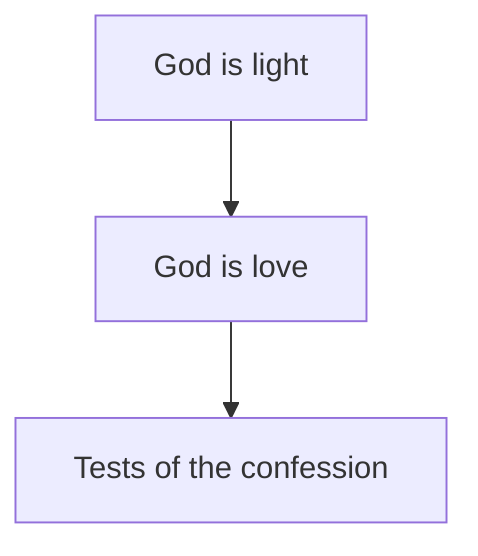

# 1 John

**Name and meaning.** The First Letter of John is, like Hebrews, more a homily than a letter (it has no formal greeting). It is a circular argument — or a spiral — about walking in the light, confessing sin, keeping the commandments, loving the brothers and sisters, and confessing Jesus Christ come in the flesh, over against secessionists who have left the community.

**Prerequisites:** [John](../gospels/john.md), whose language and theology this book shares.

## Dating and authorship

Tradition ascribes the three Johannine letters and the Gospel (and sometimes Revelation) to John the apostle. Modern scholarship usually speaks of a Johannine school or tradition. Many would assign 1, 2, and 3 John to the same author, perhaps not identical with the final author of the Gospel, writing around the turn of the first century, after a split in the community. The opening "what we have heard, what we have seen with our eyes…" claims eyewitness tradition, whether or not the writer is the son of Zebedee.

## Context

"They went out from us, but they did not belong to us" (2:19). The opponents appear to have denied that Jesus Christ has come in the flesh, and perhaps to have claimed a superior knowledge or sinlessness. The author's tests are ethical, social, and doctrinal at once: righteousness, love of the brothers and sisters, and a right confession of Jesus.

## Outline

A clean outline is hard, because the book returns to the same themes. A workable map:

- **1:1–2:2.** The word of life; God is light; the reality of sin and the advocacy of Christ.
- **2:3–29.** Knowing God and keeping commandments; a new/old command to love; warning about the world; antichrists already come; an anointing that teaches.
- **3–4.** Children of God; sin and righteousness; love in deed and truth; testing the spirits; God is love.
- **5.** Faith in the Son; the testimony of water, blood, and Spirit; confidence in prayer; a final warning against idols.

## Key passages and ideas

1:8–2:2 refuses both despair and a lie of sinlessness: if we confess, we are forgiven; if we say we have no sin, we deceive ourselves; an advocate stands with the Father. 2:18–22 introduces the word "antichrist," here not as a single future figure but as a present denial that Jesus is the Christ. 4:7–21, "God is love," is among the most quoted paragraphs in the Bible and is, in context, a test: the unseen God is believed in the visible brother or sister. 4:2–3, confession of Jesus Christ come in the flesh, is an early anti-docetic (or anti-separatist) rule of faith.

The "sin that leads to death" (5:16) is another difficult verse, later tied to debates about mortal sin and apostasy. The book also says that those born of God do not sin (3:9), and that if we say we have no sin we lie (1:8). The tension is real and should be taught as the book's own pastoral severity plus honesty, not as a puzzle to be erased.

The spiral structure can frustrate a reader looking for a straight argument. It is closer to music: themes return in a new key. Light, love, and confession keep coming back because the secession has made the community doubt what it already knew. The elder (if the same voice as 2–3 John) is not giving a first introduction to the faith. He is calling a shaken church back to what was "from the beginning." That is why the letter can sound both simple and inexhaustible.

## Themes and reception

Themes include incarnation, light, sin, advocacy, love, and testing the spirits. The letter has been central to Christian mysticism and ethics of love, and to later doctrines of antichrist and assurance. Read it with the Gospel of John, and then with the two much shorter letters that follow, which show the same conflict in a more particular setting.

## Where this leads

- Next: [2 John](2-john.md) and [3 John](3-john.md)
- Glossary: [incarnation](../../../../glossary/incarnation.md), [antichrist](../../../../glossary/antichrist.md), [love](../../../../glossary/love.md)
